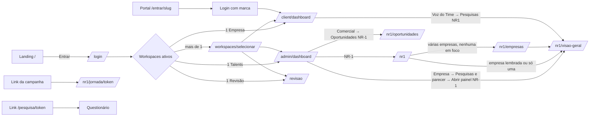
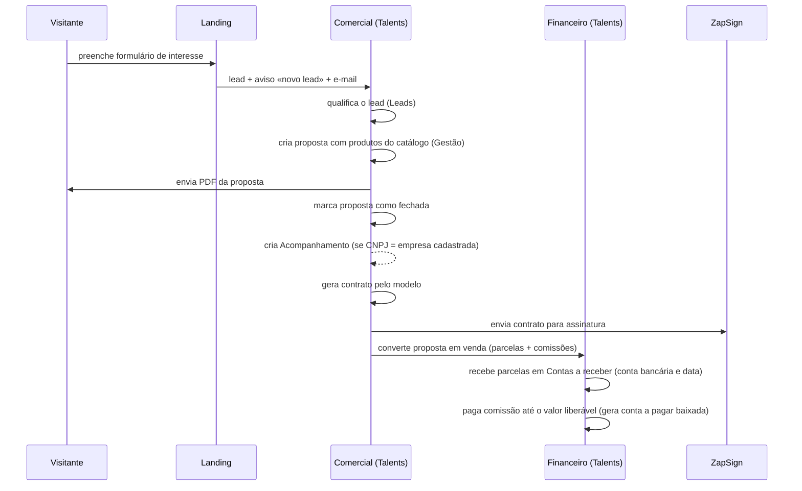
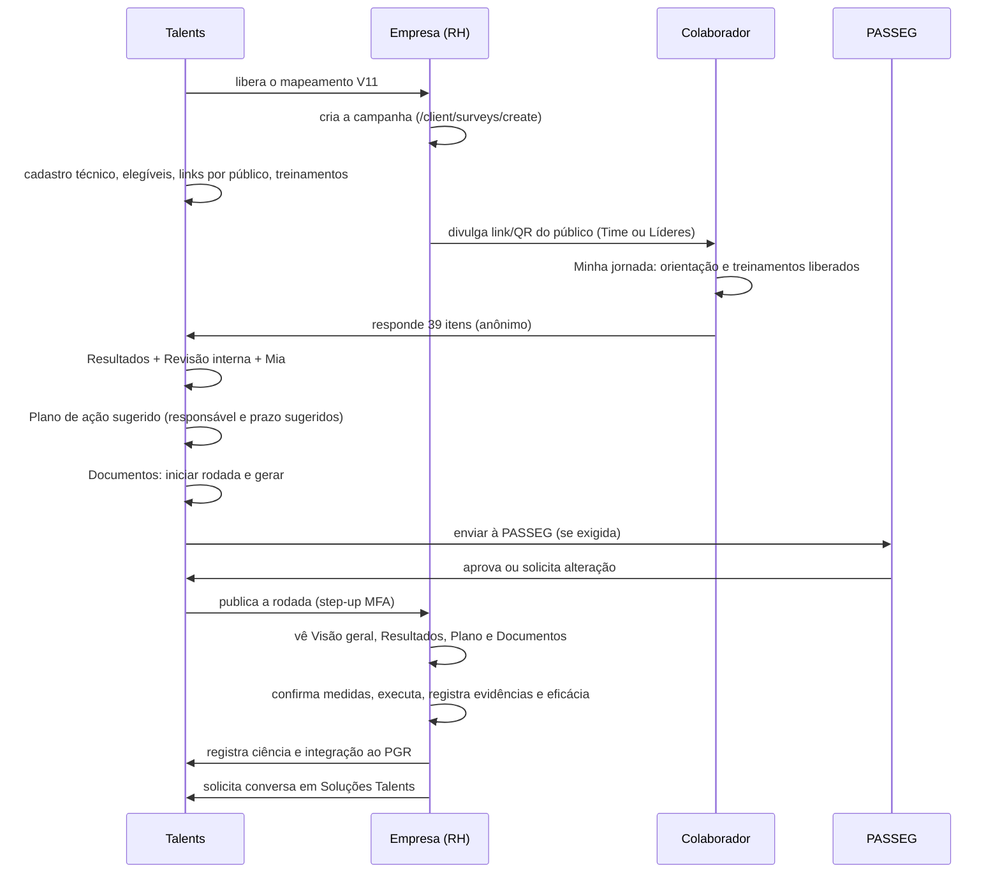
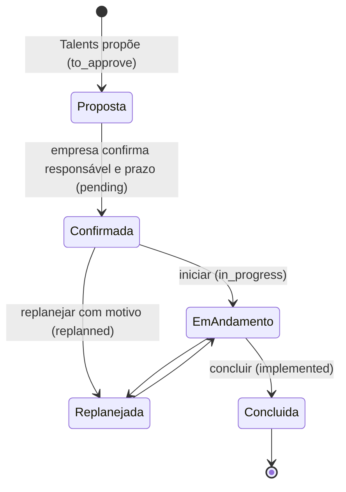

# PRD — Talents Gestão de Pessoas (plataforma SaaS)

> Documento de requisitos de produto **vivo**, escrito a partir do código do repositório `Talents-Gestao/talents`.
> Ele descreve o produto como está implementado, como as telas se ligam, quais regras valem em cada fluxo e o que ainda está pendente.
> É a fonte de contexto para quem desenvolve (pessoas e agentes como o Claude Code) e para quem decide produto.

---

## 0. Controle do documento

### 0.1 Identificação

| Campo | Valor |
|-------|-------|
| Produto | Talents — plataforma SaaS multi-tenant de gestão de pessoas |
| Empresa | Talents Gestão de Pessoas (consultoria), Várzea Paulista/SP |
| Repositório | `Talents-Gestao/talents` |
| Base desta revisão | `main` no merge do PR #124 (03/11/2026) |
| Data da revisão | 04/11/2026 |
| Substitui | PRD de 22/10/2026 (base `new-features`), que ainda descrevia telas NR-1 hoje removidas |
| Documento irmão | `CLAUDE.md` (regras operacionais para o agente, derivado deste PRD) |
| Referências NR-1 | `docs/nr1-v11/CADERNO_NR1_V11.md` (requisitos da V11) e `docs/nr1-v11/Talents_NR1_V11_Aprovacao_Final.html` (protótipo aprovado) |

### 0.2 Como ler

- **Capítulos 1 a 5** dão o contexto: o que é o produto, quem usa, como o acesso é decidido e como se navega.
- **Capítulos 6 a 11** descrevem cada superfície e cada módulo, sempre na mesma ordem: objetivo, acesso, telas e navegação, fluxos, regras, dados e eventos.
- **Capítulo 8 (NR-1)** é o mais extenso porque concentra regras legais, metodológicas e de privacidade.
- **Capítulos 12 a 20** tratam de temas transversais: avisos, integrações, segurança, arquitetura, operação, qualidade, legado, pendências e divergências.
- **Apêndices** trazem catálogos gerados a partir do código: rotas, tabelas, enums e campos de formulário.

### 0.3 Legenda de estado

| Estado | Significado |
|--------|-------------|
| **Implementado** | Há rota, tela e regra no código, na `main` |
| **Parcial** | Existe, com limitação anotada no próprio item |
| **Oculto** | Existe no código, mas não aparece na navegação (acesso só por URL ou desligado por condição fixa) |
| **Desligado** | Existe e depende de interruptor de configuração que hoje está desligado por padrão |
| **Planejado** | Ainda não entregue; não deve ser tratado como disponível |

### 0.4 Princípios de escrita deste PRD

1. O código é a fonte de verdade. Quando um documento antigo diverge do código, este PRD segue o código e registra a divergência no capítulo 20.
2. Nada é descrito como disponível ao cliente se depende de interruptor desligado, migration não aplicada ou decisão pendente.
3. Termos visíveis ao usuário aparecem como estão na interface, em português (ex.: «Abrir painel NR-1»). Identificadores técnicos aparecem em `código`.
4. Números de configuração (limites, prazos, tamanhos) são os do código no momento da revisão; mudanças neles exigem atualizar este documento.

### 0.5 Sumário

- [0. Controle do documento](#0-controle-do-documento)
- [1. Visão do produto](#1-visão-do-produto)
- [2. Perfis, papéis e contextos de acesso](#2-perfis-papéis-e-contextos-de-acesso)
- [3. Autenticação, sessão e conta](#3-autenticação-sessão-e-conta)
- [4. Mapa de navegação](#4-mapa-de-navegação)
- [5. Glossário de domínio](#5-glossário-de-domínio)
- [6. Superfície pública: landing e páginas institucionais](#6-superfície-pública-landing-e-páginas-institucionais)
- [7. Admin Talents (`/admin`)](#7-admin-talents-admin)
- [8. NR-1 — Gestão de riscos psicossociais](#8-nr-1--gestão-de-riscos-psicossociais)
- [9. Portal da empresa (`/client`)](#9-portal-da-empresa-client)
- [10. Superfícies públicas por token](#10-superfícies-públicas-por-token)
- [11. Revisão externa (`/revisao`) — Desligado](#11-revisão-externa-revisao--desligado)
- [12. Avisos, e-mails, notificações e tarefas em segundo plano](#12-avisos-e-mails-notificações-e-tarefas-em-segundo-plano)
- [13. Integrações externas](#13-integrações-externas)
- [14. Regras transversais de negócio, segurança e privacidade](#14-regras-transversais-de-negócio-segurança-e-privacidade)
- [15. Arquitetura técnica](#15-arquitetura-técnica)
- [16. Operação](#16-operação)
- [17. Qualidade e testes](#17-qualidade-e-testes)
- [18. Depreciado e removido da interface](#18-depreciado-e-removido-da-interface)
- [19. Planejado, pendências e decisões em aberto](#19-planejado-pendências-e-decisões-em-aberto)
- [20. Divergências conhecidas entre documentos e código](#20-divergências-conhecidas-entre-documentos-e-código)
- [Apêndice A — Catálogo de rotas](#apêndice-a--catálogo-de-rotas)
- [Apêndice B — Dicionário de dados (tabelas e colunas)](#apêndice-b--dicionário-de-dados-tabelas-e-colunas)
- [Apêndice C — Enums de domínio](#apêndice-c--enums-de-domínio)
- [Apêndice D — Campos de formulário validados no servidor](#apêndice-d--campos-de-formulário-validados-no-servidor)
- [Apêndice E — Mapa de arquivos de referência](#apêndice-e--mapa-de-arquivos-de-referência)

---

## 1. Visão do produto

### 1.1 O negócio

A **Talents Gestão de Pessoas** é uma consultoria estratégica em gestão de pessoas (comportamento, liderança, cultura e conformidade com riscos psicossociais), com sede em Várzea Paulista/SP. A plataforma tem dois papéis ao mesmo tempo:

1. **Sistema operacional da consultoria**: comercial (propostas, contratos, vendas), financeiro (contas a pagar e a receber, comissões), carteira de clientes, contratação de talentos, tarefas, calendário e configuração.
2. **Produto SaaS entregue às empresas clientes**: cada empresa recebe um portal com os módulos contratados (NR-1, Voz do Time, feedbacks, férias, ponto, tarefas, calendário etc.), com marca própria opcional.

### 1.2 Pilares de metodologia (comunicados na landing)

| Pilar | Página pública | Relação com o sistema |
|-------|----------------|-----------------------|
| Metamorfose Comportamental / Diagnóstico Comportamental | `/diagnostico-comportamental` | Diagnóstico empresarial, feedbacks, Profiler (planejado) |
| Contratação de Talentos | `/contratacao-de-talentos` | Banco de talentos (Sólides), Acompanhamento, Entrevistas IA |
| Direcionamento Estratégico | `/direcionamento-estrategico` | Templates de satisfação (admin); portal do cliente oculto |
| Gestão de Riscos Psicossociais (NR-1) | `/nr-1` | Campanhas NR-1, painel NR-1, documentos, plano de ação |

### 1.3 Proposta de valor por público

| Público | O que ganha |
|---------|-------------|
| Equipe Talents (consultoras, comercial, financeiro, gestão) | Um único lugar para vender, contratar, entregar e cobrar; indicadores do dia na Home |
| RH / administrador da empresa cliente | Portal com campanhas NR-1, canais de escuta (denúncias, sugestões, desligamento), feedbacks, férias, ponto e tarefas compartilhadas com a consultoria |
| Líderes e usuários da empresa | Acesso granular aos módulos que o RH liberar (ex.: líder só com Feedbacks) |
| Colaborador da empresa (sem login) | Responde pesquisas e canais por link, com anonimato e sem ver resultados |
| Organização aprovadora (PASSEG) | Revisa documentos NR-1 compartilhados explicitamente (superfície desligada até o MFA ser homologado) |

### 1.4 Superfícies do sistema

| Superfície | Prefixo | Quem usa | Layout |
|------------|---------|----------|--------|
| Landing e páginas institucionais | `/`, `/para-empresas` … | Público | `Landing/LandingLayout` |
| Autenticação e conta | `/login`, `/entrar/{slug}`, `/mfa/*`, `/profile` | Todos os perfis com login | `GuestLayout` / `AuthenticatedLayout` |
| Admin Talents | `/admin/*` | `super_admin` | `AdminLayout` |
| Portal da empresa | `/client/*` | `company_admin`, `company_user` | `ClientLayout` (com marca da empresa) |
| Painel NR-1 | `/nr1/*` | Talents, Empresa, Comercial, colaborador (jornada) | dentro do layout padrão: `AdminLayout` (Talents, Comercial) ou `ClientLayout` (Empresa), com a moldura `Nr1Frame`; a jornada do colaborador usa só a moldura mínima, sem login |
| Revisão externa | `/revisao/*` | `external_reviewer` | layout próprio das páginas `ExternalReview/*` |
| Superfícies públicas por token | `/pesquisa`, `/denuncia`, `/sugestoes`, `/desligamento`, `/mapa-proposito`, `/avaliacao`, `/feedback/assinar`, `/satisfacao` | Colaboradores e clientes sem login | páginas públicas próprias |

### 1.5 Números do produto (na base desta revisão)

| Item | Quantidade |
|------|-----------|
| Rotas registradas | 702 (422 em `/admin`, 190 em `/client`, 10 em `/nr1`, 6 em `/revisao`, demais públicas e de autenticação) |
| Páginas Inertia (`resources/js/Pages`) | 194 arquivos `.vue` |
| Migrations | 181 arquivos; 150 tabelas ativas |
| Enums de domínio (`app/Enums`) | 33 |
| Testes PHPUnit | 208 arquivos em `tests/Feature` e `tests/Unit` |
| Testes JavaScript | 20 arquivos em `tests/JavaScript` (runner `node --test`) |

### 1.6 Escopo deste PRD

Inclui todas as superfícies acima. Exclui: conteúdo editorial da landing (textos de marketing), detalhes visuais de componentes (cores, espaçamentos) e procedimentos internos da consultoria que não passam pelo sistema.

---

## 2. Perfis, papéis e contextos de acesso

### 2.1 Papéis de usuário (`UserRole`)

| Papel | Valor | Onde entra | Descrição |
|-------|-------|------------|-----------|
| Super administrador | `super_admin` | `/admin` | Equipe Talents. O acesso a cada módulo é decidido pela matriz de permissões (2.3), exceto para o Owner |
| Owner Talents | `super_admin` + `is_owner = true` | `/admin` | Acesso master; ignora a matriz; único que tem por padrão módulos novos sem backfill (ex.: `nr1_oportunidades`) |
| Administrador da empresa | `company_admin` | `/client` | Acesso a todos os módulos habilitados na empresa; gerencia usuários; exclusivo em Férias, Avaliações e Usuários |
| Usuário da empresa | `company_user` | `/client` | Acesso granular por módulo e ação, definido pelo administrador da empresa |
| Revisor externo | `external_reviewer` | `/revisao` | Organização aprovadora (PASSEG). Só lê, comenta e aprova versões compartilhadas. Desligado por padrão |
| Colaborador | (sem conta) | links públicos | Não é um usuário do sistema; acessa por token e permanece anônimo nas pesquisas |

Atributos complementares do usuário (`users`): `is_active` (inativo não entra), `is_commercial` (aparece como vendedor), `commission_percent` (percentual fixo de comissão), `password_set_at` (marca a definição de senha pelo convite), `company_id` (legado; o vínculo real é por workspace).

### 2.2 Workspaces

Um usuário pode pertencer a mais de um contexto. O contexto ativo da sessão é um **workspace** (`user_workspaces`, `WorkspaceType`):

| Tipo | Valor | Destino após login |
|------|-------|--------------------|
| Talents | `talents` | Home do admin (`admin.dashboard`), resolvida por `AdminHomeResolver` |
| Empresa | `company` | `client.dashboard` da empresa do workspace |
| Revisão externa | `external_review` | `external-review.index` |

Regras (`App\Support\WorkspaceManager`):

1. No login, se o usuário tem **um** workspace ativo, entra direto nele.
2. Com **mais de um**, vai para `GET /workspaces/selecionar` (página «Selecione o ambiente») e escolhe.
3. Sem workspace ativo, o login é recusado com mensagem de erro.
4. O workspace escolhido fica na sessão; `/dashboard` sempre redireciona para o destino do workspace ativo.
5. O login pelo portal da empresa (`/entrar/{slug}`) seleciona diretamente o workspace daquela empresa (2.5).

### 2.3 Matriz de permissões do Admin

O acesso a cada rota de `/admin` passa por `EnsureSuperAdmin` e por `EnsureAdminPermission` (`admin.can:{módulo}[,ação]`). Ações possíveis (`PermissionAction`): `view`, `create`, `edit`, `delete`, `validate`. Rotas com `|` aceitam qualquer um dos módulos (OR).

A matriz é editada em **Configuração → Equipe**, por usuário, com o componente `PermissionsMatrix`. O Owner não depende dela.

| Módulo (`AdminPermissionModule`) | Rótulo na matriz | O que libera |
|----------------------------------|------------------|--------------|
| `dashboard` | Painel | Home do admin e meta mensal. Sempre concedido a `super_admin` ativo |
| `landing_interest` | Clientes · Leads | `/admin/interessados-landing` |
| `companies` | Clientes · Empresas | CRUD de empresas, detalhe, usuários da empresa, colaboradores, regulamento, destaques do mês, avaliações, mapa de propósito, campanhas NR-1 e painel NR-1 (perfil Talents) |
| `companies_diagnostico` | Clientes · Diagnóstico empresarial | `/admin/diagnostico-empresarial` |
| `companies_contratos_fechados` | Clientes · Contratos fechados | `/admin/contratos-fechados` |
| `rhid` | RHID - Empresas | Gestão de ponto (`/admin/ponto`) e aba Gestão de ponto da empresa |
| `comercial_propostas` | Comercial · Gestão | Propostas, contratos, conversão em venda |
| `comercial_processos` | Comercial · Processos | Documentos de processo (no menu Configuração) |
| `comercial_valores_contratos` | Comercial · Valores e contratos | Tabela de valores, modelos de contrato, vendedores, configurações do PDF e ZapSign |
| `plans` | Comercial · Assinaturas | CRUD de planos (menu oculto) |
| `solides_banco_talentos` | Contratação · Banco de talentos | Currículos Sólides |
| `solides_acompanhamento` | Contratação · Acompanhamento | Kanban de contratação |
| `solides_profiler` | Contratação · Profiler | Tela «em breve» |
| `entrevistas_ia` | Contratação · Entrevistas IA | Entrevistas com áudio e relatório |
| `entrevistas_roteiros` | Contratação · Roteiros | Roteiros de entrevista |
| `entrevistas_reunioes` | Reuniões | Reuniões com ata por IA (menu oculto) |
| `feedbacks` | Feedbacks internos | Feedbacks por empresa selecionada |
| `survey_templates` | Voz do Time · Pesquisas / Mapeamentos | Templates de pesquisa NR-1 |
| `desligamento` | Voz do Time · Desligamento | Pesquisa de desligamento por empresa selecionada |
| `denuncias` | Voz do Time · Canal de denúncias | Denúncias por empresa selecionada |
| `sugestoes` | Voz do Time · Canal de sugestões e dúvidas | Sugestões por empresa selecionada |
| `strategic_calendar` | Calendário estratégico | Calendário e envio de avisos às empresas |
| `tarefas` | Tarefas | Quadros, processos-modelo, cartões |
| `methodology` | Direcionamento Estratégico | Templates de satisfação, regras de Soluções NR-1 e seção «Soluções Talents» do painel NR-1 |
| `financeiro_resumo` | Financeiro · Resumo | Resumo financeiro |
| `financeiro_vendas` | Financeiro · Vendas | Vendas e parcelas |
| `financeiro_comissoes` | Financeiro · Comissões | Comissões e pagamentos |
| `financeiro_contas_bancarias` | Financeiro · Contas bancárias | Contas e transferências |
| `financeiro_contas_a_pagar` | Financeiro · Contas a pagar | Contas a pagar |
| `financeiro_contas_a_receber` | Financeiro · Contas a receber | Ledger de recebíveis e parcelas |
| `financeiro_formas_pagamento` | Financeiro · Formas de pagamento | Cadastro de formas |
| `nr1_dados_brutos` | Pesquisas NR-1 · Dados brutos (interno) | Exportação CSV linha a linha, sempre auditada |
| `nr1_oportunidades` | Comercial · Oportunidades NR-1 (agregado) | Fila comercial NR-1 e perfil Comercial do painel NR-1 |
| `settings` | Configuração · Geral | IA (Mia), SMTP, Sólides |
| `equipe` | Configuração · Equipe | Usuários admin, matriz, revisores externos, reset de MFA |
| `empresa_talents` | Configuração · Empresa Talents | Dados da própria consultoria |
| `ferias` | Férias | Férias por empresa selecionada |

**Módulos legados** (não aparecem na matriz, mas grants antigos continuam valendo e se expandem para os filhos, via `AdminPermissionModule::legacyExpansionMap()`):

| Legado | Expande para |
|--------|--------------|
| `financeiro` | todos os `financeiro_*` |
| `comercial` | `comercial_resumo`, `comercial_propostas`, `comercial_processos`, `comercial_valores_contratos` |
| `solides` | `solides_banco_talentos`, `solides_acompanhamento`, `solides_profiler` |
| `entrevistas` | `entrevistas_ia`, `entrevistas_roteiros`, `entrevistas_reunioes` |
| `companies` | `companies_diagnostico`, `companies_contratos_fechados` |

`comercial_resumo` (tela antiga unificada na Gestão) e `training` (Capacitação) existem no enum, mas estão fora da matriz.

### 2.4 Permissões do portal da empresa

Duas condições precisam ser verdadeiras para um usuário da empresa usar um módulo:

1. **O módulo está habilitado na empresa** (`Company::hasModuleEnabled`).
2. **O usuário tem a permissão** (`company_admin` tem todas as dos módulos habilitados; `company_user` precisa do par módulo × ação concedido em `user_permissions`).

A checagem de rota é `EnsureModulePermission` (`can.module:{módulo}[,ação]`). Algumas rotas exigem também `EnsureCompanyAdmin`.

| Módulo (`PermissionModule`) | Rótulo | Habilitado na empresa quando… | Restrição adicional |
|-----------------------------|--------|-------------------------------|---------------------|
| `pesquisas` | Pesquisas NR1 | plano ativo tem o módulo `nr1` | — |
| `planos_acao` | Planos de ação | plano tem `nr1` | — |
| `relatorios` | Relatórios e exportações | plano tem `nr1` | ação `validate` autoriza validar documentos e registrar ciência/integração PGR |
| `departamentos_cargos` | Setores e cargos | plano tem `nr1` | — |
| `configuracoes_empresa` | Configurações da empresa | plano tem `nr1` | sem tela própria hoje |
| `usuarios` | Usuários | plano tem `nr1` | só `company_admin` |
| `calendario_estrategico` | Calendário estratégico | `strategic_calendar_access` = sim, ou herda do plano | — |
| `tarefas` | Tarefas | `tasks_access` = sim, ou herda do plano | — |
| `rhid` | RHID / Ponto | `rhid_access` = sim, ou herda do plano | — |
| `denuncias` | Denúncias | `denuncias_access` = sim, ou herda do plano | — |
| `sugestoes` | Canal de sugestões e dúvidas | plano tem `sugestoes` | — |
| `feedbacks` | Feedbacks internos | `feedbacks_access` = sim, ou herda do plano | — |
| `ferias` | Férias | `ferias_access` = sim, ou herda do plano | só `company_admin` |
| `desligamento` | Pesquisa de Desligamento | `desligamento_access` = sim, ou herda do plano | — |
| `acompanhamento` | Acompanhamento | `acompanhamento_access` = sim, ou herda do plano | contador no menu só para `company_admin` |
| `metodologia` | Direcionamento Estratégico | plano tem `metodologia` | rotas do portal comentadas (Oculto) |
| `capacitacao` | Capacitação | nunca (`false` fixo) | fora da matriz |

**Modo de acesso por empresa.** Na edição da empresa, cada módulo com flag própria tem três opções (`*_access_mode`): `inherit` (segue o plano), `enabled` (liga mesmo fora do plano) e `disabled` (desliga mesmo que o plano tenha). No banco isso vira `null`, `true` ou `false` na coluna `*_access`.

### 2.5 Portal próprio da empresa (marca)

| Item | Regra |
|------|-------|
| Endereço | `GET /entrar/{slug}`; `slug` em minúsculas, números e hífens (`[a-z0-9]+(-[a-z0-9]+)*`) |
| Configuração | Admin → Empresa → Editar → «Portal de entrada»: `portal_slug`, nome da marca e cor primária (`brand_primary_color`) |
| Login | Usa o mesmo formulário de login; só aceita usuário com workspace ativo naquela empresa. Credencial válida de outra empresa recebe a mesma mensagem de falha (não revela existência) |
| Sessão | Guarda o slug (`CompanyPortal::SESSION_KEY`); o `ClientLayout` aplica nome, logo e cor (`--portal-primary`) |
| Slug inexistente ou portal desligado | 404 |

### 2.6 Perfis do painel NR-1

O painel NR-1 (`/nr1`) tem perfis próprios, derivados do papel e das permissões (`App\Support\Nr1Shell\Nr1Shell`):

| Perfil | Quem | Seções que pode ver | Abre em |
|--------|------|---------------------|---------|
| Talents | `super_admin` com `companies:view` | Visão geral, Resultados, Plano de ação, Documentos, Parecer e publicação, Soluções Talents, Oportunidades (Campanha NR-1 fora do menu; rota `/nr1/campanha` permanece para gestão) | Visão geral |
| Comercial | `super_admin` sem `companies:view`, com `nr1_oportunidades:view` | Soluções Talents (só com `methodology:view`), Oportunidades | Oportunidades |
| Empresa | `company_admin` ou `company_user` | Visão geral, Resultados, Plano de ação, Documentos, Parecer e publicação, Soluções Talents (Campanha NR-1 fora do menu) | Visão geral |
| PASSEG | `external_reviewer` | Documentos (só com a revisão externa ligada; redireciona para `/revisao`) | Documentos |
| Colaborador | sem login, pelo link | Campanha NR-1 e Minha jornada | Minha jornada |

A decisão é a mesma para o menu e para a rota: esconder o item nunca é a única barreira; a rota responde 403/404 se o perfil não pode ver a seção. Detalhes no capítulo 8.

---

## 3. Autenticação, sessão e conta

### 3.1 Telas

| Rota | Página | Função |
|------|--------|--------|
| `GET /login` | `Auth/Login` | Login geral (e-mail e senha). Mostra aviso «Sessão expirada» quando aplicável |
| `GET /entrar/{slug}` | `Auth/Login` (com marca) | Login pelo portal da empresa |
| `GET /forgot-password` | `Auth/ForgotPassword` | Pede link de redefinição |
| `GET /reset-password/{token}` | `Auth/ResetPassword` | Define nova senha (também usada no convite) |
| `GET /workspaces/selecionar` | `Auth/SelectWorkspace` | Escolha do ambiente |
| `GET /verify-email` | `Auth/VerifyEmail` | Verificação de e-mail |
| `GET /confirm-password` | `Auth/ConfirmPassword` | Reconfirma a senha para ações sensíveis |
| `GET /mfa/inscricao` | `Auth/Mfa/Enroll` | Ativa a verificação em duas etapas (QR + código) |
| `GET /mfa/codigos` | `Auth/Mfa/RecoveryCodes` | Mostra os códigos de recuperação uma vez |
| `GET /mfa/desafio` | `Auth/Mfa/Challenge` | Pede o código TOTP ou de recuperação |
| `GET /mfa` | `Auth/Mfa/Settings` | Gestão do MFA da própria conta |
| `GET /profile` | `Profile/Edit` | Nome, e-mail, senha e exclusão da conta |

O cadastro público (`Auth/Register`) existe no código herdado do Breeze, mas não é usado: o acesso é sempre por convite.

### 3.2 Fluxo de login

1. Usuário informa e-mail e senha.
2. `LoginRequest` limita a **5 tentativas** por chave (e-mail + IP); depois mostra o tempo de espera.
3. Usuário inativo ou sem workspace ativo é recusado.
4. Com MFA exigido para o perfil (3.5), segue para `/mfa/desafio` ou `/mfa/inscricao`.
5. `WorkspaceManager::redirectAfterLogin` decide o destino (2.2).

### 3.3 Convite e definição de senha

1. A conta é criada pela Talents (equipe, primeiro `company_admin`, revisor externo) ou pelo `company_admin` (usuários da empresa).
2. O sistema envia e-mail (`UserInvitationMail`, `CompanyAdminInvitationMail` ou `ExternalReviewerInvitationMail`) com link para `reset-password/{token}?email=…`.
3. Os tokens de convite usam o broker `invitations`, com repositório **sem expiração por tempo**: o link vale até o primeiro uso.
4. Ao definir a senha, o sistema grava `password_set_at`.
5. «Reenviar convite» existe para empresa (primeiro admin), usuário da empresa, usuário da equipe e revisor externo.
6. A redefinição comum de senha (`forgot-password`) expira em 60 minutos (`AUTH_PASSWORD_RESET_EXPIRE_MINUTES`).

### 3.4 Sessão

- Aviso antes da expiração, com antecedência configurada em `SESSION_WARNING_MINUTES` (padrão 5).
- Após expirar, o login mostra «Sessão expirada».
- `POST /logout` encerra a sessão; o portal da empresa volta para o login com marca.

### 3.5 Verificação em duas etapas (MFA, TOTP)

| Regra | Valor |
|-------|-------|
| Biblioteca | `pragmarx/google2fa` (sem criptografia própria) |
| Tolerância | ±1 intervalo de 30 s; código já usado não vale de novo |
| Códigos de recuperação | 10, de uso único, guardados só com hash |
| Tentativas | 5 (`MFA_MAX_ATTEMPTS`), bloqueio de 15 min (`MFA_LOCKOUT_MINUTES`) |
| MFA no login de todo `super_admin` | Desligado por padrão (`MFA_REQUIRED_AT_LOGIN=false`); a inscrição é opcional |
| Step-up | Ligado (`MFA_STEP_UP_REQUIRED=true`): ações sensíveis do NR-1 exigem MFA verificado nos últimos 15 min (`MFA_STEP_UP_MINUTES`) |
| Ações com step-up | Publicar documentos NR-1, exportar dado bruto, gravar a Revisão interna |
| Revisor externo | MFA sempre obrigatório no login, independente das opções acima (quando a revisão externa está ligada) |
| Reset pelo Owner | `POST /admin/users/{user}/mfa/reset` (Equipe); envia `MfaResetMail` |
| Reset de emergência | `php artisan mfa:reset` (sem ator humano, auditado, avisa por e-mail) |
| Auditoria | `mfa_audit_events`; e-mail de segurança ao usuário (`MfaSecurityMail`) |
| Dependência | Redis em pé: o MFA falha fechado sem cache |

Nada do MFA trava Financeiro, Comercial, RHID ou Tarefas para quem não se inscreveu.

### 3.6 Perfil do usuário

Em `/profile` o usuário altera nome e e-mail (`ProfileUpdateRequest`), troca a senha (exige a atual) e pode excluir a própria conta (exige senha). O cartão do usuário no rodapé da sidebar leva ao perfil.

---

## 4. Mapa de navegação

### 4.1 Visão geral entre superfícies

### 4.2 Sidebar do Admin (`AdminLayout`)

A sidebar só mostra o que o usuário pode abrir. Um grupo aparece se houver ao menos um item visível. O título da barra superior é «Administração».

| Grupo / item | Destino | Condição de exibição |
|--------------|---------|----------------------|
| **Home** | `admin.dashboard` | `dashboard` |
| **Comercial** (grupo) | — | algum item abaixo |
| ↳ Tabela de valores | `admin.comercial.settings.edit?tab=produtos` | `comercial_valores_contratos` |
| ↳ Assinaturas | `admin.plans.index` | **Oculto** (`showAssinaturasMenu = false`), mesmo com `plans` |
| ↳ Gestão | `admin.comercial.propostas.index` | `comercial_propostas` |
| ↳ Contrato | `admin.comercial.settings.edit?tab=contratos` | `comercial_valores_contratos` |
| ↳ Oportunidades NR-1 | `/nr1/oportunidades` | `nr1_oportunidades:view` (marcado como ativo em `/nr1/*` só quando o item «NR-1» não aparece) |
| **Clientes** (grupo) | — | algum item abaixo |
| ↳ Leads | `admin.landing-interest.index` | `landing_interest` |
| ↳ Clientes | `admin.companies.index` | `companies` |
| ↳ Avaliações | `admin.client-evaluations.index` | `companies` |
| ↳ Diagnóstico empresarial | `admin.diagnostico-empresarial.index` | `companies_diagnostico` |
| ↳ Contratos fechados | `admin.contratos-fechados.index` | `companies_contratos_fechados` |
| **NR-1** | `/nr1` (painel NR-1 no próprio layout do Admin; ativo em qualquer `/nr1/*`) | perfil Talents do painel (`companies:view`, `Nr1Shell::adminMenuUrl`); o perfil só-Comercial não vê e entra por «Oportunidades NR-1» |
| **Contratação** (grupo) | — | algum item abaixo |
| ↳ Banco de talentos | `admin.solides.curriculos.index` | `solides_banco_talentos` |
| ↳ Acompanhamento | `admin.acompanhamento.index` | `solides_acompanhamento` |
| ↳ Entrevistas IA | `admin.entrevistas.index` | `entrevistas_ia` |
| ↳ Roteiros | `admin.entrevistas.roteiros.index` | `entrevistas_roteiros` |
| **Reuniões** | `admin.reunioes.index` | **Oculto** (`showReunioes = false`) |
| **Feedbacks** | `admin.feedbacks.index` | `feedbacks` |
| **Voz do Time** (grupo) | — | algum item abaixo |
| ↳ Pesquisas | `admin.survey-templates.index` | `survey_templates` ou `desligamento` |
| ↳ Mapa de Propósito | `admin.mapa-proposito.index` | `companies` |
| ↳ Canal de denúncias | `admin.complaints.index` | `denuncias` |
| ↳ Sugestões e dúvidas | `admin.suggestions.index` | `sugestoes` |
| **Calendário** | `admin.strategic-calendar.index` | `strategic_calendar` |
| **Tarefas** | `admin.tarefas.quadros.index` | `tarefas` |
| **Financeiro** (grupo) | — | algum `financeiro_*` |
| ↳ Resumo · Vendas · Comissões · Contas bancárias · Contas a pagar · Contas a receber · Formas de pagamento | `admin.financeiro.*` | módulo correspondente |
| **Configuração** (grupo) | — | algum item abaixo |
| ↳ Geral | `admin.settings.edit` | `settings` |
| ↳ Equipe | `admin.users.index` | `equipe` |
| ↳ Revisores externos | `admin.external-reviewers.index` | `equipe` |
| ↳ Empresa Talents | `admin.empresa-talents.edit` | `empresa_talents` |
| ↳ Processos | `admin.comercial.processos.index` | `comercial_processos` |
| ↳ Certificados | link externo | sempre |
| ↳ Sair | `logout` | sempre |

Telas do admin **sem item na sidebar** (acesso por outra tela ou por URL): Gestão de ponto (`/admin/ponto`, a partir da empresa), Destaques do mês (`/admin/destaques-mes`), Regulamento interno e Colaboradores (a partir da empresa), Férias (`/admin/ferias`), Desligamento (`/admin/desligamento`, a partir de Voz do Time → Pesquisas), Direcionamento Estratégico (`/admin/metodologia`, `/admin/methodology-templates`), Soluções NR-1 (`/admin/solucoes-nr1`), Avisos às empresas (`/admin/avisos`), Notícias (drawer), Profiler (`/admin/em-breve/profiler`).

### 4.3 Sidebar do Portal da empresa (`ClientLayout`)

Título da barra: nome da marca do portal ou «Área do cliente». Logo e cor vêm do portal (2.5).

| Item | Destino | Condição |
|------|---------|----------|
| Painel | `client.dashboard` | sempre |
| **Voz do Time** (seção) | — | `pesquisas` ou `denuncias` ou `sugestoes` ou `desligamento` (view) |
| ↳ Visão geral | `client.voz-do-time.index` | idem |
| ↳ Pesquisas NR1 | `/nr1` (painel NR-1 dentro do portal; ativo em qualquer `/nr1/*`) | `pesquisas:view` |
| ↳ Mapa de Propósito | `/client/mapa-proposito` | `pesquisas:view` |
| ↳ Denúncias | `client.complaints.index` | `denuncias:view` |
| ↳ Sugestões e dúvidas | `client.suggestions.index` | `sugestoes:view` |
| ↳ Desligamento | `client.desligamento.index` | `desligamento:view` |
| Acompanhamento | `client.acompanhamento.index` | `acompanhamento:view` (com contador de processos ativos para `company_admin`) |
| Direcionamento Estratégico | `client.metodologia.index` | `metodologia:view` — ver divergência 20.4 |
| Feedbacks internos | `client.feedbacks.index` | `feedbacks:view` |
| Férias | `client.ferias.index` | `ferias:view` |
| Calendário estratégico | `client.strategic-calendar.index` | `calendario_estrategico:view` |
| Tarefas | `client.tarefas.index` | `tarefas:view` |
| Setores | `client.departments.index` | `departamentos_cargos:view` |
| Cargos | `client.positions.index` | `departamentos_cargos:view` |
| RHID / Ponto | `client.rhid.compliance.index` | `rhid:view` |
| Avaliações | `client.avaliacoes.index` | `company_admin` |
| Usuários | `client.usuarios.index` | `company_admin` |
| Sair / cartão do usuário | `logout` / `profile.edit` | sempre |

No Painel, o cartão «Frase do dia» aparece acima do conteúdo (`DailyQuoteCard`).

### 4.4 Sub-navegação do Painel NR-1 (`Nr1Frame` + `Nr1SubNav`)

O painel NR-1 não tem layout próprio: abre dentro do layout padrão do perfil (sidebar principal do Talents ou do portal, com a marca da empresa) e, na área de conteúdo, fica `[sidebar principal] | [sub-navegação do NR-1] | [cabeçalho e conteúdo do NR-1]`. A sub-navegação é uma trilha vertical integrada ao conteúdo (sem cartão nem sombra): título «Inteligência organizacional», um filete fino ligando as etapas, ícone de cada seção num quadrado pastel (acentos dos cartões do painel: lilás, verde, dourado, coral) e o item ativo com barra de 3 px à esquerda na cor da marca (`primary`, que segue o tema da empresa) e tinta suave de fundo (`aria-current`, landmark «Navegação do NR-1»; a sidebar principal é «Menu principal»). Selos só com o estado que já vem no cabeçalho: Publicado / Em revisão / Em edição em Documentos (V11) ou em Parecer e publicação (modelo anterior); Ativa / Encerrada em Campanha NR-1 quando a campanha não exige publicação. Em telas abaixo de `xl` vira uma barra de abas horizontal rolável acima do cabeçalho, com o mesmo ícone pastel e barra inferior no ativo (a aba ativa rola para a vista). **Troca de campanha no cabeçalho:** mantém a seção atual; se ela não existir para a nova campanha (ex.: Parecer e publicação indo para uma V11), cai em Visão geral; o conteúdo volta ao topo. A URL direta `/nr1/parecer` de uma campanha V11 continua levando a Documentos. Os itens vêm só do servidor (`shell.menu`, montado por `Nr1Shell::SECTIONS`/`MATRIX`/`allows()`), então uma seção nova entra sem mexer no layout. Cada item troca só o conteúdo (navegação Inertia; a moldura não recarrega). O Talents vê ainda «Trocar empresa» (`/nr1/empresas`). Na impressão, as duas sidebars, a barra de topo e as abas não aparecem (regra `:has(.nr1-shell)`, só nas páginas do NR-1). O layout padrão tem o link «Pular para o conteúdo», oculto até receber foco.

| Ordem | Seção | Rota | Ícone |
|-------|-------|------|-------|
| 1 | Visão geral | `/nr1/visao-geral` (questões, dimensões e participação no topo) | ◫ |
| 2 | Minha jornada | `/nr1/jornada/{token}/minha-jornada` | ♡ |
| 3 | Resultados da pesquisa | `/nr1/resultados` | ▥ |
| 4 | Plano de ação | `/nr1/plano-de-acao` | ☷ |
| 5 | Documentos | `/nr1/documentos` | ▤ |
| 6 | Parecer e publicação | `/nr1/parecer` (só campanhas do modelo anterior) | ✎ |
| 7 | Soluções Talents | `/nr1/solucoes` | ✦ |
| 8 | Oportunidades | `/nr1/oportunidades` | ↗ |
| — | Campanha NR-1 | `/nr1/campanha` (fora do menu gerencial; colaborador mantém no link da jornada) | ▶ |

Ícones: os da sub-navegação são Heroicons do sistema por seção; o glifo da tabela é a reserva para uma seção sem ícone mapeado. Cabeçalho (inalterado, dentro do conteúdo): «← Voltar à empresa» (Talents com empresa em foco → página da empresa; Empresa → Painel) ou «← Voltar ao Talents» (Comercial), monograma/logo da empresa, «NR-1 · PESQUISA PSICOSSOCIAL», nome da empresa, linha de contexto (respostas · campanha) e seletor de campanha quando há mais de uma. Não há seletor de empresa no cabeçalho: a empresa vem da entrada (`?empresa=&campanha=` nos links do menu, lembrada na sessão). «Trocar empresa» (`/nr1/empresas`) limpa o foco da sessão para a próxima escolha não devolver à empresa anterior.

### 4.5 Superfícies públicas (sem login)

| Rota | Fluxo |
|------|-------|
| `/pesquisa/{token}` → `/pesquisa/{token}/obrigado` | Questionário NR-1 |
| `/nr1/jornada/{token}/{campanha|minha-jornada}` | Jornada do colaborador no painel NR-1 |
| `/denuncia/{token}` → `/obrigado/{protocolo}`; `/acompanhar`; `/p/{protocolo}` | Canal de denúncias |
| `/sugestoes/{token}` → `/obrigado` | Canal de sugestões e dúvidas |
| `/desligamento/responder/{token}` → `/obrigado` | Pesquisa de desligamento |
| `/mapa-proposito/{token}` → `/obrigado` | Mapa de Propósito |
| `/avaliacao/{uuid}` → `/obrigado` | Avaliação de cliente (NPS) |
| `/feedback/assinar/{token}` | Assinatura de feedback |
| `/satisfacao/{token}` → `/obrigado` | Pesquisa de satisfação (Direcionamento Estratégico) |

### 4.6 Padrões de interface comuns

| Padrão | Onde | Comportamento |
|--------|------|---------------|
| `FormPageHeader` | formulários e detalhes | título, voltar e ações principais |
| `PaginationBar` / `TableEmptyRow` / `ListEmptyState` | listas | paginação no servidor e estado vazio explícito |
| `CompanySearchSelect` | telas do admin que precisam de empresa | busca de empresa com digitação |
| Seletor de empresa da sessão | Feedbacks, Férias, Desligamento, Denúncias, Sugestões no admin | `POST …/company` grava a empresa escolhida; as rotas com `Ensure*CompanySelected` exigem essa escolha |
| `FullScreenOverlay` | modais longos (lead, conta, pagamento) | sobreposição de tela inteira |
| `MoneyInput` | valores | digitação em reais; o back-end grava centavos |
| `InfoTooltip` | campos com regra | explicação curta no ponto de uso |
| Sino de avisos | topo do admin e do cliente | contador de não lidos, lista recente, marcar lido, excluir |
| Drawer de notícias | topo | feed por categoria |
| Toasts | ações | confirmação ou erro; no painel NR-1, `ToastHost` |
| `prefers-reduced-motion` | animações (Home, landing, painel NR-1) | desliga transições |

### 4.7 Jornadas ponta a ponta

As jornadas abaixo atravessam módulos. Cada passo indica a tela e o efeito no sistema; as regras detalhadas estão nos capítulos citados.

#### 4.7.1 Do lead ao recebimento e à comissão

| Passo | Tela | Efeito |
|-------|------|--------|
| 1 | `/` ou páginas de serviço | `landing_interest_submissions`, aviso `lead_received`, `LandingInterestMail` |
| 2 | Clientes → Leads | qualificação, responsável, notas |
| 3 | Comercial → Gestão → nova proposta | `commercial_proposals` + linhas de produto; aviso `proposal_created` |
| 4 | Gestão → PDF | PDF com validade e seções escolhidas |
| 5 | Gestão → status Fechada | aviso `proposal_won`; `hiring_processes` em Engenharia de Cargo quando aplicável |
| 6 | Gestão → Gerar contrato → ZapSign | `commercial_contracts`; documento na ZapSign |
| 7 | Gestão → Converter em venda | `commercial_sales`, `commercial_sale_installments`, `commercial_commissions`; aviso `sale_created` |
| 8 | Financeiro → Contas a receber | baixa da parcela com conta e data; aviso `installment_paid`; teto e liberável da comissão recalculados |
| 9 | Financeiro → Comissões | `commercial_commission_payments` + conta a pagar baixada; aviso `commission_paid` |
| 10 | (diário) | parcela vencida gera aviso `installment_overdue` |

#### 4.7.2 Implantação de uma empresa cliente

| Passo | Ator | Tela | Efeito |
|-------|------|------|--------|
| 1 | Talents | Clientes → Clientes → Nova empresa | empresa, assinatura do plano, primeiro `company_admin`, convite por e-mail |
| 2 | Talents | Editar empresa | modos de acesso por módulo, portal de entrada (slug, marca, cor), logo |
| 3 | Talents | Detalhe → Mapeamentos disponíveis | libera templates NR-1 para a empresa |
| 4 | Talents | Detalhe → Gestão de ponto | credenciais RHID (se contratado) |
| 5 | RH da empresa | link do convite → definir senha | `password_set_at`; entra em `/client/dashboard` (ou pelo `/entrar/{slug}`) |
| 6 | RH da empresa | Setores, Cargos | estrutura usada nas pesquisas e canais |
| 7 | RH da empresa | Usuários | cria usuários com permissões por módulo |
| 8 | RH da empresa | Painel / Voz do Time | copia os links públicos de denúncias e sugestões para divulgar ao time |
| 9 | Talents | Tarefas → Ativar processo para empresa | quadro compartilhado de implantação |
| 10 | Talents | Calendário | itens do público da empresa (rituais, campanhas do mês) |

#### 4.7.3 Campanha NR-1 V11

#### 4.7.4 Denúncia

| Passo | Ator | Tela | Efeito |
|-------|------|------|--------|
| 1 | Colaborador | `/denuncia/{token}` | registra, anônima ou identificada; protocolo `DEN-AAAA-NNNNN` |
| 2 | Sistema | — | mensagem de sistema, auditoria, aviso `complaint_created` à empresa |
| 3 | RH da empresa (ou Talents com a empresa selecionada) | Denúncias → detalhe | lê (auditado), muda status, responde |
| 4 | Sistema | — | e-mail ao denunciante identificado; aviso `complaint_updated` |
| 5 | Colaborador | `/denuncia/{token}/acompanhar` → protocolo | lê respostas e responde |

#### 4.7.5 Feedback com assinatura

| Passo | Ator | Tela | Efeito |
|-------|------|------|--------|
| 1 | RH ou líder | Feedbacks → Novo feedback | sessão criada Em andamento, com colaborador, líder, modelo e data |
| 2 | Líder | Editar sessão | respostas por seção e perguntas extras (sessões concluídas ou canceladas não editam) |
| 3 | Líder | «Enviar para assinatura» | duas assinaturas com token e e-mail; status Aguardando assinaturas; aviso `feedback_awaiting_signature` |
| 4 | Colaborador e líder | `/feedback/assinar/{token}` | assinatura desenhada e declaração |
| 5 | Sistema | — | sessão Concluída; aviso `feedback_completed`; PDF disponível |

#### 4.7.6 Contratação de talentos

| Passo | Ator | Tela | Efeito |
|-------|------|------|--------|
| 1 | Comercial | proposta de Contratação de Talentos fechada | processo criado em Engenharia de Cargo |
| 2 | Talents | Contratação → Acompanhamento | avança etapas (anúncio, currículos, análise comportamental, entrevistas, visita, contratação), com notas e nº de candidatos |
| 3 | Talents | Banco de talentos | consulta candidatos da Sólides agrupados por vaga inferida |
| 4 | Talents | Entrevistas IA | grava a entrevista, obtém transcrição e relatório por roteiro (PDF/DOCX) |
| 5 | Empresa | Acompanhamento (portal) | acompanha o mesmo quadro e comenta |

#### 4.7.7 Desligamento

| Passo | Ator | Tela | Efeito |
|-------|------|------|--------|
| 1 | RH (ou Talents) | Desligamento → novo registro | entrevista em Rascunho |
| 2a | RH | formulário presencial | preenche o roteiro de 10 seções |
| 2b | RH | «Link para o colaborador» | gera link; colaborador responde em `/desligamento/responder/{token}` |
| 3 | RH | detalhe | revisa, conclui, baixa PDF; pode revogar o link |

---

## 5. Glossário de domínio

| Termo | Definição no sistema |
|-------|----------------------|
| Campanha NR-1 | Um registro `surveys`: aplicação de um instrumento a uma empresa, com período, status e links |
| Instrumento | Template de pesquisa versionado (`survey_templates` + `survey_instrument_versions`) |
| Método | Regra de cálculo da campanha (`survey_method_versions`): `production_v1` ou `talents39_v1` |
| V11 / modelo novo | Campanha com método `talents39_v1` (39 itens, 7 dimensões, fluxo de revisão) |
| Modelo anterior / legado | Campanha com `production_v1` ou sem método (COPSOQ, Laudo) |
| Dimensão | Seção do instrumento; na V11 são 7 |
| Faixa | Nível calculado (`green`, `yellow`, `red`) com rótulo por método (8.4) |
| Grupo mínimo | Menor número de respondentes para exibir um recorte; piso 5 na V11 |
| Outros Setores | Agregado dos setores abaixo do grupo mínimo, recalculado com as respostas originais |
| Publicação | Ato da Talents que libera resultados e documentos à empresa |
| Rodada de revisão | Ciclo de documentos V11 (Em edição → … → Publicado) |
| PASSEG | Organização aprovadora (SST) que revisa os documentos da V11 |
| Laudo | Fluxo do modelo anterior: Diagnóstico → Parecer → Publicar |
| Medida | Item do plano de ação psicossocial (`psychosocial_measures`) |
| Mia | Assistente de IA do sistema (OpenAI ou Anthropic) |
| Proposta | Registro comercial (`commercial_proposals`) com produtos do catálogo |
| Venda | Registro financeiro (`commercial_sales`) com parcelas |
| Comissão | Valor devido ao vendedor (`commercial_commissions`), proporcional ao recebido |
| Workspace | Contexto de acesso do usuário (Talents, Empresa ou Revisão externa) |
| Aviso | Notificação interna do sino (`company_notices`) |
| Espelho | Relatório de ponto do RHID em PDF, importado e analisado |
| Acompanhamento | Processo de contratação em kanban de 8 etapas |

---

## 6. Superfície pública: landing e páginas institucionais

### 6.1 Objetivo

Apresentar a consultoria, gerar leads qualificados e dar acesso ao login. Todas as páginas são Inertia sem autenticação, com `LandingLayout`, cabeçalho de vidro e link «Entrar».

### 6.2 Páginas

| Rota | Página | Conteúdo principal |
|------|--------|--------------------|
| `/` | `Welcome` | Hero em vidro claro (WebGL, `HeroGlass`) com o título «Contratar certo. Desenvolver de verdade. Proteger o time.», Frentes Empresas × Pessoas (`LandingFrentes`), Pilares em bento (`LandingPilaresBento`), Recrutamento em stepper (`LandingRecrutamento`), «Além de contratar» (`LandingAlem`) e CTA final |
| `/para-empresas` | `ParaEmpresas` | Metamorfose Empresarial™, pilares, benefícios, apoio à NR-1 |
| `/para-pessoas` | `ParaPessoas` | Metamorfose Pessoal™, pilares e benefícios |
| `/nossos-clientes` | `NossosClientes` | Empresas atendidas e cases |
| `/sobre` | `Sobre` | Consultoria, valores e metodologias próprias |
| `/contato` | `Contato` | Canais de contato e formulário (`ContactForm`) |
| `/nr-1` | `Nr1` | Metodologia NR-1: governança, campanha, anonimato, indicadores, relatórios e parecer técnico |
| `/diagnostico-comportamental` | `DiagnosticoComportamental` | Benefícios, resultados e formulário de interesse |
| `/contratacao-de-talentos` | `ContratacaoTalentos` | Processo personalizado, benefícios e formulário |
| `/direcionamento-estrategico` | `DirecionamentoEstrategico` | Decisões priorizadas, alinhamento e formulário |
| `/sitemap.xml` | view `sitemap` | As 10 URLs públicas acima com `lastmod` |

### 6.3 Formulário de interesse (lead)

| Item | Regra |
|------|-------|
| Endpoint | `POST /interesse` (`landing.interest`) |
| Limite | 5 envios por minuto por IP (`throttle:public-landing-interest`) |
| Campos | nome (obrigatório, 255), e-mail (obrigatório), telefone (40), empresa (255), mensagem (5.000), origem (obrigatória) |
| Origem (`LandingInterestSource`) | Site, Telefone, WhatsApp, Indicação, Evento, Outro (campo `LandingInterestSourceField`) |
| Efeitos | Cria `landing_interest_submissions` (ação `CreateLandingInterestSubmission`), publica aviso interno «novo lead» (`PublishLeadNotice`) e envia `LandingInterestMail` aos destinatários de `config('landing.interest_recipients')`; lista vazia ou falha de envio ficam registradas em `mail_error` do lead, sem bloquear o envio do formulário |
| Destino na operação | Admin → Clientes → Leads (7.3.1) |

### 6.4 Requisitos não funcionais da landing

- Hero com movimento: a primeira pintura já é a composição final; o canvas WebGL entra por fade. Sem WebGL ou com `prefers-reduced-motion`, cai para a versão estática (fallback técnico permitido pela regra de entrega).
- Desempenho medido: CLS da Home no mobile reduzido para 0,006 (commit de 29/10/2026).
- PWA (`vite-plugin-pwa`) com ícones e manifesto.
- SEO: `sitemap.xml` com as páginas públicas.

---

## 7. Admin Talents (`/admin`)

Todas as rotas do capítulo exigem login, workspace Talents e `super_admin` ativo. A permissão citada em cada módulo é a do middleware `admin.can`.

### 7.1 Home — Painel operacional (`/admin/dashboard`)

**Acesso:** `dashboard` (sempre concedido a `super_admin` ativo). **Página:** `Admin/Dashboard`. **Dados:** `AdminHomeDashboardBuilder`.

#### Estrutura da tela

| Bloco | Conteúdo |
|-------|----------|
| Cabeçalho «Painel operacional» | Saudação, Frase do dia (`AdminQuoteBanner`, catálogo `resources/data/metamorfose-quotes.json`), CTAs para tarefas ADM abertas e **Pendências** (`alertsCount`) |
| Abas | «Operação de hoje», «Indicadores», «Leitura do mês» |
| Cartões do topo | **Financeiro** (com links para Contas a pagar e Contas a receber), **Tarefas · hoje**, **Calendário · hoje**. «Tarefas · hoje» (quadros Admin, data de hoje em America/Sao_Paulo, até 6 cartões): cartões abertos (não arquivados, não concluídos) com vencimento hoje ou atrasado em que o usuário é membro ou criador, e etapas de checklist não concluídas com vencimento hoje ou atrasado em que ele é o responsável ou membro do cartão. Cada cartão aparece uma vez, com as etapas do dia abaixo; o clique abre o cartão no quadro (`/admin/tarefas/quadros/{board}?cartao={id}`). Sem vencimento não entra |
| Indicadores (grade de 3 colunas) | Clientes ativos, Novos clientes (mês), MRR (mensal), Faturamento (mês), Contratações abertas, Tempo médio de contratação, Direcionamento ativo |
| Gráficos | Leads por origem no mês (`LeadsSourceDonut`), Funil comercial (`DashboardSalesFunnel`), Meta mensal (`MonthlyGoalGauge`) |
| Filtro do funil | Toggle «Neste mês / Total» e ícone de calendário «Filtrar por período» (data inicial e final, inclusive; final ≥ inicial). Com período aplicado, o funil conta leads e propostas criados no intervalo (mesmas contagens independentes), o toggle fica sem seleção e o subtítulo mostra as datas; «Limpar» ou clicar no toggle remove o período. Backend: `GET /admin/dashboard?data_inicio=aaaa-mm-dd&data_fim=aaaa-mm-dd` acrescenta `funnelRange`, `funnelLostRange` e `funnelRangePeriod`; sem os parâmetros o payload não muda |
| Estados vazios | Ilustrados (`HomeEmptyState`), nunca zeros falsos |

#### Regras

1. Números vêm do banco: parcelas, contas a pagar, leads, propostas, empresas, vendas e itens de calendário.
2. São heurísticas (não métricas contábeis): taxa de conversão, funil simplificado, fluxo previsto, tempo médio de contratação, hora do evento lida da descrição e «negociação» = propostas abertas.
3. **Meta mensal** editável na própria Home (`PATCH /admin/dashboard/meta-mensal`, campo `goal_reais`, ≥ 0), gravada em `admin_dashboard_settings.monthly_revenue_goal_cents`; sem valor, usa `TALENTS_DASHBOARD_MONTHLY_GOAL_CENTS` (padrão R$ 20.000).
4. Zero na tela significa ausência de dados ou filtro, nunca placeholder.
5. O layout dos cartões é configurável pelo usuário (`useAdminDashboardLayout`).
6. Contagem animada (`CountUp`) respeita `prefers-reduced-motion`.

### 7.2 Comercial

#### 7.2.1 Gestão de propostas (`/admin/comercial/propostas`)

**Acesso:** `comercial_propostas`. **Páginas:** `Admin/Commercial/Proposals/Index` (lista e kanban) e `Proposals/Form` (criação e edição). `GET /admin/comercial` leva à mesma gestão (dashboard legado).

**Visões da lista**

| Visão | Comportamento |
|-------|---------------|
| Kanban (`ProposalsKanbanBoard`) | Colunas: Leads, Abertas, Fechadas, Perdidas; até 100 cartões por coluna; proposta parada há 30 dias é destacada |
| Lista | Abas Todas / Abertas / Fechadas / Perdidas, com paginação |
| Métricas (`ProposalBoardMetrics`) | KPIs compactos acima do quadro |
| Filtros | Busca (texto e código `PROP-…`), vendedor, status, situação de venda (com/sem venda), período de criação |
| Expirando (`ExpiringProposalsModal`) | Propostas que vencem em até 3 dias (até 50 no modal) |

**Status da proposta** (`commercial_proposals.list_status`): `open` (Aberta), `closed` (Fechada), `ended` (Perdida). Registros antigos sem `list_status` derivam o status de `is_closed` e da venda. Filtros legados (`em_negociacao`, `em_andamento`, `aprovadas`, `encerradas`) continuam aceitos para não quebrar links.

**Formulário da proposta (seções)**

| Seção | Campos e regras |
|-------|-----------------|
| Dados do cliente | Nome do cliente (obrigatório), CNPJ, contato, número de funcionários (obrigatório, inteiro) |
| Produtos | Linhas do catálogo (`catalog_products.*`): habilitar, modalidade, salário, modo de taxa, unidades, valor customizado, ajuste, desconto (% ou valor) e observação por produto |
| Tipo de serviço | Público atendido, palestra (data do evento), permanência mínima |
| Seções opcionais no PDF | Liga/desliga blocos do PDF (`pdf_optional_sections.*`) |
| Descrições no PDF | Textos por produto (padrão vem das configurações) |
| Palestra — dados do evento | Dados que alimentam o contrato |
| Informações comerciais | Vendedor, forma de pagamento, comissão (%), recorrência (meses e valor mensal), fechada |
| Contratos gerados | Lista de contratos da proposta, PDF e envio ZapSign |
| Resumo | Total calculado em tempo real (`POST …/propostas/preview`) |

**Fluxos**

1. **Criar proposta:** preenche cliente e produtos; o preview recalcula o total a cada mudança; ao salvar, grava a proposta e o snapshot de comissão do vendedor; publica aviso «nova proposta».
2. **Marcar contato:** `PATCH …/contacted` registra que o cliente foi contatado.
3. **Notas:** `PATCH …/notes` (até 2.000 caracteres).
4. **Mudar status:** `PATCH …/status`. Para «Perdida» exige motivo (`ProposalLostReason`: Preço, Timing, Concorrência, Sem retorno, Escopo, Outros) e aceita justificativa (até 5.000).
5. **Fechar proposta:** confirma «Marcar proposta como fechada?»; publica aviso «proposta fechada» e cria o **Acompanhamento de contratação** na etapa Engenharia de Cargo quando o CNPJ da proposta corresponde a uma empresa cadastrada (`CreateHiringProcessFromClosedProposal`). Sem correspondência, não cria processo e mostra aviso.
6. **Reabrir:** `POST …/reabrir`, com confirmação. Não apaga o acompanhamento já criado.
7. **Comissões extras:** `POST …/comissoes-extra` adiciona outro vendedor com comissão na mesma proposta (`ExtraCommissionModal`).
8. **Gerar contrato:** `POST …/contratos` escolhe um modelo e preenche os placeholders (7.2.3).
9. **Converter em venda:** `POST …/converter` (modal «Converter em venda»): forma de pagamento, parcelas e datas; cria `commercial_sales` com parcelas e comissões (`ProposalSaleConversionService::convert`); publica «nova venda». Salvar com impacto no saldo pede confirmação.
10. **PDF da proposta:** `GET …/pdf` (`CommercialProposalPdfService`) com as seções opcionais escolhidas e a validade.
11. **Excluir:** com confirmação «Excluir proposta?».

**Regras**

- Validade da proposta = data de criação + dias configurados no PDF (`pdf_validade_dias`, 1–365). Aviso de vencimento com 3 dias de antecedência.
- Comissão: percentual fixo do vendedor (cadastro na Equipe); a proposta guarda o snapshot (`commission_percent`). O registro em `commercial_commissions` só nasce na venda, quando há valor.
- Propostas recorrentes guardam meses e valor mensal; a venda herda a recorrência.
- Totais legados (`svc_*`) só existem em propostas históricas; o cálculo atual vem do catálogo (`CommercialPricingService`).

#### 7.2.2 Tabela de valores e configurações (`/admin/comercial/configuracoes`)

**Acesso:** `comercial_valores_contratos`. **Página:** `Admin/Commercial/Settings`, com abas:

| Aba | Conteúdo |
|-----|----------|
| Produtos | `CommercialProductsManager`: CRUD do catálogo (`commercial_products`) com tipo de precificação e configuração por tipo |
| PDF | Validade (dias), observações, texto de aceite, descrições padrão por produto, condições de pagamento, texto de encerramento |
| Empresa | Dados da Talents como CONTRATADA (nome, CNPJ, endereço, cidade/UF, telefone, e-mail, representação legal, foro, signatário e CPF, termos e prazo padrão) |
| Contratos | `ContractTemplatesManager`: modelos de contrato (7.2.3) e ZapSign (token, URL base, envio automático de e-mail) |
| Vendedores | Comissão padrão (%) e lista de vendedores com liga/desliga (`PATCH /admin/comercial/vendedores/{user}`) |

**Tipos de precificação** (`CommercialProductPricingType`):

| Tipo | Rótulo | Uso |
|------|--------|-----|
| `fixed` | Valor fixo | preço único |
| `per_employee` | Por funcionário (valor único) | preço × funcionários |
| `tiered_per_employee` | Por funcionário (faixas) | preço por faixa de funcionários |
| `fixed_modality` | Modalidade (valor fixo por opção) | ex.: online / presencial |
| `salary_times_employees` | Salário × funcionários | contratação de talentos |
| `threshold_multiplier` | Base com multiplicador por faixa | base + multiplicador |
| `flexible_rates` | Hora / quantidade / unidade | modos Por hora, Por quantidade, Por unidade |

#### 7.2.3 Contratos e assinatura eletrônica

| Item | Regra |
|------|-------|
| Modelos | `commercial_contract_templates`; três modelos canônicos com timbrado oficial (`CanonicalContractTemplates`), sincronizáveis pelo comando `commercial:sync-canonical-contract-templates` |
| Origem do modelo | `source_type` (HTML editado no editor ou DOCX convertido por `DocxToHtmlService`) |
| Editor | `GET …/contract-templates/{template}/editor`; download DOCX em `…/docx` |
| Placeholders | `ContractPlaceholderService`: mesmos dados do PDF da proposta; só serviços contratados aparecem; serviço não contratado vira linha vazia, «Não» ou «—»; valores por extenso (`BrlExtenso`) |
| Geração | `ContractGenerationService` cria `commercial_contracts` com o HTML preenchido; PDF em `GET /admin/comercial/contratos/{contract}/pdf` (`ContractPdfService`) |
| ZapSign | `POST /admin/comercial/contratos/{contract}/zapsign` envia o PDF em base64 (`ZapSignService`); telefone normalizado (`BrazilMobilePhone`); o envio automático de e-mail segue a configuração |
| Sem token ZapSign | O envio falha com mensagem; o contrato continua disponível em PDF |

#### 7.2.4 Assinaturas (planos SaaS) — Oculto no menu

**Acesso:** `plans`. **Rotas:** `/admin/plans` (CRUD). **Páginas:** `Admin/Plans/*`, título «Assinaturas».

| Campo | Regra |
|-------|-------|
| Nome | obrigatório |
| Máx. pesquisas por ano | opcional |
| Módulos | `module_ids` (tabela `modules`, vínculo `module_plan`) |
| Período de visão do calendário | `strategic_calendar_view_period` (2 meses, 3 meses, trimestre, anual) |
| Ativo | sim/não |

Preço mensal e máximo de colaboradores saíram da tela (colunas podem continuar no banco). A empresa recebe o plano via assinatura (`subscriptions`, status `active`). O item de menu está desligado por constante (`showAssinaturasMenu = false`); as rotas funcionam por URL.

#### 7.2.5 Oportunidades NR-1

Item «Oportunidades NR-1» do grupo Comercial abre `/nr1/oportunidades` (painel NR-1, perfil Comercial ou Talents). As rotas antigas `/admin/oportunidades-nr1/*` continuam para as ações (assumir, estado, próxima ação). Ver 8.13.

#### 7.2.6 Processos comerciais (Configuração → Processos)

**Acesso:** `comercial_processos`. **Rotas:** `/admin/comercial/processos` (CRUD, `show`, download). Documentos de processo com título, conteúdo em rich text (`RichTextEditor`) e arquivo anexo; seeds iniciais em `CommercialProcessSeeder`.

### 7.3 Clientes

#### 7.3.1 Leads (`/admin/interessados-landing`)

**Acesso:** `landing_interest`. **Página:** `Admin/LandingInterest/Index` (lista + modal «Novo Lead»).

| Ação | Regra |
|------|-------|
| Listar | Filtros: busca, origem, qualificado, período de criação |
| Incluir manualmente | Mesmos campos do formulário público + responsável (`assigned_to`) |
| Qualificar e anotar | `PATCH`: `is_qualified`, `admin_notes` (até 10.000) |
| Excluir | `DELETE` |
| Converter em cliente | `POST …/{submission}/converter` (exige também `companies` com criar). Cria a empresa pelo mesmo fluxo do cadastro (`CreateCompanyWithAdmin`): nome = empresa do lead (ou o nome do lead), e-mail de contato = e-mail do lead, primeiro `company_admin` com o nome do lead e convite de acesso. Grava `converted_company_id` e `converted_at`; a lista mostra o selo «Cliente» com link para a empresa. Lead já convertido, ou e-mail já usado por um usuário, é recusado com mensagem |

Lead incluído manualmente também gera aviso «novo lead».

#### 7.3.2 Empresas (`/admin/companies`)

**Acesso:** `companies`. **Páginas:** `Admin/Companies/Index`, `Create`, `Edit`, `Show`.

**Lista:** nome, CNPJ, status, paginação.

**Criar empresa (campos):** nome (obrigatório), e-mail de contato (obrigatório; recebe o convite do primeiro `company_admin`), Instagram, razão social, CNPJ (com **consulta ReceitaWS** em `GET /admin/companies/lookup-cnpj`), segmento, ramo de atividade, mês da data-base (convenção coletiva), endereço (rua, bairro, cidade, UF, CEP), regime tributário, estimativa de funcionários, plano, ativo e logo (até 2 MB).

**Editar empresa:** os mesmos campos, mais modos de acesso por módulo (2.4: calendário, tarefas, RHID, denúncias, férias, desligamento, acompanhamento), remover logo e **Portal de entrada** (`portal_slug`, nome da marca, cor).

**Fluxo de criação**

1. Talents cria a empresa com o e-mail de contato.
2. O sistema cria o primeiro usuário `company_admin` com workspace da empresa e envia `CompanyAdminInvitationMail`.
3. «Reenviar convite» (`POST …/resend-invitation`) gera novo link.
4. A empresa recebe assinatura do plano escolhido; os módulos aparecem no portal conforme 2.4.

**Detalhe da empresa (`Show`)** — abas:

| Aba | Conteúdo |
|-----|----------|
| **Empresa** | Painel operacional (alertas, KPIs, atalhos, atividade recente). A gestão abre num modal a partir do atalho |
| **Gestão de ponto** | Credenciais RHID da empresa (`CompanyRhidCredentialsForm`) e métricas (`GET …/rhid-metrics`); exige `rhid` |
| **Colaboradores** | Lista de colaboradores da empresa e atalho para o cadastro (7.3.4) |
| **Regulamento interno** | Regulamentos publicados (7.3.5) |

**Painel operacional (aba Empresa):** prop Inertia `dashboard` com contagens leves (usuários, campanhas NR-1, plano ativo, colaboradores, regulamentos, flags RHID/denúncias), atalhos tipados e listas curtas de campanhas/mapas. UI em `CompanyDashboardSummary` + `CompanyShortcutGrid`. Os atalhos de gestão não desenrolam bloco na página: abrem `CompanyShortcutDestinationModal` para escolher o destino. Usuários e Mapa de Propósito, que já eram atalhos de rotina, usam o mesmo modal. Excluir empresa abre a confirmação direto.

| Atalho | O que o modal oferece |
|--------|------------------------|
| Dados | Editar empresa e leitura do cadastro; link público de denúncias quando existe |
| Assinaturas | Alterar o plano na ficha, catálogo de planos e lista das assinaturas vinculadas |
| Direcionamento Estratégico | Planos, templates de satisfação e vincular/desvincular (`…/methodology-templates/{template}`) |
| Mapeamentos disponíveis | Catálogo de templates NR-1 e vincular/desvincular (`…/templates/{template}`) |
| **Pesquisas e parecer** | Uma opção por campanha com **«Abrir painel NR-1»** (`/nr1/visao-geral?empresa=&campanha=`) e «Excluir» (com `companies:delete`) |
| Mapa de Propósito | Dashboard (`/admin/mapa-proposito`) |
| Usuários | Gerenciar, novo usuário e a ficha de cada vinculado (7.3.3) |
| Excluir empresa | Confirmação da exclusão, sem lista de destinos |

A revogação de compartilhamentos de documentos com revisores continua em `DELETE …/document-shares/{share}`.

**Excluir campanha NR-1:** `DELETE /admin/companies/{company}/surveys/{survey}` executa `ArchiveAndDeleteSurvey` (arquiva e faz soft delete, registrando quem excluiu).

#### 7.3.3 Usuários da empresa (pelo admin)

**Rotas:** `/admin/companies/{company}/users` (CRUD + reenvio de convite). **Páginas:** `Admin/Companies/Users/Index` e `Form`.

| Campo | Regra |
|-------|-------|
| Nome, e-mail | obrigatórios |
| Papel | `company_admin` ou `company_user` |
| Ativo | sim/não |
| Permissões | matriz módulo × ação (`PermissionsMatrix`), só para `company_user` |

#### 7.3.4 Colaboradores da empresa (`/admin/colaboradores`)

**Acesso:** `companies`. **Páginas:** `Admin/Employees/Index`, `Form`, `Show`.

Cadastro completo (`company_employees`) em seções: Dados pessoais, Contato de emergência, Dados profissionais, Documentos, Observações. Lookup de endereço por CEP (`GET /admin/colaboradores/lookup-cep`, ViaCEP). Datas de nascimento e admissão alimentam aniversários e tempo de casa no calendário.

#### 7.3.5 Regulamento interno (`/admin/regulamento-interno`)

**Acesso:** `companies`. Por empresa: título, conteúdo em rich text, publicado sim/não e anexo PDF/DOC/DOCX com download (`…/download`).

#### 7.3.6 Destaques do mês (`/admin/destaques-mes`)

**Acesso:** `companies`. Registro de pessoa destaque por empresa, ano e mês, com categoria (`MonthlyHighlightCategory`: Produtividade, Pontualidade, Engajamento, Atendimento, Comercial, Indicação), foto opcional e publicação. Filtros por empresa e mês. Sem item de menu (aba removida do detalhe da empresa); rota mantida.

#### 7.3.7 Avaliações de clientes (`/admin/avaliacoes-clientes`)

**Acesso:** `companies`. **Páginas:** `Admin/ClientEvaluations/Index`, `Create`, `Show`.

| Item | Regra |
|------|-------|
| Criar | Empresa, ciclo (ano 2020–2100 e trimestre 1º a 4º, ambos obrigatórios), respondente (nome, e-mail, telefone), expiração |
| Envio | Link público `/avaliacao/{uuid}`; «Enviar por e-mail» (`ClientEvaluationInvitationMail`) |
| Resposta | NPS (0–10) e notas de Atendimento, Qualidade da entrega e Comunicação, comentário, nome e cargo de quem respondeu |
| Status (`ClientEvaluationStatus`) | Pendente, Respondida, Expirada, Substituída. Criar nova avaliação no mesmo ciclo e empresa marca a pendente como Substituída; se já houver resposta no ciclo, a criação é recusada |
| Excluir | Só no admin |

O `company_admin` também cria e acompanha avaliações no portal (9.17).

#### 7.3.8 Diagnóstico empresarial (`/admin/diagnostico-empresarial`)

**Acesso:** `companies_diagnostico`. **Páginas:** `Admin/BusinessDiagnostics/*`. Formulário «Diagnóstico Gestão de Pessoas Talents» (empresa, responsável, e-mail e questionário sobre a empresa e o maior desafio em gestão de pessoas); lista, detalhe e edição.

#### 7.3.9 Contratos fechados (`/admin/contratos-fechados`)

**Acesso:** `companies_contratos_fechados`. Histórico das propostas fechadas, com badges de contrato gerado, status ZapSign e venda vinculada. Somente leitura, paginado.

### 7.4 Contratação

#### 7.4.1 Banco de talentos (`/admin/solides/curriculos`)

**Acesso:** `solides_banco_talentos`. **Página:** `Admin/Solides/Resumes/Index` («Sólides — Currículos e candidatos»).

| Item | Regra |
|------|-------|
| Fonte | API Gestão da Sólides (token e URL em Configuração → Geral) |
| Filtros | Período (`DateRangePicker`), texto da origem, texto do grupo |
| Visões | Lista ou agrupada por **vaga inferida** (`SolidesInferredVacancyGrouper`), porque a API não tem endpoint nativo de vagas |
| Paginação | Paginação da própria API |
| Sem integração | Mensagem de configuração pendente |

#### 7.4.2 Acompanhamento de contratação (`/admin/acompanhamento`)

**Acesso:** `solides_acompanhamento`. **Página:** `Admin/HiringFollowUp/Index` (`HiringFollowUpBoard`). O mesmo quadro existe no portal da empresa (9.7).

| Etapa (`HiringProcessStage`) | Ordem |
|------------------------------|-------|
| Engenharia de Cargo | 1 |
| Anúncio de Vagas | 2 |
| Análise de currículo | 3 |
| Análise Comportamental | 4 |
| Entrevista Presencial | 5 |
| Entrevista com o Gestor | 6 |
| Visita à Empresa (Opcional) | 7 |
| Contratação | 8 |

| Ação | Rota | Regra |
|------|------|-------|
| Criar processo | `POST /admin/acompanhamento` | empresa, título (obrigatórios), etapa inicial, observações (2.000), nº de candidatos |
| Editar | `PATCH …/{hiringProcess}` | mesmos campos |
| Avançar / Recuar | `POST …/avancar`, `…/recuar` | registra entrada de etapa (`hiring_process_stage_entries`) com notas e candidatos |
| Reordenar | `POST …/reordenar` | ordem dos cartões dentro da etapa |
| Observações | `POST …/observacoes` | comentário (2.000) no histórico |
| Excluir | `DELETE` | — |

Processo também nasce automaticamente ao fechar proposta (7.2.1, passo 5), com aviso «acompanhamento criado».

#### 7.4.3 Entrevistas IA (`/admin/entrevistas`)

**Acesso:** `entrevistas_ia`. **Páginas:** `Admin/Interviews/Index`, `Create`, `Show`.

1. «Nova entrevista»: nome do candidato (obrigatório), cargo, roteiro (obrigatório), empresa (opcional) e áudio (até 500 MB, `interview.max_upload_mb`).
2. O job `ProcessInterviewAudioJob` (fila Redis, `ffmpeg`) transcreve com Whisper e extrai respostas por pergunta do roteiro.
3. Status (`InterviewStatus`): Na fila → Transcrevendo → Extraindo → Concluída | Falhou.
4. Relatório em PDF (`…/relatorio.pdf`) e DOCX (`…/relatorio.docx`).
5. «Reprocessar» refaz a análise; «Excluir» remove entrevista e áudio.

Dependências: chave de transcrição em Configuração → Geral; worker da fila com timeout de 1.800 s.

#### 7.4.4 Roteiros de entrevista (`/admin/entrevistas/roteiros`)

**Acesso:** `entrevistas_roteiros`. Roteiros com nome, padrão (sim/não) e seções com perguntas; o seeder cria um roteiro padrão de 7 seções (`InterviewQuestionnaireSeeder`).

#### 7.4.5 Profiler — Planejado

`/admin/em-breve/profiler` (`Admin/ComingSoon`) e a permissão `solides_profiler` existem; não há funcionalidade.

### 7.5 Reuniões IA (`/admin/reunioes`) — Oculto no menu

**Acesso:** `entrevistas_reunioes`. **Páginas:** `Admin/Meetings/*`. Criar reunião (título, empresa, participantes), enviar áudio, transcrição e geração de ata (`ProcessMeetingAudioJob`), edição da ata (até 100.000 caracteres), reprocessar e excluir. Status (`MeetingStatus`): Rascunho, Na fila, Transcrevendo, Gerando ata, Concluída, Falhou. O item de menu está desligado (`showReunioes = false`); as rotas funcionam por URL.

### 7.6 Módulos do admin que operam «por empresa selecionada»

Feedbacks, Férias, Desligamento, Denúncias e Sugestões são **as mesmas telas e controllers do portal do cliente**, servidos no admin com outro prefixo de rota (concerns `Resolves*Routes`). A Talents escolhe a empresa uma vez e a escolha fica na sessão:

1. Ao abrir a lista (`/admin/feedbacks`, `/admin/ferias`, `/admin/desligamento`, `/admin/complaints`, `/admin/sugestoes`), aparece o seletor de empresa (`FeedbackCompanyPicker`, `FeriasCompanyPicker` etc.).
2. `POST /admin/{módulo}/company` grava a empresa (`company_id`) no contexto (`*CompanyContext`).
3. As rotas de detalhe e escrita exigem a empresa selecionada (`Ensure*CompanySelected`); sem ela, redirecionam para a lista.
4. Toda leitura e escrita é filtrada pela empresa selecionada (isolamento coberto por testes de IDOR).

As regras de cada módulo estão no capítulo 9; aqui ficam só as diferenças do admin.

| Módulo | Permissão admin | Diferença em relação ao portal |
|--------|-----------------|--------------------------------|
| Feedbacks | `feedbacks` | A Talents atua como administradora da empresa (vê todas as sessões, inclusive a seção do líder) |
| Férias | `ferias` | Mesmo cadastro; alimenta o calendário da empresa |
| Desligamento | `desligamento` | Acesso também por Voz do Time → Pesquisas |
| Denúncias | `denuncias` | Lista por empresa; mensagens e status como no portal |
| Sugestões | `sugestoes` | Lista por empresa; status como no portal |

### 7.7 Voz do Time (admin)

#### 7.7.1 Pesquisas / Mapeamentos (`/admin/survey-templates`)

**Acesso:** `survey_templates` (item «Pesquisas» também aparece com `desligamento`). **Páginas:** `Admin/SurveyTemplates/Index` («Mapeamentos»), `Create` («Novo mapeamento»), `Edit`, `Show`.

| Campo | Regra |
|-------|-------|
| Título, descrição | título obrigatório (255) |
| Seções (dimensões) | ao menos uma; título obrigatório |
| Perguntas | ao menos uma por seção: enunciado, inversão (`reverse_score`), peso (0–100), escala (`frequency` ou `agreement`) |
| Ativo | só na edição |

**Regras de versionamento** (`SurveyTemplateLock`, `SurveyTemplateVersioningService`):

- Depois que uma campanha começa a coletar (no instrumento V11, depois que é aberta), texto, dimensão, polaridade, escala, peso e ordem **não mudam no lugar**: a alteração vira nova versão do template.
- No início da campanha, a matriz do template é congelada em `survey_instrument_versions` (`SurveyInstrumentVersionResolver`), reutilizando a versão existente quando a matriz (hash) coincide.
- O instrumento V11 entra pelo comando `nr1:import-instrument-v11` (idempotente; recusa se a matriz diferir de um template travado) e nasce com polaridade **pendente de homologação** (liberada por `nr1:accept-polarity`).

A lista também mostra, em acordeões, o roteiro fixo de Feedback e o roteiro da Pesquisa de Desligamento (somente leitura).

#### 7.7.2 Mapa de Propósito (`/admin/mapa-proposito`)

**Acesso:** `companies`. **Página:** `Admin/PurposeMap/Show` (`PurposeMap/DashboardPanel`).

- Dashboard por empresa com as respostas abertas da campanha (9.5) e temas extraídos.
- «Analisar» (`POST /admin/mapa-proposito/analisar`) dispara `GeneratePurposeMapThemesJob`: temas por IA (Mia) quando configurada; senão, por frequência de palavras (`PurposeMapThemeAnalyzer`).
- Resultados em `/admin/mapa-proposito/resultados`.

#### 7.7.3 Canal de denúncias e Sugestões

Ver 7.6 e 9.3/9.4.

### 7.8 Calendário estratégico, avisos e notícias

#### 7.8.1 Calendário estratégico (`/admin/calendario-estrategico`)

**Acesso:** `strategic_calendar`. **Páginas:** `Admin/StrategicCalendar/Index`, `Create`, `Edit`.

| Elemento | Regra |
|----------|-------|
| Tipos (`StrategicCalendarItemKind`) | Evento, Ritual, Aniversário |
| Origem (`StrategicCalendarSource`) | Talents (criado pela consultoria) ou Empresa (criado no portal) |
| Público | Uma ou várias empresas (`CompanyAudienceMultiSelect`, tabela `strategic_calendar_item_company`) |
| Datas | Data única ou intervalo (`DateRangeFields`) |
| Recorrência (`StrategicCalendarRecurrence`) | Semanal, Quinzenal, Mensal, Anual; ocorrências expandidas na leitura (`StrategicCalendarOccurrenceExpander`) |
| Anexos | Vários arquivos por item, com download e exclusão |
| Mudança de data | Arrastar (`PATCH …/{item}/data`) ou mudar a data de início ou de fim no formulário de edição publica o aviso «data alterada» às empresas do público, no lugar do genérico «Calendário atualizado» (um aviso por empresa) |
| Temas mensais | Janeiro Branco, Fevereiro Laranja, Março Azul-claro, Abril Azul, Maio Amarelo, Junho Vermelho, Julho Amarelo, Agosto Dourado, Setembro Amarelo, Outubro Rosa, Novembro Azul, Dezembro Vermelho (`strategicCalendarThemes.js`) |
| Mistura de fontes | Tarefas com prazo e férias (`StrategicCalendarLeaveEnricher`) aparecem no calendário, com rótulos próprios |
| Filtro | Por tipo, por empresa e por origem («Ambas» / «Talents» / «Empresa», parâmetro `agenda`, igual ao portal); os três combinam. Com origem específica, férias e afastamentos não aparecem (não pertencem a nenhuma das duas agendas) |
| Importação | `php artisan calendar:import-csv` (export de agenda) |

#### 7.8.2 Avisos às empresas (`/admin/avisos`)

**Acesso:** `strategic_calendar` para criar e listar avisos manuais. **Páginas:** `Admin/Notices/Index` («Avisos às empresas») e `Create` (empresa, título até 255, corpo até 5.000). O sino (abrir, marcar lido, marcar todos, excluir, excluir todos, recentes) não exige permissão de módulo. Catálogo de eventos automáticos em 12.1.

#### 7.8.3 Notícias (`/admin/noticias`)

Feed externo por categoria (`NewsCategory`: RH, Empreendedorismo, Contabilidade, Saúde, Tendências, Lançamentos, Datas importantes, Eventos), com cache, exibido no drawer do topo. Também em `/client/noticias`.

### 7.9 Tarefas (`/admin/tarefas`)

**Acesso:** `tarefas` (reordenar quadros e partilhar cartões exigem `tarefas:edit`). **Páginas:** `Admin/Tasks/Boards/*` e `Admin/Tasks/Processes/*`.

#### 7.9.1 Conceitos

| Conceito | Tabela | Descrição |
|----------|--------|-----------|
| Processo-modelo | `task_process_templates` | Modelo reutilizável com listas e cartões-modelo (nome, slug, descrição, cor, ativo) |
| Lista-modelo | `task_template_lists` | Nome, visibilidade padrão (interna/empresa), permitir que a empresa solte cartões |
| Cartão-modelo | `task_template_cards` | Título, descrição, visibilidade padrão, prazo relativo em dias |
| Quadro | `task_boards` | Interno da Talents ou por empresa (instanciado de um processo) |
| Lista | `task_lists` | Coluna do quadro, com visibilidade e cor |
| Cartão | `task_cards` | Tarefa com membros, labels, checklists, anexos, comentários, datas e recorrência |

#### 7.9.2 Telas e navegação

| Tela | Rota | Conteúdo |
|------|------|----------|
| Tarefas (tela única) | `/admin/tarefas/quadros` e `/admin/tarefas/quadros/{board}` | Todos os quadros na mesma tela, empilhados e recolhíveis, em grupos: «Favoritos» primeiro, depois «Quadros internos» e «Quadros por empresa» (cada quadro aparece uma vez), na ordem definida pela reordenação. Topo fixo (`TaskBoardsNav`): busca por nome do quadro, empresa ou descrição; atalhos para pular até cada quadro (Ctrl/Cmd+clique abre a rota do quadro em outra aba); «Expandir todos» / «Recolher todos»; «Ordenar» (arrastar dentro de cada grupo, com `tarefas:edit`); «Novo» (novo quadro interno, ativar processo, modelos de processo). Cada quadro (`BoardSection`) tem um cabeçalho de uma linha (`BoardHeader`; no celular rola na horizontal): chevron para recolher/expandir, nome (renomear), favoritar, selo Interno/empresa, «Ver descrição», membros + Convidar (quando o conteúdo já carregou), Partilhar com empresa (quadro interno, com resumo de quem da empresa terá acesso antes de confirmar), «Acesso da empresa» (quadro de empresa: `CompanyAccessPanel`, somente leitura — status do módulo Tarefas e a regra que o define, usuários da empresa com papel, nível em Tarefas, situação Ativo/Convite pendente/Inativo, data do último convite, se acessam este quadro e por quê, contato principal, aviso quando ninguém tem acesso com atalho para Usuários da empresa, «Reenviar convite» e «Editar permissões» para quem tem a permissão de empresas), e, expandido, Ver arquivados e Kanban/Lista; menu «⋯» com renomear, cor de capa e excluir quadro (com confirmação). Recolhido, mostra um resumo em uma linha (listas, cartões por lista, % concluídos, atrasados, próximo prazo), calculado no servidor sem carregar cartões. Expandido, mostra o Kanban completo (`KanbanBoard`) ou a Lista; com alguma lista acima de 4 cartões, o Kanban tem altura máxima (70% da janela, a partir de 640 px) e as colunas rolam por dentro; o quadro rola na horizontal. Estado inicial: favoritos e o último quadro usado expandidos, os demais recolhidos; a escolha de cada quadro (expandido/recolhido e Kanban/Lista) fica guardada por usuário no navegador. Em `/quadros/{board}` o quadro pedido abre expandido e a tela rola até ele (links, notificações e favoritos seguem valendo). Carregamento sob demanda: a página traz a lista com os resumos e o conteúdo só do último quadro usado; o de cada quadro expandido é pedido quando ele chega perto da área visível, por recarga parcial do Inertia (prop `boardPayloads`, ids no cabeçalho `X-Task-Boards`, no máximo 12 por pedido, só ids que o usuário pode ver), com esqueleto enquanto carrega. Cartão: etiquetas com nome, prazo, recorrência, progresso do checklist, comentários, anexos, membros e «Ver descrição» (oculta por padrão); edição completa no `CardModal` |
| Novo quadro interno | `/admin/tarefas/quadros/create` | nome, descrição, cor |
| Ativar processo para empresa | `/admin/tarefas/quadros/ativar` | escolhe empresa e processo; cria quadro da empresa (`InstantiateProcessTemplateForCompany`). Ao escolher a empresa, mostra quantos usuários terão acesso (administradores ativos da empresa; usuários comuns só como membros) e que nenhum e-mail é enviado: ativar processo e partilhar cartões não disparam e-mail; o acesso ao portal vem do convite enviado no cadastro da empresa (contato principal) e no cadastro de cada usuário |
| Processos | `/admin/tarefas/processos` | «Modelos de processo»: criar, editar listas e cartões-modelo, ativar |

#### 7.9.3 Regras do cartão

| Regra | Detalhe |
|-------|---------|
| Visibilidade do cartão (`TaskCardVisibility`) | `internal` (só Talents), `company` (aparece no portal), `inherit` (segue a lista) |
| Visibilidade da lista (`TaskListVisibility`) | `internal` ou `company` |
| Cartão visível ao portal | cartão `company`/`inherit` em lista `company`; ou em lista `internal` quando o cartão tem `company_id` |
| Empresa mover cartão | só para lista `company` com `allow_company_drop_in` |
| Membros (`TaskBoardMemberRole`) | Dono, Editor, Comentarista, Leitor |
| Recorrência (`TaskCardRecurrence`) | Diária, Semanal, Mensal, Anual, com data de término; ao concluir, o próximo cartão é criado (`DuplicateTaskCardForRecurrence`) |
| Checklists | vários por cartão; itens com descrição, prazo e responsável; reordenação |
| Comentários | até 10.000 caracteres, com menções (notificação `TaskCommentMentionNotification`) |
| Atribuição | notificação `TaskCardMemberAssignedNotification` |
| Arquivar / restaurar | cartões e listas |
| Atividade | trilha em `task_activity_logs` (`LogTaskActivity`) |
| Lembrete | job diário às 08:00 (`RemindUpcomingTaskDueDatesJob`) com `TaskDueReminderNotification` |
| Partilhar cartões | `POST …/partilhar-cartoes` associa à empresa os cartões internos sem `company_id`; também `php artisan tasks:share-board-cards` |

### 7.10 Financeiro (`/admin/financeiro`)

#### 7.10.1 Resumo (`/admin/financeiro`)

**Acesso:** `financeiro_resumo`. **Página:** `Admin/Finance/Dashboard`. Períodos 30 dias, 90 dias, 12 meses e Tudo. Cartões de entradas e saldo (`FinanceCashflowMetrics`, que também alimenta a Home), Próximos vencimentos, Vencidos, Vendas recentes, total de **perda assumida** de comissões no período e link «Ver comissões pendentes» (abre Comissões com o filtro Pendentes).

#### 7.10.2 Vendas (`/admin/financeiro/vendas`)

**Acesso:** `financeiro_vendas`. **Páginas:** `Admin/Finance/Sales/Index`, `Form`, `Show`.

| Item | Regra |
|------|-------|
| Origem | Conversão de proposta (7.2.1) ou venda avulsa (`POST /admin/financeiro/vendas`, `ProposalSaleConversionService::createManual`) |
| Campos da avulsa | cliente (obrigatório), CNPJ, e-mail, telefone, vendedor, total (R$), forma de pagamento (PIX, Boleto, Cartão), nº de parcelas |
| Edição | cliente, contatos, vendedor, data da venda, observações; salvar com impacto no saldo pede confirmação |
| Status da venda | `aberta`, `parcial`, `quitada`, `cancelada` |
| Parcelas | `pendente`, `pago`, `cancelado`; parcelas canceladas não entram no total nem no status (todas canceladas → «aberta») |
| Parcela | editar vencimento, valor, método e status (`PATCH /admin/financeiro/parcelas/{id}`); registrar pagamento com comprovante (`…/pagamento`, `…/comprovante`) |
| Exclusão | bloqueada se a venda tem pagamento de comissão registrado |
| Detalhe | blocos Comissão (status, histórico, pagar) e Parcelas/cobranças |
| Código | `VENDA-…` pesquisável (`CommercialCodeSearch`) |

#### 7.10.3 Comissões (`/admin/financeiro/comissoes`)

**Acesso:** `financeiro_comissoes`. **Página:** `Admin/Finance/Commissions/Index`.

| Regra | Detalhe (fonte única: `CommissionPayoutCalculator`) |
|-------|-------------------------------------------------------|
| Teto | `round(percentual × soma das parcelas não canceladas)`; recalculado quando o total da venda muda |
| Liberável | `floor(percentual × valor recebido) − já pago`, nunca negativo nem acima do teto; venda quitada libera `teto − pago` |
| Pagamentos | vários por comissão, cada um limitado ao liberável no momento; sem liberação antecipada |
| Status | `a_pagar`, `parcial`, `paga` |
| Conta bancária | cada pagamento exige conta ativa e gera uma **conta a pagar já baixada** (origem comissão) que reduz o saldo; esse lançamento fica travado em Contas a pagar (sem editar, pagar, excluir ou mudar data) |
| Desfazer | só o último pagamento pode ser excluído (exclusão lógica com autoria, `DeleteLatestCommissionPayment`), desfazendo a conta a pagar vinculada |
| Legado | pagamentos antigos aparecem como «sem conta (legado)», sem movimento retroativo |
| Perda assumida | se o teto cair abaixo do já pago (parcela cancelada depois do repasse), a comissão fica paga, a diferença é perda assumida pela empresa e um aviso interno `commission_loss_assumed` é publicado uma vez por entrada nessa situação |
| Filtro Pendentes | a pagar + parcial |
| Observações | `PATCH …/{commission}` (até 2.000) |
| Fluxo de caixa | pagamento de comissão **não** entra em `FinanceCashflowMetrics` (o Resumo segue só com entradas) |
| Saneamento | `php artisan commercial:recalculate-sale-statuses` (dry-run por padrão; `--apply` grava) realinha status, totais e tetos de dados antigos |

#### 7.10.4 Contas bancárias (`/admin/financeiro/contas-bancarias`)

**Acesso:** `financeiro_contas_bancarias`. CRUD (nome, tipo `FinanceBankAccountType`: Corrente, Poupança, Caixa, Outra; saldo inicial; ativa) e **Transferir entre contas** (`POST …/transferir`, gera `finance_bank_transfers`).

Saldo atual (`FinanceBankAccountBalance`) = saldo inicial + recebimentos manuais pagos na conta + parcelas pagas na conta + transferências recebidas − contas a pagar pagas na conta − transferências enviadas. Pendentes não movimentam saldo.

#### 7.10.5 Contas a pagar (`/admin/financeiro/contas-a-pagar`)

**Acesso:** `financeiro_contas_a_pagar`. Campos: título, valor, vencimento, conta bancária (obrigatória), status (`FinancePayableStatus`: pendente, pago, cancelado) e recorrência mensal (nº de meses; vencimentos sem transbordar o fim do mês, `MonthlyRecurrenceDates`). «Registrar pagamento» pede conta e forma de pagamento e a data efetiva (`PaymentDateFields`). Lançamentos de origem comissão ficam travados.

#### 7.10.6 Contas a receber (`/admin/financeiro/contas-a-receber`)

**Acesso:** `financeiro_contas_a_receber`. **Página:** `Admin/Finance/Receivables/Index`, com abas Pendentes, Recebidas, Todas.

| Regra | Detalhe |
|-------|---------|
| Ledger unificado | parcelas de venda + recebimentos manuais numa lista só, montada em SQL (`UNION ALL`), ordenada e paginada no banco (`FinanceReceivableLedger`) |
| Ordenação | por vencimento (sem data no fim) ou por data de recebimento (pendentes no fim) (`FinanceListSort`) |
| Receber | modais «Receber parcela» e «Receber conta», com conta bancária obrigatória e data efetiva |
| Data de pagamento | editável depois da baixa (`ChangeFinancePaymentDate`): muda só `paid_at`, sem mexer em valor, conta, status ou comprovante; toda alteração fica em `finance_audit_logs` |
| Fuso | a data informada é o dia no calendário de São Paulo; grava 00:00 desse dia (`FinancePaymentDate`) |
| Retorno à lista | após salvar, volta à lista com a mesma busca, aba, ordenação e página (`FinanceListReturn`) |
| Avisos | parcela paga gera aviso «parcela paga»; o comando `commercial:notify-overdue-installments` (diário, 08:15) cria «parcela vencida» uma vez por parcela |

#### 7.10.7 Formas de pagamento (`/admin/financeiro/formas-pagamento`)

**Acesso:** `financeiro_formas_pagamento`. CRUD simples (nome, ativa), usado na baixa de contas e na proposta.

### 7.11 Configuração

#### 7.11.1 Geral (`/admin/settings`)

**Acesso:** `settings`. **Página:** `Admin/Settings/Index`, com três blocos e botão de teste em cada um:

| Bloco | Campos | Teste |
|-------|--------|-------|
| Mia (IA) | provedor (`openai` ou `anthropic`), modelo, chave de API, chave de transcrição OpenAI (Whisper) separada, máximo de tokens (100–16.000), temperatura (0–2) | `POST …/ai/test` e `…/ai/test-transcription` |
| E-mail (SMTP) | host, porta, criptografia, usuário, senha, remetente (e-mail e nome), habilitado | `POST …/mail/test` (envia para um e-mail informado) |
| Sólides (Integração) | URL base, locale (`pt`), token, habilitado | `POST …/solides/test` |

Regras: segredos são criptografados com `APP_KEY` (`SafelyDecryptsAttributes` evita quebra se a chave mudar; `php artisan app:check-encryption` diagnostica). Com SMTP habilitado, os valores do banco substituem `MAIL_*` após o boot (`MailSetting::applyToRuntimeConfig`). A antiga `/admin/ai-settings` continua respondendo e leva ao mesmo conteúdo.

#### 7.11.2 Equipe (`/admin/users`)

**Acesso:** `equipe`. **Páginas:** `Admin/Users/Index` («Equipe Talents») e `Form`.

| Campo | Regra |
|-------|-------|
| Nome, e-mail | obrigatórios; e-mail recebe convite |
| Ativo | sim/não |
| Comercial | `is_commercial` (aparece como vendedor) |
| Comissão | com/sem comissão e percentual fixo (`OptionalCommissionFields`) |
| Permissões | matriz módulo × ação (2.3) |
| Ações | reenviar convite, reset de MFA, excluir |

#### 7.11.3 Revisores externos (`/admin/revisores-externos`)

**Acesso:** `equipe`. **Página:** `Admin/ExternalReviewers/Index` («Revisores externos (PASSEG)»). Cadastrar revisor (nome, e-mail, organização aprovadora existente ou nova), enviar convite, ativar/desativar e reenviar convite. O cadastro **não libera acesso**: a revisão externa segue desligada até o MFA ser homologado (capítulo 11).

#### 7.11.4 Empresa Talents (`/admin/empresa-talents`)

**Acesso:** `empresa_talents`. **Página:** `Admin/PlatformCompany/Edit` («Empresa Talents (CONTRATADA)»), com blocos Identificação, Representação legal nos contratos, Foro padrão e Termos comerciais padrão. Os dados aparecem nos PDFs de proposta e nos contratos.

#### 7.11.5 Processos e Certificados

Processos: ver 7.2.6. Certificados: link externo para o site de certificados (abre em nova aba).

### 7.12 Gestão de ponto (`/admin/ponto`)

**Acesso:** `rhid`. **Páginas:** `Admin/TimeClock/Index` e `Settings`. `/admin/rhid/*` redireciona para cá.

| Área | Conteúdo |
|------|----------|
| Painel | «Empresas com RHID», com métricas por empresa (`RhidAdminPortfolioMetricsService`) e estado vazio quando nenhuma empresa tem credenciais |
| Empresa em foco | Abas Aderência, Banco de horas, Justificativas, Equipe; últimas marcações; pessoas (ativas/inativas) |
| Justificativas | CRUD (`JustificationsCrudPanel`): pessoa, tipo, texto (2.000), início, fim, minutos diurnos e noturnos |
| Escala | configuração de horários (`punch-schedule`) e preferência de segundo intervalo de almoço por pessoa (em lote) |
| Espelhos | importação de PDF por pessoa e período, lote assíncrono, reprocessar, parse síncrono, download do arquivo |
| Relatórios | geração assíncrona na Control iD (`reports/start` → `status` → `download`) |
| Configuração | `/admin/ponto/companies/{company}/configuracao` (`PontoConfigPanel`): credenciais e teste de conexão |

Regras: credenciais RHID por empresa com senha criptografada; toda chamada auditada em `rhid_audit_logs`; importação automática do dia fechado às 00:30 (`rhid:import-closed-day`). Detalhes de análise no módulo do portal (9.15).

### 7.13 Direcionamento Estratégico e Soluções NR-1 (sem item de menu)

| Tela | Rota | Acesso | Conteúdo |
|------|------|--------|----------|
| Direcionamento Estratégico | `/admin/metodologia` | `methodology` | Stepper da metodologia (`MethodologyStepper`) e templates recentes |
| Templates de satisfação | `/admin/methodology-templates` | `methodology` | CRUD: título, seções e perguntas (tipo, obrigatória, escala máxima) |
| Regras de Soluções NR-1 | `/admin/solucoes-nr1` | `methodology` | «Regras de recomendação por dimensão»: serviço, serviços elegíveis, texto consultivo, confiança (Alta/Média/Baixa), ativa, responsável comercial; botão «Revisar» marca a regra como revisada (8.12) |

Os templates de satisfação são vinculados à empresa no acordeão «Direcionamento Estratégico» do detalhe da empresa. A pesquisa pública `/satisfacao/{token}` existe, mas o módulo no portal do cliente está oculto (9.20).

---

## 8. NR-1 — Gestão de riscos psicossociais

### 8.1 Objetivo e escopo

Apoiar a empresa cliente no gerenciamento dos fatores de risco psicossociais exigidos pela NR-1 (GRO/PGR), com uma pesquisa de percepção anônima, resultados agregados, interpretação técnica, plano de ação acompanhado e documentos versionados.

**A Talents fornece:** preparação da campanha, aplicação da pesquisa, resultados agregados, interpretação, proposta de plano de ação, relatório técnico integrado e serviços associados.

**A Talents não fornece:** classificação de risco ocupacional (matriz 4×4) nem declaração automática de conformidade legal. A classificação, quando houver, é feita no GRO/PGR pela organização e por seu prestador de SST. A aprovação documental da PASSEG não equivale, por si, à integração concluída ao PGR.

### 8.2 Regras de produto que não podem mudar

Estas regras vêm do Caderno V11 (§2) e valem para qualquer evolução:

1. A interface é a do dia a dia: nada de texto explicando o sistema ao programador nas telas do usuário.
2. Três opções visíveis ao cliente: Orientação NR-1 (sempre incluída) e Treinamento Online e Presencial para Time e/ou Líderes, contratáveis por público.
3. O colaborador vê apenas orientação, treinamentos liberados para seu público e o questionário; nunca resultados nem ofertas.
4. Resultados de percepção (escala 1–5) ficam separados da classificação ocupacional do PGR.
5. Todas as dimensões em atenção aparecem, sem limite de três.
6. «Outros Setores» é recalculado com as respostas originais, nunca por média de médias nem com supressão de respondentes do total.
7. A Talents sugere responsáveis e prazos; a empresa confirma ou altera; tudo fica no histórico com evidências.
8. Só dois documentos finais na V11: relatório executivo e relatório técnico integrado ao plano de ação.
9. A revisão da PASSEG vive dentro de Documentos, não como aba separada.
10. Resultados e documentos oficiais só ficam visíveis à empresa após a publicação.
11. Soluções comerciais só depois da publicação, por critério de pertinência, nunca venda automática por nota.
12. Sem matriz 4×4 no painel e sem selo automático de conformidade legal.

### 8.3 Jornada operacional

| Ordem | Ator | Evento e resultado | Onde no sistema |
|-------|------|--------------------|-----------------|
| 01 | Talents | Libera o mapeamento (template) para a empresa | Empresa → Mapeamentos disponíveis |
| 02 | Empresa ou Talents | Cria a campanha (template, título, período, status, grupo mínimo) | `/client/surveys/create` |
| 03 | Talents | Preenche cadastro técnico, elegíveis, links por público, convites e treinamentos contratados | Painel NR-1 → Campanha NR-1; telas de apoio do admin (8.10) |
| 04 | Colaboradores | Respondem pelo link ou QR do seu público, de forma anônima | `/pesquisa/{token}` ou `/nr1/jornada/{token}` |
| 05 | Sistema | Calcula resultados a cada envio e no recálculo | `SurveyResultCalculator` |
| 06 | Talents | Revisa dados (Revisão interna), propõe o plano de ação, gera a análise da Mia | Resultados, Plano de ação |
| 07 | Talents | Gera os documentos da rodada e, se exigido, envia à PASSEG | Documentos |
| 08 | PASSEG | Aprova ou solicita alteração (texto obrigatório) | `/revisao` (desligado por padrão) |
| 09 | Talents | Publica a rodada; a empresa passa a ver resultados, plano e documentos | Documentos |
| 10 | Empresa | Confirma responsáveis e prazos, executa, registra evidências e eficácia; registra ciência e integração ao PGR | Plano de ação, Documentos |
| 11 | Sistema e Comercial | Libera recomendações de serviços e trata oportunidades | Soluções Talents, Oportunidades |

### 8.4 Métodos, instrumentos e faixas

#### 8.4.1 Método da campanha (`survey_method_versions`)

| Código | Nome usado no produto | Características |
|--------|----------------------|-----------------|
| `production_v1` | Modelo anterior (COPSOQ, Laudo) | Padrão de toda campanha criada sem método explícito; média Likert 1–5 com inversão por item; fluxo Laudo (Diagnóstico → Parecer → Publicar) |
| `talents39_v1` | V11 | Instrumento de 39 itens e 7 dimensões; índice agregado por soma; fluxo de revisão e dois documentos finais; jornada do colaborador |

Regras:

- Campanha sem método nasce em `production_v1` (hook `creating` do model `Survey`). `talents39_v1` só por escolha explícita: **não há campo na tela de criação para escolher o método** (ver 19.2).
- `Survey::usesReviewFlow()` é verdadeiro só para `talents39_v1`; é ele que separa V11 e modelo anterior em todo o painel.
- A versão do instrumento é congelada na criação (`instrument_version_id`) a partir do template.

#### 8.4.2 Instrumento V11 (39 itens)

Fonte: `database/seeders/Talents39InstrumentData.php` (transcrição do Apêndice A do Caderno). Escala de frequência: Nunca (1), Raramente (2), Às vezes (3), Frequentemente (4), Sempre (5).

| Dimensão | Itens |
|----------|-------|
| Demandas e Sobrecarga | 6 |
| Autonomia e Organização | 5 |
| Liderança e Gestão | 6 |
| Relacionamentos e Clima | 6 |
| Segurança Psicológica | 6 |
| Esgotamento e Saúde Emocional | 5 |
| Percepção Organizacional | 5 |

Polaridade: enunciado **desfavorável** = escore direto (igual à resposta); enunciado **favorável** = escore invertido (6 − resposta). Texto, dimensão e polaridade dependem de homologação da responsável técnica; qualquer mudança exige nova versão do instrumento. Enquanto a polaridade não é aceita (`nr1:accept-polarity`), os documentos AEP/PGR da campanha não são liberados.

#### 8.4.3 Cálculo

| Elemento | Regra |
|----------|-------|
| Resposta bruta | 1 a 5 (obrigatória em todos os itens no envio) |
| Escore de sinalização | direto ou `6 − resposta`, conforme polaridade |
| Média por dimensão | soma dos escores válidos da dimensão ÷ respostas válidas dos itens da dimensão |
| Índice geral `talents39_v1` | soma dos escores orientados dos 39 itens ÷ respostas válidas, arredondado **meio para cima** em centésimos sobre a fração exata; a faixa é decidida **depois** do arredondamento (`Nr1PooledItemScore`) |
| Média `production_v1` | média ponderada Likert 1–5 com inversão por item (`Nr1Scoring`, `config/nr1.php`) |
| % favorável | itens positivos: Frequentemente + Sempre; itens desfavoráveis: Nunca + Raramente; sempre sobre a base válida da pergunta |
| % desfavorável | o inverso |
| Participação (adesão) | respostas completas ÷ elegíveis da campanha × 100; contagem de **pessoas**, não de respostas |
| Benchmark por segmento | tecnologia 2,68 · saúde 2,92 · educação 2,80 · indústria 2,80 · padrão 2,80 (`segment_risk_benchmarks`); alerta com margem de 0,20 |
| Tendência | variação considerada relevante a partir de 0,25 (`trend_change_threshold`) |

Cortes das faixas (iguais nos dois métodos): até 2,33 = `green`; até 3,66 = `yellow`; acima = `red`.

#### 8.4.4 Rótulos das faixas (`Nr1BandLabels`)

O valor gravado em `survey_results.risk_level` é sempre `green|yellow|red`. Só o texto muda pelo método da campanha:

| Faixa | V11 (`talents39_v1`) | Modelo anterior |
|-------|----------------------|-----------------|
| `green` | Menor sinalização | Leve |
| `yellow` | Atenção | Moderado |
| `red` | Maior sinalização | Grave |

Os rótulos da V11 deixam claro que a faixa é percepção do questionário, não classificação de risco do PGR (aviso exibido no painel).

#### 8.4.5 Recálculo e manutenção

| Comando | Função |
|---------|--------|
| `nr1:recalculate` | Recalcula `survey_results` (COPSOQ/V11) |
| `nr1:audit-scoring` | Audita dimensões, `reverse_score` e distribuição |
| `nr1:diagnostic` | Diagnóstico do estado das pesquisas e respostas |
| `nr1:method-versions-report` | Lista instrumento e método por template e campanha (só leitura) |
| `nr1:import-instrument-v11` | Importa o instrumento V11 como template versionado |
| `nr1:accept-polarity` | Registra a homologação da polaridade |
| `nr1:generate-invites` | Gera convites de uso único (só o hash fica no banco) |
| `nr1:coarsen-completed-dates` | Reduz `completed_at` antigos ao mês (irreversível; exige `--force`) |
| `nr1:reconstruct-answers` | Reconstrói respostas a partir de `survey_responses` (estimativa estatística, não dado original) |
| `nr1:seed-profile-responses` | Insere respostas de perfil favorável/desfavorável (demonstração e testes) |

O recálculo foi otimizado em 25× (PR #117), com teste de equivalência. O botão «Recalcular» também existe no painel (Talents e empresa com `pesquisas:edit`).

### 8.5 Confidencialidade e grupos pequenos

Política única em `Nr1GroupPrivacy`; toda saída por setor (painel, PDFs, exportações e IA) passa por ela.

| Regra | Detalhe |
|-------|---------|
| Grupo mínimo | `max(5, min_group_size da campanha)`. O model recusa gravar campanha com mínimo menor que 5 |
| Setor abaixo do mínimo | não aparece isolado; entra em «Outros Setores» |
| Outros Setores | recalculado sobre as respostas originais do grupo (`survey_group_results`, grupo `others`) |
| Supressão em cascata | se a soma dos setores ocultos ficar abaixo do mínimo, o menor setor visível também é ocultado, para que nenhum grupo saia por subtração |
| Composição | nomes dos setores agregados e `department_id` nunca vão no payload da empresa |
| Amostra total insuficiente | abaixo do mínimo, a empresa não vê setores nem número/participação: «Amostra insuficiente: com menos de N respostas, o número e a participação não são exibidos.» A Talents vê |
| Demografia | campanhas V11 não coletam faixa etária nem tempo de casa; antigas mantêm o dado, mas o painel gerencial não os exibe |
| Data da resposta | `completed_at` gravado só com o mês (início do mês) |
| Exportação da empresa | só agregada, sem linhas de resposta |
| Dado bruto | exportação CSV linha a linha só no admin, com `nr1_dados_brutos:view`, step-up de MFA e registro em `psychosocial_access_logs` |
| Comercial | vê só metadados e agregados de campanhas liberadas (`Nr1CommercialSerializer`, lista branca) |
| Auditoria de acesso | `psychosocial_access_logs` registra painel, download de documento, exportações, impressão do panorama e dado bruto |

### 8.6 Ciclo de vida da campanha

#### 8.6.1 Estados

| Campo | Valores | Efeito |
|-------|---------|--------|
| `status` | `draft`, `active`, `closed` | Só `active` aceita respostas |
| Janela | `starts_at`, `ends_at` | Antes do início: «não iniciada»; depois do fim: «encerrada» |
| `requires_publication` | `true` em toda campanha nova; `false` nas anteriores ao gate | Com `true`, a empresa só vê resultado após publicar |
| `published_at` / `published_by` | data e autor | Marca a campanha como Publicada |
| `requires_passeg_review` | sim/não | Na V11, exige rodada aprovada pela PASSEG antes de publicar |
| `uses_invitations` | sim/não | Ativa o convite único |
| `commercial_released_at` | data | Libera a campanha ao Comercial |
| `deleted_at` | soft delete | Campanha excluída e arquivada |

Selo de status no cabeçalho do painel: **Publicado** (verde), **Em revisão** (âmbar; rodada em revisão, alteração solicitada ou aprovada), **Em edição** (cinza); campanha que não exige publicação: **Ativa** ou **Encerrada**.

#### 8.6.2 Criação

`POST /client/surveys` (permissão `pesquisas`):

| Campo | Regra |
|-------|-------|
| Template | obrigatório; precisa estar liberado para a empresa |
| Título | obrigatório (255) |
| Início / fim | padrão: agora e +1 mês; fim ≥ início |
| Status | padrão `active` |
| Grupo mínimo | padrão 5; mínimo 5, máximo 1.000 |

Efeitos: gera `public_token` (UUID), congela a versão do instrumento, grava `requires_publication = true` e leva à tela da campanha.

#### 8.6.3 Gate de publicação (`SurveyPublicationGate`, middleware `survey.published`)

- Campanha que exige publicação: resultados, impressão, exportações, plano e documentos respondem 404 à empresa até estar «Publicada» (`allows` / `scopeVisible` / `isPublished` usam a mesma regra).
- «Publicada» = `surveys.published_at` preenchido **ou**, no modelo anterior (`production_v1`), parecer disponibilizado (`action_plans.admin_published_at`). Parecer salvo na V11 **não** libera a campanha.
- Campanhas anteriores ao gate (`requires_publication = false`) continuam visíveis como antes (decisão D9, sem backfill).
- Na V11, a publicação grava `published_at` pela rodada de revisão (8.11). No modelo anterior: botão «Publicar» do Laudo (`POST /admin/companies/{c}/surveys/{s}/publicar`) **ou** disponibilizar o parecer (grava `admin_published_at` e, se ainda nulo, `published_at`).
- Publicar dispara o aviso «relatório publicado» à empresa (sino e, com SMTP, e-mail).

### 8.7 Coleta pública

#### 8.7.1 Entradas

| Entrada | Rota | Regra |
|---------|------|-------|
| Link geral | `/pesquisa/{public_token}` | Vale enquanto a campanha não tem links por público |
| Link por público | `/pesquisa/{token do link}` | Públicos `time` (Time) e `lideres` (Líderes), com janela e liga/desliga próprios; com links por público, o link geral deixa de abrir (toda resposta tem público) |
| Jornada no painel | `/nr1/jornada/{token}/{campanha|minha-jornada}` | Só campanhas V11; mesma regra de abertura do link público |
| QR | `GET /client/surveys/{s}/audiencias/{link}/qr` | Mesmo destino do link do público |

Resolução do token: `SurveyPublicEntry`. Token inexistente → 404. Campanha inativa, não iniciada ou encerrada → tela «Pesquisa indisponível» (`Survey/Closed`). Na V11, link e QR só são mostrados à empresa enquanto a campanha e o link estão abertos.

#### 8.7.2 Tela do questionário (`Survey/Take`)

Blocos: Treinamentos para o seu grupo (só os contratados e liberados para o público), Objetivo, Sigilo, Como responder, Orientação NR-1 e as perguntas. Envio:

| Campo | Regra |
|-------|-------|
| `answers.{id}` | obrigatório para cada item, inteiro 1–5 |
| Setor | obrigatório quando a empresa tem setores cadastrados; precisa ser da empresa |
| Faixa etária / tempo de casa | aceitos só em campanhas que coletam demografia (não V11) |
| `invitation` | código do convite único, quando a política exige |
| `submission_key` | chave do envio para evitar duplo clique (a primeira resposta vale) |

Gravação em transação: consome o convite e cria `survey_responses` (com `session_token` aleatório, setor, público e mês de conclusão) e `survey_answers`. Limites: 30 envios/min por IP+token; páginas públicas com `throttle:public-token-page`.

#### 8.7.3 Envio duplicado (`config('nr1.collection.duplicate_policy')`)

| Política | Comportamento |
|----------|---------------|
| `none` (padrão) | só limite de taxa; nada novo é coletado |
| `device_cookie` | marca o navegador após o envio; sem identificador no servidor (burlável) |
| `one_time_token` | convite de uso único; no banco só o hash, o público e o mês de uso |

`NR1_CLIENT_DRAFT` (padrão desligado) guarda rascunho só no navegador do respondente. Nenhuma política liga pessoa e resposta.

#### 8.7.4 Convite único (opção da Talents)

`POST /admin/companies/{c}/surveys/{s}/campanha-nr1/convite-unico` liga a opção; `…/convites` gera N códigos (por público). O código aparece **uma vez**; no banco fica só o hash (`survey_invitation_tokens`), sem ligação com resposta, sessão, aparelho ou pessoa.

### 8.8 Painel NR-1 (`/nr1`) — estrutura comum

**Entrada:** Talents pelo item «NR-1» da sidebar do Admin ou pela empresa («Pesquisas e parecer» → «Abrir painel NR-1», já com `?empresa=&campanha=`); Comercial pelo menu Comercial → Oportunidades NR-1; Empresa pelo menu Voz do Time → Pesquisas NR1 (sem item novo); colaborador pelo link da jornada. `GET /nr1` redireciona para a seção inicial do perfil (403 se não houver nenhuma), repassando a query. Talents sem empresa em foco (nem na URL nem lembrada na sessão) e com mais de uma empresa com campanha vai antes para **`/nr1/empresas`**: faixa de destaque no estilo do banner do painel («NR-1 · Escolha a empresa»), busca por nome sem acento (com destaque do trecho e contador «N empresas», atalho «/»), filtros rápidos (Todas / Com campanha ativa / Em revisão / Publicadas / Modelo anterior / V11) e cartões em grade (3/2/1 colunas) com monograma na cor da marca da empresa, chip de estado da campanha mais recente (os mesmos do cabeçalho), chip do método, «N campanhas NR-1», nome e período da campanha mais recente e «Outras campanhas» quando houver mais de uma. «Abertas recentemente» (empresas abertas no painel nesta sessão) vem primeiro; depois, ordem alfabética. Os cartões chegam como prop adiada (skeleton, estado de erro com «Tentar de novo», vazio e sem resultado). Payload só com identificação (nome, marca, estado, método, quantidade, título e período das campanhas), em consultas fixas (`Nr1ShellCompanyPicker`, sem N+1); nenhum resultado, índice, resposta, setor ou dado de colaborador. O cartão inteiro abre a Visão geral da campanha mais recente. Só o perfil Talents com `companies:view` abre (`Nr1Shell::canPickCompany`); empresa, Comercial e Admin sem permissão recebem 403.

**Contexto (`Nr1ShellContext`):**

- Talents: empresa e campanha vêm da query `empresa`/`campanha` e ficam lembradas na sessão (os itens do menu também levam a query). Padrão: a campanha de coleta mais recente (por data de início). Abrir `/nr1/empresas` limpa o foco (`clearTalentsFocus`); «Abertas recentemente» permanece.
- Empresa: entra direto na própria empresa (ignora `empresa` da URL) e só enxerga campanhas **publicadas** (ou que não exigem publicação). Padrão: a mais recente publicada. Uma campanha mais nova ainda não publicada nunca é padrão, não entra no seletor, não abre por `?campanha=` e o nome dela não vai no payload.
- Comercial e revisor: sem empresa em foco.

**Página única:** `Pages/Nr1/Section.vue` renderiza a seção pelo `section.key` dentro do `AdminLayout` (Talents, Comercial) ou do `ClientLayout` (Empresa), na moldura `Components/Nr1Shell/Nr1Frame.vue` (sub-navegação `Nr1SubNav`, cabeçalho `ShellHeader`, `ToastHost` e barra de carregamento entre seções), com componentes em `Components/Nr1Shell/*` (V11) e `Legacy*View` (modelo anterior). A jornada do colaborador usa só a moldura mínima (abas da jornada, sem sidebar, marca nem links de gestão). Tema escopado em `.nr1-shell` (`resources/css/nr1-shell*.css`, carregado só pelo `Nr1Frame`), aplicado ao cabeçalho e ao conteúdo; a moldura usa os tokens do Talents. Botões padronizados (`Nr1Button`: primary, secondary, inverse, ghost-on-dark, ghost-on-light, link, icon, chip).

**Matriz seção × modelo da campanha:**

| Seção | V11 (`talents39_v1`) | Modelo anterior |
|-------|----------------------|-----------------|
| Visão geral | Cartões, pontos fortes, dimensões, prioridades, próximas ações, grupos | Cabeçalho do laudo, índice geral e dimensões |
| Campanha NR-1 | Etapas, orientação, treinamentos por público, links/QR, elegíveis | Etapas, período, coleta, respostas e link |
| Minha jornada | Link do colaborador | Não existe (404) |
| Resultados | Abas Dimensões / Setores / 39 perguntas + Revisão interna (Talents) | Laudo 01 Diagnóstico (radar, setores, mapa de calor, perguntas, insights). No Detalhamento por pergunta, a média exibida é índice de risco (1–5): enunciado favorável inverte (`6 − resposta`, via `reverse_score`), igual ao `Nr1Scoring`. No painel da empresa não aparecem a Mia nem o convite de parecer com especialista |
| Plano de ação | Medidas V11 | Plano do legado (itens do parecer) |
| Documentos | Central de documentos com rodada de revisão | A empresa só vê os arquivos que a Talents publicou. A situação da publicação, a PASSEG e o histórico ficam na Talents |
| Parecer e publicação | Não aparece (URL redireciona) | Laudo 02 Parecer + 03 Publicar + Documentos liberados |
| Soluções Talents | Regras dimensão → serviço | Disponível também no legado |
| Oportunidades | Fila comercial | Fila comercial |

URLs antigas (`/admin/companies/{c}/surveys/{s}/action-plan`, `/client/surveys/{s}/results`, `…/painel-psicossocial`, `…/action-plan`, `…/plano-de-acao`) só redirecionam para o painel (`LegacyUrlRedirectController`), para não quebrar favoritos e e-mails já enviados.

### 8.9 Painel NR-1 — seções

#### 8.9.1 Visão geral

| Elemento | Regra |
|----------|-------|
| Cabeçalho | empresa, campanha, respostas, status (8.6.1) |
| 4 cartões (`Nr1OverviewCards`) | Índice geral (`ScoreGauge` com as 3 faixas), Adesão (respondentes válidos ÷ elegíveis, `ProgressRing`), Dimensões em atenção (N de 7), Execução do plano |
| Pontos fortes | 3 maiores % favoráveis (desempate: maior base, depois ordem da pergunta), com enunciado, percentual e base N; só com base ≥ grupo mínimo. No legado, estado honesto (sem sentido do enunciado) |
| Dimensões | 7 barras ordenadas por índice, clicáveis, com as perguntas da dimensão (`DimensionBars`, `DimensionBadge` com cor e ícone próprios) |
| Prioridades | lista completa das dimensões em atenção, em ordem decrescente |
| Próximas ações | do plano (prazo em data) |
| Participação por grupo | rosca (`GroupDonut`) ordenada por tamanho, com Outros Setores agregado |
| Ações | «Acompanhar ações →» (Plano), «Imprimir panorama ↓» (registrado no log de acesso) |
| «(exemplo)» | nunca aparece: não existe elegível estimado |

#### 8.9.2 Campanha NR-1

| Elemento | Regra |
|----------|-------|
| Etapas | Configuração → Coleta → Resultados → Publicação, lidas do que está gravado (`Nr1ShellCampaignFacts`) |
| Período, grupo mínimo, publicação | fatos da campanha |
| Orientação NR-1 | sempre «incluída» (texto fixo); vídeos de abertura e/ou encerramento opcionais por campanha, escolhidos na biblioteca global da Talents (`nr1_orientation_videos`); quando exigidos, o colaborador precisa assistir até o fim (~95%) para avançar |
| Vídeos da jornada | Talents configura em Campanha NR-1 (shell ou `/admin/companies/{c}/surveys/{s}/campanha-nr1`): exigir abertura e/ou encerramento + selecionar da biblioteca; empresa só consulta o estado; biblioteca em `/admin/nr1/videos` (`survey_templates`) |
| Treinamentos (`TrainingCards`) | Online e Presencial × Time e Líderes. Contratado: destacado com escopo, datas, link/arquivo, local, facilitador, capacidade, presença. Não contratado: discreto, com «Solicitar proposta» (empresa) |
| Solicitar proposta | cria oportunidade com origem `training_request`, estado «Novo»; nunca por visualização; bloqueia pedido aberto duplicado para a mesma modalidade e público; o botão vira «Proposta solicitada» |
| Links e QR | por público, com janela própria; «Copiar link da pesquisa»; QR em SVG |
| Elegíveis | número e fonte (Talents) |
| Participação | contagem por público, respeitando a amostra mínima |

Ações da Talents nesta seção usam as rotas de apoio (8.10.1).

#### 8.9.3 Minha jornada (colaborador)

Entrada simples pelo link/QR do público. Exibe objetivo, sigilo e instruções; Orientação NR-1 sempre; Online/Presencial só se contratados e liberados para aquele público (`Nr1JourneyBuilder`); material por `GET /pesquisa/{token}/treinamento/{training}/arquivo`; se a campanha exigir vídeo de abertura, o CTA «Responder questionário →» só libera após assistir até o fim. No questionário (`/pesquisa/{token}`): vídeo de abertura na etapa inicial (quando exigido) e vídeo de encerramento após «Revisar e enviar», antes do POST (quando exigido); stream em `GET /pesquisa/{token}/video/{video}`. Progresso do gate fica só no navegador (`localStorage` por token), sem vínculo pessoa↔vídeo no servidor. Nunca mostra resultados, rankings, ofertas, preços, nome da empresa no cabeçalho ou dados de outros colaboradores.

#### 8.9.4 Resultados da pesquisa (V11)

| Aba | Conteúdo |
|-----|----------|
| Dimensões | barras clicáveis com as perguntas de cada dimensão e «Interpretação dos indicadores» (Menor sinalização 1,00–2,33 · Atenção 2,34–3,66 · Maior sinalização 3,67–5,00) |
| Setores | «Onde estão os participantes»: cartões por grupo com nível (`LevelPill`, ícone + texto) e as 7 dimensões; Outros Setores sem composição |
| 39 perguntas | cartões com distribuição nas 5 frequências, % favorável/desfavorável, busca por texto, filtro por dimensão e ordenação; 12 iniciais com «ver todas as 39» (`QuestionsExplorer`) |
| Revisão interna (só Talents) | categorias fixas + uma por dimensão em atenção, com checkbox; decisão (Solicitar informação ou documento · Sugerir avaliação complementar · Informações suficientes para esta etapa) e nota (5.000); gravar exige step-up de MFA (`InternalReviewService`) |

Abas com `role=tablist`, setas, Home e End. Também: cartão da **Mia** (`MiaCard`): estado da análise de IA, gerada por `GenerateAiAnalysisJob` com limite por hora e payload só agregado; «Recalcular»; relatórios e exportações (empresa com `relatorios`).

#### 8.9.5 Plano de ação (V11)

**Contadores:** Ações propostas, Responsáveis confirmados (ex.: 0/6), Aguardando confirmação.

**Cartão de medida (`MeasureCard`):** dimensão com índice e faixa, chips «Sugestão Talents» × «Confirmada pela empresa», status, linha do tempo, responsável e prazo sugeridos e confirmados, aferição, evidências e histórico antes/depois (`PsychosocialMeasurePresenter`).

| Campo | Comportamento |
|-------|---------------|
| Fator/dimensão | referência ao resultado; descrição do problema organizacional, sem diagnóstico clínico |
| Ação proposta | texto revisável pela Talents; objetivo e resultado esperado |
| Responsável sugerido | área/função sugerida pela Talents; não equivale a aceite |
| Responsável confirmado | usuário da empresa ou texto livre |
| Prazo sugerido | data, origem e justificativa; editável pela Talents até a publicação |
| Prazo confirmado | data aprovada pela empresa |
| Base de evidência | `questionnaire_indication` (indicação do questionário) ou `validated_factor` (fator validado) |
| Origem | `manual` ou `engine_suggestion` (sugerida pelo motor) |
| Aferição | indicador, evidência, verificação de eficácia (Eficaz · Parcialmente eficaz · Não eficaz), data e nota |
| Histórico | eventos com autor, data, antes/depois e justificativa (`psychosocial_measure_events`) |

**Ciclo (rótulos do plano × valor gravado):**

| Ação | Quem | Rota | Campos |
|------|------|------|--------|
| Nova medida | Talents | `POST /admin/companies/{c}/surveys/{s}/medidas` | fator (obrig.), descrição (obrig.), base de evidência (obrig.), responsável, prazo, objetivo, resultado esperado, indicador |
| Editar sugestão | Talents (até publicar) | `PATCH …/medidas/{m}/sugestao` | fator, descrição, objetivo, resultado esperado, responsável, prazo, origem e nota do prazo, indicador, motivo |
| Mudar status | Talents | `PATCH …/medidas/{m}` | status |
| Confirmar | Empresa (`planos_acao:edit`) | `POST /client/surveys/{s}/plano-de-acao/{m}/confirmar` | responsável (usuário ou texto), prazo (obrig.), motivo |
| Ajustar | Empresa | `…/ajustar` | responsável, prazo, **motivo obrigatório** |
| Iniciar / Concluir | Empresa | `…/iniciar`, `…/concluir` | — |
| Replanejar | Empresa | `…/replanejar` | novo prazo e **motivo obrigatórios** |
| Evidência | Empresa | `…/evidencias` | descrição (obrig., 2.000) e arquivo (até 20 MB) |
| Eficácia | Empresa | `…/eficacia` | resultado, nota (obrig., 5.000), data |

Regras: o plano não «parece implementado» só por ter sido impresso ou publicado; a ordem gerencial da pesquisa não é prioridade legal de risco; a impressão do plano está dentro do relatório técnico, não em documento oficial separado. As medidas novas não leem nem escrevem `action_plan_items` (tabela do plano legado).

#### 8.9.6 Documentos (V11) — Central de documentos

Documentos oficiais da V11: **Relatório executivo** e **Relatório técnico + plano de ação**, revisados e publicados juntos numa rodada. Detalhes em 8.11.

| Elemento | Conteúdo |
|----------|----------|
| Documentos oficiais | os dois documentos com «Imprimir ↓» (abre o PDF congelado, com versão, identificador e data) |
| Revisão | stepper (`ReviewStepper`): Em edição → Em revisão PASSEG → Alteração solicitada ou Aprovado pela PASSEG → Publicado; passos PASSEG aparecem como «Não exigida» quando a revisão não é exigida |
| Checklist de publicação | pendências que impedem publicar (`PublicationChecklist`) |
| Histórico | eventos reais (`ReviewTimeline`): autor, data, de → para |
| Ações Talents | Iniciar nova revisão, Gerar documentos, Enviar à PASSEG, Exigir/dispensar revisão PASSEG, Publicar (step-up de MFA) |
| Empresa | só versões publicadas; «Ciência da empresa» e «Integração ao PGR» (com `relatorios:validate`) |
| PASSEG | aprova e solicita alteração em `/revisao` (fora do painel) |

#### 8.9.7 Parecer e publicação (modelo anterior)

Só aparece em campanhas do modelo anterior; na V11 a URL redireciona para Documentos. A empresa precisa de `relatorios` **e** `planos_acao`.

| Etapa do Laudo | Conteúdo |
|----------------|----------|
| 01 Diagnóstico | na seção Resultados (painel do legado) com «Continuar para o parecer» |
| Parecer | três seções que abrem e fecham: Parecer técnico (aberta), Plano de ação e Anexos (recolhidos). Anexos lista só o Inventário de Riscos Psicossocial, com o estado de publicação no painel NR-1 da empresa. A publicação fica em seguida |
| Documentos liberados | no parecer legado, a publicação centraliza no Inventário de Riscos Psicossocial (substitui o inventário empresa; o Inventário de Riscos PGR saiu da UI). O botão mostra um visto quando a versão está no painel NR-1 da empresa. A Mia só preenche o texto do parecer; «Atualizar arquivos publicados» gera nova versão só desse PDF. «Plano com resultados + parecer» fica inativo. Resumo executivo inativo na UI; dossiê fora desta tela (8.11.4) |
| Empresa | texto próprio da empresa: o parecer publicado e os documentos da pesquisa. Sem as instruções de publicação da Talents (Mia, inventários e exigência de publicar o Inventário de Riscos Psicossocial). Enquanto o parecer não é publicado, a página avisa que ainda está em espera |
| Plano de ação | «Da análise à execução» lista as medidas geradas (`psychosocial_measures`) para a Talents e, depois da publicação do parecer, para a empresa |

Rotas de ação do legado (admin): `PUT …/action-plan` (parecer e anexos), `POST …/action-plan/generate-suggested` (plano sugerido), `GET|POST …/action-plan/document-pdf` e `…/pdf`, `POST …/technical-opinion`, `GET …/technical-opinion-file`, `GET …/nr1-reports/{type}` (relatório executivo e encaminhamento técnico). Itens do plano legado: `PATCH /client/action-plan-items/{item}` (responsável, prazo, status `pending|in_progress|done`).

#### 8.9.8 Soluções Talents

| Elemento | Regra |
|----------|-------|
| 3 serviços fixos (`Nr1ServiceCards`) | Só na Talents: 01 Pesquisa Psicossocial (Serviço realizado) · 02 Avaliação Complementar (Sob proposta) · 03 Intervenção Organizacional (Sob proposta). A empresa não vê esses cards |
| Recomendações | uma por dimensão em atenção, a partir das regras configuráveis (`Nr1ServiceMatch`). No modelo anterior a seção do questionário entra na regra correspondente (Demandas → Demandas e Sobrecarga, Apoio da gestão → Liderança e Gestão, e as demais seções HSE nas regras de clima ou percepção). A Talents vê essas recomendações na campanha antiga; a empresa, depois da publicação |
| Serviços do catálogo | ao gravar o status da pesquisa como encerrada (`closed`), e já havendo resultado, a própria campanha enfileira **uma** geração a partir dos produtos ativos (`commercial_products`); nasce «Aguardando aprovação»; a Talents edita ou dispensa e «Liberar para a empresa» é o que o cliente vê em «Serviços que a empresa pode contratar»; «Solicitar conversa» cria o lead. O comando `nr1:generate-service-suggestions` só reprocessa campanhas antigas que ficaram sem essa geração |
| Antes da publicação | «Recomendações disponíveis quando o relatório for publicado.» |
| Empresa | texto da empresa, sem o fluxo interno da Mia e sem os três serviços fixos. Vê as recomendações já liberadas e os serviços do catálogo já aprovados; vazio avisa que ainda não há indicação. «Solicitar conversa» cria lead (`solution_request`); «Meus pedidos». Só regras **ativas e revisadas** (`NR1_SOLUTIONS_REQUIRE_REVIEW=true`) |
| Sugestão automática | sem clique da empresa, gera só oportunidade «A qualificar» (`solution_suggestion`), nunca interesse declarado |
| Talents | vê as ativas e consulta a oportunidade |
| Comercial | só com `methodology:view`, sem campanha em foco |

Regras padrão (seed da migration de `nr1_service_matches`):

| Sinalização | Serviços sugeridos |
|-------------|--------------------|
| Demandas e Sobrecarga | Diagnóstico Empresarial; Contratação de Talentos; Reestruturação (contratação só após investigar capacidade e processos) |
| Segurança Psicológica | Voz do Time; CNV; Canal de Denúncias |
| Esgotamento e Saúde Emocional | Diagnóstico Empresarial; revisão de processos e práticas de gestão |
| Liderança e Gestão | Treinamento de Lideranças; Profiler; PDI; Feedback |
| Relacionamentos e Clima | Imersão; CNV; Contrato de Expectativas |
| Percepção Organizacional | Direcionamento Estratégico; Voz do Time; Diagnóstico |

Textos provisórios até aprovação da gestora (pergunta 11 do Caderno).

#### 8.9.9 Oportunidades

| Elemento | Regra |
|----------|-------|
| KPIs | identificadas, em contato, a qualificar |
| Fila comercial | cartões (`OpportunityCard`) com serviço, origem, empresa e campanha, estágio, solicitante, responsável, última atividade, próxima ação e histórico |
| Paginação | 25 por página no servidor (`queuePage`, parâmetro `pagina`) |
| Filtros | estágio e origem |
| Quadro por estágio | apenas visual (sem arrastar) |
| Ações (`nr1_oportunidades:edit`) | Assumir, mudar estágio (Perdido exige motivo), registrar próxima ação (texto até 1.000 e data) |
| Empresa | nunca acessa (403) |

Origens (`Nr1Opportunity`): Treinamento, Solução sugerida, Solução solicitada. Estágios: Novo, A qualificar, Em contato, Proposta enviada, Ganho, Perdido. Recusa de serviço encerra só a proposta, sem declarar obrigação legal cumprida e sem alterar classificação. Eventos em `nr1_opportunity_events`. Detalhe de campanha publicada para o Comercial: `/admin/oportunidades-nr1/{survey}` (dimensões e setores agregados).

### 8.10 Telas de apoio do admin (fora do painel)

#### 8.10.1 Campanha (admin) — `/admin/companies/{c}/surveys/{s}/campanha-nr1`

**Página:** `Admin/Surveys/Campaign`. Blocos: Elegíveis cadastrados, Links por público, Convite único, Marcar treinamentos contratados.

| Ação | Rota | Campos |
|------|------|--------|
| Elegíveis | `POST …/campanha-nr1/elegiveis` | número (obrig.) e fonte (obrig., mínimo 3 caracteres) |
| Contratar treinamento | `POST …/campanha-nr1/contratar` | modalidade, público, escopo (obrig.), preço, início, fim, link, material (20 MB), responsável, local, data/hora, facilitador, capacidade, presença, liberado |
| Remover contratação | `POST …/campanha-nr1/remover-contratacao` | modalidade, público |
| Convite único | `POST …/campanha-nr1/convite-unico` e `…/convites` | público, quantidade |

#### 8.10.2 Cadastro técnico — `/admin/companies/{c}/surveys/{s}/cadastro-tecnico`

**Página:** `Admin/CampaignRegistration/Edit`, em blocos: Identificação (estabelecimento/unidade, processo, razão social e CNPJ congelados), Elegíveis e grupos de exposição, Avaliação e controles (resumo AEP, observação, controles existentes), Responsável técnico e aprovação (nome, função, registro profissional, organização aprovadora). Tabela `survey_campaign_registrations`. Campos usados pelo checklist de publicação: razão social, estabelecimento, fonte dos elegíveis e responsável técnico (nome, função, registro).

#### 8.10.3 Medidas — `/admin/companies/{c}/surveys/{s}/medidas`

**Página:** `Admin/Measures/Edit` («Nova medida» e «Medidas do plano de ação»). Cada medida gerada pela Mia tem o botão «Editar» para ajustar a sugestão enquanto a campanha não está publicada. O texto da Mia não lista as medidas. No card do parecer, cada medida usa a mesma visualização do menu Plano de Ação (índice, faixa, linha do tempo, responsável e prazo sugeridos) e lista os setores em que aquela dimensão está em atenção. Dá para incluir medida, completar a sugestão, mudar o status e pedir nova geração da Mia, sem sair para o cadastro de medidas. Ao encerrar a pesquisa (`status` fechado ou `ends_at` passado), o agendamento `nr1:generate-action-measures` (de hora em hora) enfileira **uma** geração por IA (`action_measures_generated_at`); o botão «Atualizar medidas» nesta página dispara outra chamada e substitui só sugestões ainda «A aprovar». O texto da Mia no parecer descreve o cenário com mais detalhe e linguagem próxima de quem lê, sem plano de ação nem lista de medidas. A geração do parecer usa pelo menos 4.000 tokens de resposta.

#### 8.10.4 Resultados psicossociais — `/admin/companies/{c}/surveys/{s}/resultados-psicossociais`

**Página:** `Admin/Surveys/PsychosocialResults` (cabeçalho, abas do painel e Revisão interna). Também `POST …/revisao-interna`, `POST …/recalcular`, `POST …/ai-analysis` e `GET …/dados-brutos/csv` (com `nr1_dados_brutos`).

#### 8.10.5 Documentos (admin) — `/admin/companies/{c}/surveys/{s}/documentos`

**Página:** `Admin/Documents/Central` (Documentos oficiais, Documentos da revisão atual, Revisão do relatório técnico e plano de ação). Rotas em 8.11.

### 8.11 Documentos NR-1

#### 8.11.1 Tipos (`PsychosocialDocument`)

| Tipo | Nome | Modelo | Uso |
|------|------|--------|-----|
| `executive_brief` | Resumo executivo / Relatório executivo | V11 e legado | Campanha, adesão, panorama das 7 dimensões, pontos fortes, atenções, ações com responsável e prazo; 1–2 páginas |
| `technical_report` | Inventário de Riscos Psicossocial | V11 e legado | Dados da empresa, parecer técnico (seção 2), participação e resultados (seção 3), pontos positivos, prioridades e plano completo; sem Anexo A (instrumento), Anexo B nem controle documental; documento único centralizado |
| `pgr_subsidy` | Inventário de Riscos PGR | legado (fora da UI) | Tipo mantido no backend para versões antigas; não aparece mais no parecer nem na centralização de publicação |
| `evidence_dossier` | Dossiê de evidências | legado | Anexos (AEP, observação, inventário, outros) e lista congelada; bloqueado com polaridade pendente |

#### 8.11.2 Versões, snapshot e hash

1. Liberar um documento gera uma **versão** (`psychosocial_document_versions`, `kind = released`) com o **snapshot congelado** (JSON canônico, `CanonicalJson`) e seu hash.
2. O PDF é sempre a impressão do snapshot (`pdf_status`: `queued` → `ready` | `failed`; geração na fila; `pdf_sha256`).
3. Só os campos do PDF podem mudar depois de criada a versão; o resto é imutável.
4. Validar cria uma versão-filha (`kind = validated`) com o mesmo snapshot e o mesmo hash, mais o bloco de validação. Selo: «pendente de validação» → «validado».
5. Recalcular a campanha **não** altera hashes nem arquivos emitidos; corrigir dados exige nova versão.
6. Lacuna de dado permanece nula: o sistema não infere.
7. Checklist de publicação (`DocumentPublicationChecklist`, cenário T19): olha o snapshot da versão; nenhum documento oficial sai com «CNPJ não informado», «profissional a identificar» ou elegíveis fictícios.

#### 8.11.3 Rodada de revisão (V11, `PsychosocialReviewRound`)

| Estado | Rótulo | Próximos estados |
|--------|--------|------------------|
| `draft` | Em edição | `in_review`, `published` (direto, quando a revisão PASSEG não é exigida) |
| `in_review` | Em revisão PASSEG | `changes_requested`, `approved` |
| `changes_requested` | Alteração solicitada | `in_review` |
| `approved` | Aprovado pela PASSEG | `published` |
| `published` | Publicado | — |

| Ação | Rota (admin) | Regra |
|------|--------------|-------|
| Iniciar revisão | `POST …/documentos/revisao` | cria rodada N em edição |
| Gerar documentos | `POST …/documentos/revisao/{round}/gerar` | gera versões dos dois documentos |
| Exigir revisão PASSEG | `POST …/documentos/exigir-revisao` | liga/desliga `requires_passeg_review` |
| Enviar à PASSEG | `POST …/documentos/revisao/{round}/enviar` | revisor (obrig.) e dias de compartilhamento (1–90; padrão 30) |
| Publicar | `POST …/documentos/revisao/{round}/publicar` | exige step-up de MFA; recusa se a revisão é exigida e não foi aprovada, ou se há pendências no checklist; grava `published_at` da campanha e publica aviso |
| Baixar versão | `GET …/documentos/versoes/{version}/download` | registrado no log de acesso |

Ações do revisor (em `/revisao`): comentar, aprovar, solicitar alteração (texto obrigatório). Ações da empresa: registrar ciência (`POST /client/surveys/{s}/documentos/ciencia`) e confirmar integração ao PGR com evidência (arquivo obrigatório até 20 MB, nota opcional) (`…/integracao-pgr`), ambas com `relatorios:validate`. Eventos da rodada (`psychosocial_review_events`, imutáveis): Revisão iniciada, Documentos gerados, Enviado à revisão da PASSEG, Alteração solicitada pela PASSEG, Aprovado pela PASSEG, Publicado para a empresa, Ciência da empresa registrada, Integração ao PGR confirmada.

«Aprovado pela PASSEG» significa revisão documental; «Integração ao PGR confirmada» é um registro separado que só existe com evidência de SST.

#### 8.11.4 Documentos do legado: liberação e validação

| Ação | Rota (admin) | Regra |
|------|--------------|-------|
| Prévia do resumo (modal) | `GET …/resumo-executivo/previa` | PDF ao vivo; rotas mantidas, mas o botão do resumo está **inativo** no parecer legado |
| Prévia / publicar Inventário de Riscos Psicossocial (legado) | `GET …/documentos/technical_report/previa` · `POST …/relatorio-tecnico/liberar` · `POST …/relatorio-tecnico/validar` | documento único do parecer legado; publicar envia a versão ao painel da empresa e o botão ganha o visto; o parecer só publica com esse PDF pronto. O PDF leva o logo da Talents no cabeçalho; versão já gravada só muda ao substituir a publicação |
| Prévia do documento | `GET …/documentos/{type}/previa` | mesma regra para subsídio AEP/PGR e demais tipos do modal |
| Liberar resumo executivo | `POST …/resumo-executivo/liberar` | congela versão (V11 / API); UI do parecer legado não usa mais este botão |
| Liberar subsídio AEP/PGR | `POST …/subsidio-pgr/liberar` | bloqueado com auditoria pendente (ex.: instrumento HSE-IT) ou polaridade não homologada |
| Liberar dossiê | `POST …/dossie/liberar` | até 20 anexos (tipo AEP, observação, inventário, outros; 20 MB cada); mesmo bloqueio |
| Validação informada | `POST …/documentos/{type}/validacao-informada` | nome, função, registro, data e prova (até 10 MB) |
| Validação no sistema | `POST /client/surveys/{s}/documentos/{type}/validar` | declaração do usuário com `relatorios:validate` |
| Compartilhar com revisor | `POST …/documentos/{type}/compartilhar` | revisor e expiração (máx. 90 dias); exige revisão externa ligada |
| Download | `GET …/documentos/{type}/download` e `/client/surveys/{s}/documentos/{type}/download` | versão congelada; `?inline=1` para visualizar no navegador; registrado no log de acesso |
| Download do resumo | `GET …/resumo-executivo/download` | mesma regra; o modal do parecer usa a prévia, não este download |

Caminhos de validação (`PsychosocialDocumentValidation`): `in_system` (no sistema) e `informed` (informada, com prova anexa).

### 8.12 Regras de Soluções (admin `/admin/solucoes-nr1`)

Cada regra (`nr1_service_matches`): fator (dimensão), serviço, serviços elegíveis, texto consultivo, confiança (Alta/Média/Baixa), ativa, responsável comercial e marca de revisão (`POST …/{match}/revisar`). Com `NR1_SOLUTIONS_REQUIRE_REVIEW=true` (padrão), a empresa só vê regra revisada.

### 8.13 Avisos do NR-1 (`PublishNr1Notice`, `NoticeVisibility`)

| Evento | Quem recebe |
|--------|-------------|
| Nova oportunidade NR-1 | Comercial (`nr1_oportunidades`) e o próprio responsável |
| Nova solicitação de proposta ou conversa | Talents |
| Relatório publicado | Empresa da campanha |

Vão para o sino e, com SMTP configurado, por e-mail (`Nr1NoticeMail`); sempre só a quem pode abrir a área.

### 8.14 Cenários de aceite (Caderno §18)

| ID | Cenário |
|----|---------|
| T01 | Uma empresa não vê campanhas nem documentos de outra |
| T02 | Cliente não acessa resultados/documentos oficiais antes de «Publicado» |
| T03 | PASSEG só aprova a versão submetida; mudança exige nova versão |
| T04 | «Solicitar alteração» exige justificativa e mantém histórico |
| T05 | Trilha Time não recebe treinamento contratado só para Líderes (e vice-versa) |
| T06 | Orientação NR-1 é exibida para ambos os públicos |
| T07 | Empresa solicita proposta para Online Time; surge lead no CRM sem duplicação |
| T08 | Os 39 itens aparecem com escala de frequência, não de concordância |
| T09 | Item favorável inverte (6 − resposta); desfavorável permanece direto |
| T10 | Percentuais Q7: 37/40 = 92,5%; Q8: 30/40 = 75% no dataset V11 |
| T11 | Com 40 respondentes e 48 elegíveis, adesão = 83,3% |
| T12 | «Outros Setores» agrega 15 respostas do exemplo e recalcula a base original |
| T13 | Filtro e exportação não permitem inferir setor com 1–4 respondentes |
| T14 | Lista de atenção mostra todas as seis dimensões, em ordem descendente |
| T15 | Cartões das 39 perguntas são pesquisáveis, filtráveis e ordenáveis |
| T16 | Talents edita prazo/responsável sugerido sem marcar confirmação |
| T17 | Empresa confirma responsável e prazo e salva prova e eficácia |
| T18 | Relatório técnico impresso incorpora o plano; executivo separado |
| T19 | Documento oficial não contém campos vazios/fictícios na versão publicada |
| T20 | Depois de publicado, documento não muda sem nova versão |
| T21 | Oportunidades pós-publicação têm origem rastreável e sem dados brutos |
| T22 | Recusa comercial não altera classificação nem fecha pendências ocupacionais |
| T23 | Cadastro excluído ou inativo é tratado conforme política LGPD |
| T24 | Interface funciona em celular e desktop, teclado e leitores de tela |
| T25 | Setor/empresa sem dados mostra estado vazio, sem zerar médias |

Base demonstrativa (seed local `Nr1DemoSeeder`): «Companhia do Livro (demo NR-1)», 40 respostas, 48 elegíveis, índice 2,60, 6 de 7 dimensões em atenção, grupos Produção 19 / Manual 6 / Outros Setores 15. Esses números nunca podem virar padrão fixo em produção.

### 8.15 Acessibilidade e desempenho do painel

- Um `h1` por página, `nav` rotulado, `aria-current` no menu e no stepper, foco visível (anel de 3 px), contraste AA medido nas telas auditadas, `prefers-reduced-motion` zera animações.
- Pendente de teste humano com NVDA/VoiceOver: stepper, toasts, seletor de campanha, confirmação de publicar e leitura alternativa dos gráficos.
- Medido com 3.000 respondentes × 39 itens: telas entre 0,06 s e 0,32 s (exceto primeira Visão geral fria), sem N+1. O recálculo roda no envio e no fechamento, não na abertura das telas.

---

## 9. Portal da empresa (`/client`)

Todas as rotas exigem login com workspace da empresa. O controller resolve a empresa pelo workspace ativo; nenhuma rota aceita `company_id` vindo do usuário para trocar de empresa. Os módulos seguem as duas condições de 2.4 (habilitado na empresa + permissão do usuário).

### 9.1 Painel (`/client/dashboard`)

**Acesso:** todo usuário da empresa. **Página:** `Client/Dashboard`.

| Bloco | Conteúdo |
|-------|----------|
| Frase do dia | `DailyQuoteCard`, só no Painel |
| Cabeçalho «Painel NR-1» | atalho para Pesquisas NR1 (abre o painel NR-1) e indicadores da última campanha visível (`StatCard`, `HealthBadge`, `ProgressBar`) |
| Próximo item do calendário | destaque com título e data |
| Dimensões com maior risco | top 3 da última campanha, com estado vazio «Sem resultados por seção» |
| Próximos 7 dias | itens do calendário estratégico (estado vazio «Sem eventos nesta semana») |
| Minhas tarefas | cartões atribuídos ao usuário, em aberto (estado vazio «Sem tarefas atribuídas») |
| Canal de sugestões e dúvidas | link público para colaboradores, com copiar (`ComplaintsPublicLinkPanel`) |
| Canal de denúncias | link público para colaboradores |
| Calendário estratégico | widget do mês com temas e orientações (`StrategicCalendarWidget`) |

Cada bloco só aparece se o módulo correspondente está habilitado e permitido.

### 9.2 Voz do Time — visão geral (`/client/voz-do-time`)

**Página:** `Client/TeamVoice/Index`. Agrega os canais de escuta com atalhos e os links públicos: Pesquisas NR1 (abre o painel NR-1), Mapa de Propósito, Sugestões e dúvidas e Canal de denúncias.

### 9.3 Denúncias (`/client/complaints`)

**Acesso:** `denuncias`. **Páginas:** `Client/Complaints/Index` e `Show`. Base legal comunicada: Lei 14.457/2022.

| Item | Regra |
|------|-------|
| Lista | protocolo, categoria, status, data; paginação |
| Detalhe | blocos Relato, Mensagens e Trilha de auditoria |
| Categorias | Assédio moral, Assédio sexual, Discriminação, Corrupção ou fraude, Segurança no trabalho, Outros |
| Status | `new` (Nova), `under_review` (Em análise), `resolved` (Resolvida), `archived` (Arquivada) |
| Mensagem da empresa | 5 a 10.000 caracteres; autor `company` |
| Notificação ao denunciante | se identificado, recebe e-mail (`ComplaintReporterNotificationMail`) a cada nova mensagem ou mudança de status |
| Conteúdo | descrição e mensagens criptografadas; se a `APP_KEY` mudar, aparece «[Conteúdo indisponível — chave de criptografia alterada]» em vez de erro |
| Auditoria | `complaint_audit_logs` registra criação, leitura, mensagens e status (`ComplaintAuditService`); IP não é gravado na criação |
| Avisos | «nova denúncia» e «denúncia atualizada» no sino da empresa; o corpo do aviso nunca traz a descrição |

Fluxo público em 10.2.

### 9.4 Sugestões e dúvidas (`/client/sugestoes`)

**Acesso:** `sugestoes`. **Páginas:** `Client/Suggestions/Index` e `Show`.

| Item | Regra |
|------|-------|
| Lista | assunto, área, data, status; link público com copiar |
| Status (`SuggestionCatalog`) | Nova, Em análise, Respondida, Arquivada |
| Assuntos | Sugestão de melhoria, Dúvida, Ideia, Feedback, Relato de situação no trabalho, Outro |
| Áreas | RH, DP, Fiscal, Financeiro, Contábil, Sucesso do Cliente, Atendimento, Marketing, Comercial, Desenvolvimento, Legalização, Serviços Gerais, PREFIRO NÃO INFORMAR |
| Pedido de retorno | Sim · Não · Não preciso, é apenas uma sugestão |
| Conteúdo | criptografado, com o mesmo tratamento de chave alterada das denúncias |

### 9.5 Mapa de Propósito (`/client/mapa-proposito`)

**Acesso:** `pesquisas` (analisar exige `pesquisas:edit`). **Página:** `Client/PurposeMap/Show`.

- Campanha anônima com setor e cinco perguntas abertas: por que trabalha (motivação), sonho, dor pessoal, dor do setor e dor da empresa (cada uma com mínimo de 3 caracteres).
- Dashboard (`PurposeMapDashboardBuilder`) com respostas, temas por pergunta (Motivações, Sonhos, dores) e insights.
- «Analisar» enfileira `GeneratePurposeMapThemesJob` (IA ou frequência de palavras).
- Link público em 10.5.

### 9.6 Pesquisa de desligamento (`/client/desligamento`)

**Acesso:** `desligamento`. **Páginas:** `Client/Offboarding/Index`, `Form`, `Show`.

| Item | Regra |
|------|-------|
| Registro | nome do colaborador (obrigatório), data da entrevista, status (`draft` Rascunho, `completed` Concluída) |
| Roteiro fixo (`ExitInterviewScript`) | 10 seções: Experiência na empresa, Desligamento, Desenvolvimento profissional, Liderança, Relacionamento e ambiente de trabalho, Estrutura e recursos, Comunicação, Recursos Humanos, Cultura organizacional, Encerramento; mais campos de nota da consultora |
| Modos | presencial (preenchido pela empresa/Talents) ou por link público ao colaborador |
| Link | «Link para o colaborador»: gerar (`POST …/link`) e revogar (`DELETE …/link`) |
| PDF | `GET …/pdf` |

### 9.7 Acompanhamento de contratação (`/client/acompanhamento`)

**Acesso:** `acompanhamento` (criar, editar e excluir exigem as ações correspondentes). **Página:** `Client/HiringFollowUp/Index` com o mesmo quadro de 8 etapas do admin (7.4.2). Para `company_admin`, o menu mostra o número de processos ativos.

### 9.8 Feedbacks internos (`/client/feedbacks`)

**Acesso:** `feedbacks`. **Páginas:** `Client/Feedbacks/*` dentro de `FeedbacksLayout`.

#### 9.8.1 Telas

| Tela | Rota | Conteúdo |
|------|------|----------|
| Painel | `/client/feedbacks` | «Desenvolvimento com conversa estruturada», indicadores, Pontos fortes recorrentes, Atenção na equipe, matriz Nine Box (`NineBoxMatrix`), gráficos |
| Colaboradores | `/client/feedbacks/employees` | lista, cadastro e perfil com histórico de feedbacks |
| Sessões | `/client/feedbacks/sessions` | lista de sessões em cartões |
| Novo feedback | `/client/feedbacks/sessions/create` | colaborador (nome obrigatório, e-mail), modelo, líder (obrigatório), data agendada (obrigatória), próximo alinhamento, título |
| Editar sessão | `/client/feedbacks/sessions/{s}/edit` | respostas por seção (`FeedbackQuestionField`), perguntas extras por seção, enviar para assinatura |
| Sessão | `/client/feedbacks/sessions/{s}` | respostas, painel de assinaturas, PDF |
| Modelos | `/client/feedbacks/templates` (e `/create`, `/{template}/edit`) | modelos de feedback da própria empresa: nome, descrição, ativo, seções e perguntas (Texto longo, Texto curto, Escolha única, Lista de itens; obrigatória); os modelos da Talents aparecem só como referência |

#### 9.8.2 Regras

| Regra | Detalhe |
|-------|---------|
| Modelo padrão | «Contrato de Expectativas — Padrão Talents» (`FeedbackTemplateSeeder`) |
| Modelos da empresa | Só o administrador (`company_admin`, ou a Talents com a empresa selecionada) cria, edita e exclui (`FeedbackTemplateController`); `company_user` recebe 403. O modelo tem `company_id` e só aparece para a empresa dona (lista, «Novo feedback» e edição; para outra empresa é 404). Depois de usado em algum feedback, seções e perguntas ficam travadas (só nome, descrição e ativo mudam) e o modelo não pode ser excluído, só desativado |
| Tipos de pergunta (`FeedbackQuestionType`) | Texto, Texto longo, Escolha única, Lista de tópicos, Bloco CCM, Tabela de ações, Grupo de notas |
| Status (`FeedbackSessionStatus`) | Em andamento (ao criar) → Aguardando assinaturas → Concluída; ou Cancelada. O valor Rascunho existe no enum, mas a criação já grava Em andamento |
| Visibilidade | `company_admin` (e a Talents) vê todas as sessões; `company_user` vê só as sessões em que é o líder (`FeedbackVisibility`) |
| Seção do líder | «Perguntas do líder para o líder» só aparece ao perfil administrador |
| Assinaturas | enviar para assinatura cria duas assinaturas (colaborador e líder), cada uma com token e e-mail (`FeedbackSignatureInvitationMail`); sem e-mail do colaborador, o envio é recusado com mensagem |
| Conclusão | quando as duas assinaturas são registradas, a sessão fica Concluída e gera aviso «feedback concluído» |
| Avisos | «feedback enviado para assinatura» e «feedback concluído» |
| PDF | `GET …/pdf` |

Fluxo público de assinatura em 10.6.

### 9.9 Férias (`/client/ferias`)

**Acesso:** `ferias` + `company_admin`. **Páginas:** `Client/Leaves/Index` e `Form` (`FeriasLayout`).

| Campo | Regra |
|-------|-------|
| Colaborador | nome obrigatório |
| Início / fim | obrigatórios; fim ≥ início |
| Status (`EmployeeLeaveStatus`) | Agendada, Em andamento, Concluída, Cancelada |

Os períodos aparecem no calendário estratégico para administradores (não para usuários comuns).

### 9.10 Calendário estratégico (`/client/calendario-estrategico`)

**Acesso:** `calendario_estrategico`. **Páginas:** `Client/StrategicCalendar/Index` e `DayModal`.

| Elemento | Regra |
|----------|-------|
| Visão | período definido pelo plano (`strategic_calendar_view_period`: 2 meses, 3 meses, trimestre, anual) |
| Filtro de origem | Ambas, Talents, Empresa |
| Itens da Talents | somente leitura para a empresa |
| Itens da empresa | criar, editar, excluir, com anexos |
| Conclusão | marcar ocorrência como concluída por usuário (`PATCH …/{item}/conclusao`, por data) e marcar tarefa concluída (`…/tarefas/{card}/conclusao`) |
| Próximas datas | lista lateral |
| Temas do mês | campanha de conscientização do mês |
| Mistura | tarefas com prazo e férias (para administradores) |

### 9.11 Tarefas (`/client/tarefas`)

**Acesso:** `tarefas`. **Página:** `Client/Tasks/Index`, tela única em `/client/tarefas` e `/client/tarefas/{board}`, com a mesma estrutura do Admin (7.9.2): todos os quadros visíveis empilhados e recolhíveis («Favoritos», «Quadros da Talents» e «Quadros da empresa»), busca e atalhos no topo, Expandir/Recolher todos, resumo no estado recolhido e conteúdo carregado ao expandir. O resumo e o conteúdo contam só os cartões que a empresa vê (mesma regra da visibilidade cartão × lista; `company_user` fora dos membros do quadro vê só os cartões em que é membro) e só as listas com cartões visíveis. Cada quadro tem favoritar, membros e Kanban/Lista. Sem quadro visível, a tela mostra um aviso.

O portal vê só os quadros da empresa e só os cartões visíveis ao portal (7.9.3). Pode editar título, descrição, datas e conclusão do cartão, mover entre listas permitidas, comentar com menções, anexar, marcar itens de checklist e favoritar quadros. Não cria quadros, listas nem processos.

### 9.12 Setores e cargos

**Acesso:** `departamentos_cargos`. **Páginas:** `Client/Departments/Index` e `Client/Positions/Index`. CRUD com nome (obrigatório). Importação de setores por CSV (`POST /client/import/departments`; primeira linha é cabeçalho; nome na primeira coluna). Os setores alimentam o questionário NR-1 (setor obrigatório quando existe), os recortes de resultado e o canal de denúncias.

### 9.13 Usuários (`/client/usuarios`)

**Acesso:** `usuarios` + `company_admin`. **Páginas:** `Client/Users/Index` e `Form`. Criar (nome, e-mail; convite por e-mail), editar (nome, e-mail, ativo e matriz de permissões por módulo e ação, apenas módulos habilitados na empresa), excluir.

### 9.14 Avisos e notícias

**Avisos** (`/client/avisos`, `Client/Notices/Index` «Avisos e novidades»): lista dos avisos da empresa, abrir (leva ao destino, `NoticeDestinationUrl`), marcar lido, marcar todos, excluir e excluir todos. Sino no topo com contador. **Notícias:** `/client/noticias` (mesmo feed do admin).

### 9.15 RHID / Ponto (`/client/rhid`)

**Acesso:** `rhid`. **Páginas:** `Client/Rhid/Compliance`, `CollaboratorShow`, `Settings`.

#### 9.15.1 Compliance de ponto (`/client/rhid/compliance`)

Abas: **Visão geral**, **Marcações e aderência**, **Banco de horas**, **Justificativas**, **Colaboradores**.

| Aba | Conteúdo |
|-----|----------|
| Visão geral | «Gestão de ponto»: pontualidade, faltas não justificadas e atestados por pessoa (`PontoPeopleSnapshot`) |
| Marcações e aderência | marcações do espelho no período (ENT./SAÍ. 1 a 4), por dia da semana, entradas/saídas, marcações desconsideradas; aderência do espelho importado aos horários da empresa |
| Banco de horas | distribuição de saldo (negativo, zero, positivo, sem dado), média por departamento, maiores débitos e maiores saldos |
| Justificativas | por tipo, atestado × outras, top colaboradores, por setor; lançar justificativa individual ou **em massa** |
| Colaboradores | lista com acesso à ficha |
| Importações | última importação e importações recentes de espelhos |

#### 9.15.2 Ficha do colaborador (`/client/rhid/collaborators/{person}`)

Blocos: Identificação, Vínculo, Aderência (Talents), Banco de horas (referência) e Espelhos importados.

#### 9.15.3 Operações via API interna (`/client/rhid/api/*`)

| Grupo | Operações |
|-------|-----------|
| Pessoas | listar (ativas/inativas), detalhe, preferência de segundo intervalo de almoço (individual e em lote), troca de turno em massa |
| Dispositivos | listar, criar, editar, excluir, enviar para ID Cloud |
| Justificativas | tipos, listar com filtros (empresas, centros de custo, departamentos, cargos, pessoas, turnos, tipos), criar, criar em massa, excluir |
| Banco de horas | por pessoa e de todos (com tamanho de página e lote) |
| Espelhos | importar PDF, lote assíncrono, reprocessar, parse síncrono, aderência, conformidade mensal |
| AFD | exportar AFD ou AFD 671 por período e filtros |
| Relatórios | gerar assíncrono, consultar status, baixar |
| Sincronização | forçar sincronização completa |
| Escala | ler e gravar configuração de horários (segundo trabalho, segundo almoço, tolerância em minutos, dias) |

#### 9.15.4 Configuração (`/client/rhid/settings`)

Credenciais da empresa na Control iD, teste de conexão e configuração de horários (`PunchScheduleSettingsForm`).

#### 9.15.5 Regras

- Parser de espelho em Python (`tools/rhid-espelho-parser`), executado na fila (`ProcessRhidEspelhoParseJob`, `ProcessRhidEspelhoBatchJob`).
- Importação automática do dia fechado (ontem, após 23h59) às 00:30, horário de São Paulo. Ao selecionar um mês sem espelhos no seletor da visão geral, o sistema enfileira sozinho a importação do mês (`POST …/espelhos/auto-import` com `month=AAAA-MM`) e atualiza os indicadores ao concluir a fila.
- **Pontualidade média / faltas:** só dias úteis **com espelho importado** entram no denominador. Feriado, atestado e férias saem. Falta não justificada = dia com espelho sem jornada completa (4 batidas analisáveis). Dia sem espelho é lacuna de dados, não falta. Atraso na entrada não vira falta se as 4 marcações existirem.
- UI (`PontoPeopleSnapshot`): card/modal com regras; clique em «Mais pontuais»/faltas abre detalhe dia a dia (`GET …/espelhos/monthly-compliance/detail`).
- Saldos formatados como no espelho RHID (horas:minutos com sinal).
- Toda chamada à Control iD fica em `rhid_audit_logs`; senha criptografada.
- Empresa de QA visual usa dados locais (`PontoLocalFixtureService`), sem chamar a Control iD.

### 9.16 Pesquisas NR1 (portal)

O item de menu abre o painel NR-1 (capítulo 8). As telas antigas de lista e campanha continuam por URL e são o único caminho para **criar** campanha hoje:

| Tela | Rota | Uso atual |
|------|------|-----------|
| Lista | `/client/surveys` | lista de campanhas (`Client/Surveys/Index`) |
| Nova campanha | `/client/surveys/create` | criação (8.6.2) |
| Campanha | `/client/surveys/{s}` | links anônimos por público, orientação, participação e treinamentos |
| Editar | `/client/surveys/{s}/edit` | título, período, status, grupo mínimo |
| Documentos | `/client/surveys/{s}/documentos` | documentos oficiais, publicados, ciência, integração ao PGR |
| Soluções | `/client/surveys/{s}/solucoes` | recomendações e «Meus pedidos» |
| Links por público | `POST/PATCH …/audiencias` | criar e alterar (habilitado, abertura, fechamento) |
| Exportações | `…/export/csv`, `…/export/json`, `…/painel-psicossocial/export/*`, `…/painel-psicossocial/imprimir` | agregadas, com `relatorios` |
| Relatórios PDF | `…/reports/executive`, `technical`, `referral`, `action-plan` | com `relatorios` |

### 9.17 Avaliações (`/client/avaliacoes`)

**Acesso:** `company_admin`. Mesmo fluxo do admin (7.3.7), restrito à própria empresa: criar, ver e reenviar por e-mail (sem excluir).

### 9.18 Perfil

`/profile`, igual para todos (3.6).

### 9.19 Capacitação

Desligada (`PermissionModule::Capacitacao` sempre falso, fora da matriz).

### 9.20 Direcionamento Estratégico (portal) — Oculto

As rotas `client/metodologia/*` estão comentadas em `routes/client.php`. As páginas `Client/Methodology/*` existem (stepper, pesquisas de satisfação, resultados por dimensão em gráfico 0–5, link público e QR), assim como o controller. Ficam fora do ar até o módulo estar pronto.

---

## 10. Superfícies públicas por token

Regras comuns: sem login; token aleatório (UUID ou similar) por empresa ou por registro; limite de requisições por IP + token (`config/public_rate_limits.php`); token inválido → 404; registro fechado → tela de indisponível; nada identifica o respondente além do que ele mesmo informa.

| Limite (`public_rate_limits`) | Valor por minuto |
|-------------------------------|------------------|
| Envio de pesquisa (NR-1, mapa, satisfação) | 30 |
| Registro de denúncia | 10 |
| Registro de sugestão | 10 |
| Consulta de protocolo de denúncia | 20 |
| Mensagem do denunciante | 30 |
| Lead da landing | 5 |
| Assinatura de feedback / envio de desligamento | 20 (throttle fixo da rota) |

### 10.1 Questionário NR-1 (`/pesquisa/{token}`)

Ver 8.7. Páginas `Survey/Take`, `Survey/ThankYou` («Obrigado!») e `Survey/Closed` («Pesquisa indisponível»).

### 10.2 Canal de denúncias (`/denuncia/{token}`)

| Passo | Tela | Regra |
|-------|------|-------|
| 1 | `Complaint/Submit` | categoria (obrig.), descrição (20 a 20.000), anônima sim/não, setor opcional (da empresa); se não anônima, nome e e-mail obrigatórios |
| 2 | gravação | protocolo `DEN-AAAA-NNNNN` sequencial por empresa e ano (`ComplaintProtocol`), status `new`, mensagem de sistema «Denúncia registrada com sucesso. Guarde o número de protocolo para acompanhar.», auditoria sem IP, aviso à empresa |
| 3 | `Complaint/Thanks` | «Registro concluído» com o protocolo |
| 4 | `Complaint/Track` (`/acompanhar`) | informa o protocolo (normalizado: aceita com ou sem hífens) |
| 5 | `Complaint/ReporterView` (`/p/{protocolo}`) | protocolo, relato, mensagens; o denunciante responde (5 a 10.000) |

O token do canal é da empresa (`companies.complaints_public_token`), exibido no Painel, na Voz do Time e no detalhe da empresa.

### 10.3 Sugestões e dúvidas (`/sugestoes/{token}`)

`Suggestion/Submit`: assunto (obrig.), área, mensagem (10 a 20.000), pedido de retorno (obrig.) e nome opcional. Depois, `Suggestion/Thanks` («Obrigado por contribuir!»).

### 10.4 Pesquisa de desligamento (`/desligamento/responder/{token}`)

`Offboarding/Public/Take` com o roteiro em acordeões; envio grava as respostas na entrevista; `ThankYou` («Respostas enviadas»); link revogado ou concluído → `Closed` («Pesquisa indisponível»).

### 10.5 Mapa de Propósito (`/mapa-proposito/{token}`)

`PurposeMap/Take`: setor e as cinco perguntas abertas; `ThankYou`; campanha fechada → `Closed` («Indisponível»).

### 10.6 Assinatura de feedback (`/feedback/assinar/{token}`)

`Feedback/Sign`: mostra a sessão e o papel (colaborador ou líder), captura a assinatura desenhada (`SignaturePad`, `signature_data`) e a aceitação da declaração. Ao completar as duas assinaturas, a sessão é concluída.

### 10.7 Avaliação de cliente (`/avaliacao/{uuid}`)

`ClientEvaluation/Take` («Avaliação Talents»): NPS e notas de Atendimento, Qualidade da entrega e Comunicação, comentário, nome e cargo. Depois, `ThankYou`. Expirada, respondida ou substituída → `Unavailable` («Avaliação indisponível»).

### 10.8 Pesquisa de satisfação (`/satisfacao/{token}`)

`Methodology/SurveyTake` (com bloco «Identificação» quando a pesquisa coleta e-mail) e `SurveyThankYou`. Pertence ao Direcionamento Estratégico; a gestão no portal está oculta (9.20).

---

## 11. Revisão externa (`/revisao`) — Desligado

### 11.1 Objetivo

Permitir que a organização aprovadora (PASSEG) leia, comente e aprove os documentos da V11 que a Talents compartilhar, sem acesso a mais nada do sistema.

### 11.2 Estado atual

Desligado por padrão: `NR1_EXTERNAL_REVIEW_ENABLED=false`, `NR1_EXTERNAL_REVIEW_MFA_REQUIRED=true`. Com a revisão desligada, compartilhar é recusado, o revisor recebe 404 e nenhum compartilhamento vale. Só ligar em produção depois do teste manual do MFA com autenticador real e do OK do responsável.

### 11.3 Telas e ações

| Rota | Página | Ação |
|------|--------|------|
| `GET /revisao` | `ExternalReview/Index` («Documentos para revisão») | lista de versões compartilhadas com o revisor e ainda válidas |
| `GET /revisao/documentos/{version}` | `ExternalReview/Show` | parecer técnico da Talents, documento e comentários |
| `GET …/download` | — | PDF da versão |
| `POST …/comentarios` | — | comentário |
| `POST …/aprovar` | — | aprova a versão submetida (só a versão enviada) |
| `POST …/solicitar-alteracao` | — | pede alteração com texto obrigatório; a rodada volta à Talents |

### 11.4 Regras

- Acesso só a versões compartilhadas explicitamente (`document_shares`), com expiração (máximo 90 dias).
- MFA sempre exigido na sessão do revisor (`EnsureExternalReviewer`); sem MFA, vai para desafio ou inscrição.
- Revisões gravadas em `document_share_reviews` (`comment`, `approval`, `change_request`).
- A Talents revoga compartilhamentos no detalhe da empresa.
- O revisor não vê respostas, painéis nem outras empresas.

---

## 12. Avisos, e-mails, notificações e tarefas em segundo plano

### 12.1 Avisos internos (sino)

Tabela `company_notices` (leitura em `company_notice_reads`). Audiência (`CompanyNoticeAudience`): `company` (empresa) ou `talents` (equipe interna). Tipos de evento (`CompanyNoticeEventKind`):

| Evento | Rótulo | Audiência | Origem |
|--------|--------|-----------|--------|
| `created` / `updated` / `deleted` | novo item / item atualizado / item removido | empresa | calendário estratégico e avisos manuais |
| `date_changed` | data alterada | empresa | mudança de data no calendário (`PublishStrategicCalendarChangeNotice`) |
| `proposal_created` | nova proposta | Talents | Comercial |
| `proposal_won` | proposta fechada | Talents | Comercial |
| `hiring_follow_up_from_proposal` | acompanhamento criado | Talents | fechamento de proposta |
| `sale_created` | nova venda | Talents | Financeiro |
| `installment_paid` | parcela paga | Talents | baixa de parcela |
| `installment_overdue` | parcela vencida | Talents | comando diário 08:15 |
| `commission_paid` | comissão paga | Talents | pagamento de comissão |
| `commission_loss_assumed` | perda de comissão assumida | Talents | recálculo de comissão |
| `lead_received` | novo lead | Talents | landing ou inclusão manual |
| `feedback_awaiting_signature` | feedback enviado para assinatura | empresa | Feedbacks |
| `feedback_completed` | feedback concluído | empresa | Feedbacks |
| `complaint_created` / `complaint_updated` | nova denúncia / denúncia atualizada | empresa | Denúncias (sem a descrição) |
| `nr1_opportunity_created` | nova oportunidade NR-1 | Comercial | NR-1 |
| `nr1_proposal_requested` | nova solicitação de proposta ou conversa | Talents | NR-1 |
| `nr1_report_published` | relatório publicado | empresa | NR-1 |

Regras: cada aviso tem destino ao clicar (`NoticeDestinationUrl`); a visibilidade dos avisos NR-1 segue `NoticeVisibility` (ninguém recebe aviso de área que não pode abrir), inclusive no contador e no e-mail.

### 12.2 E-mails (`app/Mail`)

| E-mail | Quando |
|--------|--------|
| `UserInvitationMail` | convite de usuário (equipe Talents ou usuário da empresa) |
| `CompanyAdminInvitationMail` | convite do primeiro administrador da empresa |
| `ExternalReviewerInvitationMail` | convite do revisor externo |
| `LandingInterestMail` | novo lead da landing |
| `ClientEvaluationInvitationMail` | avaliação de cliente |
| `ComplaintReporterNotificationMail` | nova mensagem ou status para denunciante identificado |
| `FeedbackSignatureInvitationMail` | pedido de assinatura de feedback |
| `Nr1NoticeMail` | avisos NR-1 (quando há SMTP) |
| `MfaResetMail` / `MfaSecurityMail` | reset e eventos de segurança do MFA |

Envio usa o SMTP do painel quando habilitado; senão, `MAIL_*` do ambiente.

### 12.3 Notificações de tarefas (`app/Notifications`)

`TaskCardMemberAssignedNotification` (atribuição), `TaskCommentMentionNotification` (menção) e `TaskDueReminderNotification` (lembrete de vencimento).

### 12.4 Jobs (`app/Jobs`)

| Job | Função | Gatilho |
|-----|--------|---------|
| `ProcessInterviewAudioJob` | transcrição e relatório de entrevista | upload ou reprocessar |
| `ProcessMeetingAudioJob` | transcrição e ata de reunião | upload ou reprocessar |
| `GenerateAiAnalysisJob` | análise da Mia na campanha NR-1 | botão de análise (limite por hora) |
| `GeneratePurposeMapThemesJob` | temas do Mapa de Propósito | botão «Analisar» |
| `ProcessRhidEspelhoParseJob` | parse de espelho de ponto | importação |
| `ProcessRhidEspelhoBatchJob` | lote de espelhos | lote ou importação automática |
| `RemindUpcomingTaskDueDatesJob` | lembrete de prazos | agendado 08:00 |

### 12.5 Agendamentos (`bootstrap/app.php`)

| Horário | Tarefa |
|---------|--------|
| 00:30 (America/Sao_Paulo) | `rhid:import-closed-day` — enfileira a importação do espelho do dia fechado |
| 08:00 | `RemindUpcomingTaskDueDatesJob` |
| 08:15 | `commercial:notify-overdue-installments` |

Executados pelo container `scheduler` (`schedule:work`).

---

## 13. Integrações externas

| Integração | Uso | Configuração | Comportamento sem configuração |
|------------|-----|--------------|--------------------------------|
| OpenAI / Anthropic (Mia) | análise NR-1, temas do Mapa de Propósito, relatórios de entrevista, atas | Configuração → Geral (provedor, modelo, chave, tokens, temperatura) | recursos de IA mostram estado indisponível; Mapa de Propósito cai para frequência de palavras |
| OpenAI Whisper | transcrição de entrevistas e reuniões | chave de transcrição separada | entrevista/reunião falha com mensagem |
| ReceitaWS | consulta de CNPJ no cadastro de empresa | `ReceitaWsService` | preenchimento manual |
| ViaCEP | endereço por CEP (colaboradores) | `ViaCepService` | preenchimento manual |
| Sólides (API Gestão) | banco de talentos | Configuração → Geral | tela mostra integração pendente |
| RHID / Control iD | ponto, espelhos, dispositivos, AFD, relatórios | credenciais por empresa | módulo sem dados; estado vazio |
| ZapSign | assinatura eletrônica de contratos | Comercial → Configurações → Contratos | envio recusado; PDF disponível |
| Feeds de notícias | drawer de notícias | `App\Services\News` | feed vazio |
| SMTP | e-mails | Configuração → Geral ou `MAIL_*` | e-mails não saem; o fluxo principal continua (erro registrado quando aplicável) |

Proteção de chamadas de saída: URLs externas configuráveis passam por `SafeExternalUrl` (só http/https, sem IPs privados ou reservados, contra SSRF).

---

## 14. Regras transversais de negócio, segurança e privacidade

### 14.1 Multi-tenant

- Toda consulta do portal é filtrada pela empresa do workspace ativo; não há parâmetro de empresa aceito do usuário no portal.
- No admin, telas por empresa usam a empresa da URL (`/admin/companies/{company}/…`) ou a empresa selecionada na sessão (7.6), sempre conferindo o vínculo do registro com a empresa.
- Isolamento entre empresas coberto por testes de IDOR.

### 14.2 Anonimato e dados sensíveis

- Pesquisas NR-1, Mapa de Propósito, sugestões e denúncias anônimas não guardam identificador do respondente junto da resposta.
- Denúncias, sugestões, segredos de IA, SMTP, RHID e ZapSign são criptografados com `APP_KEY`. `APP_KEY` é imutável em produção; `SafelyDecryptsAttributes` evita erro fatal se ela mudar e `app:check-encryption` diagnostica.
- Respostas NR-1 com data reduzida ao mês; V11 não coleta idade nem tempo de casa.
- Dados reais de clientes não devem ir para logs de desenvolvimento nem ambientes de teste.

### 14.3 Limites de upload

| Item | Limite |
|------|--------|
| Servidor (PHP e nginx) | 512 MB por requisição |
| Áudio de entrevista | até 500 MB (`config('interview.max_upload_mb')`) |
| Logo da empresa | 2 MB |
| Anexos NR-1 (parecer, relatórios, evidências, dossiê, material de treinamento) | 20 MB cada |
| Prova de validação informada | 10 MB |

### 14.4 Idioma, datas e moeda

- Interface e domínio em português do Brasil, com acentuação correta nos textos visíveis; chaves de API, rotas e identificadores não mudam só para acentuar.
- Fuso de referência: America/Sao_Paulo para datas informadas pelo usuário (ex.: data de pagamento) e agendamentos.
- Valores em reais na tela (`MoneyInput`), gravados em centavos no banco (`*_cents`).

### 14.5 Auditoria

| Área | Registro |
|------|----------|
| Denúncias | `complaint_audit_logs` |
| RHID | `rhid_audit_logs` |
| Financeiro (datas de pagamento) | `finance_audit_logs` |
| NR-1 (acesso a dados e documentos) | `psychosocial_access_logs` |
| NR-1 (medidas, rodadas, oportunidades) | `psychosocial_measure_events`, `psychosocial_review_events`, `nr1_opportunity_events` |
| MFA | `mfa_audit_events` |
| Tarefas | `task_activity_logs` |
| Campanhas excluídas | soft delete com autor (`deleted_by`) |

### 14.6 Interruptores de configuração existentes (exceções à regra de entrega)

| Variável | Padrão | Efeito |
|----------|--------|--------|
| `NR1_EXTERNAL_REVIEW_ENABLED` | `false` | liga a revisão externa (`/revisao`) |
| `NR1_EXTERNAL_REVIEW_MFA_REQUIRED` | `true` | exige MFA do revisor |
| `NR1_SOLUTIONS_REQUIRE_REVIEW` | `true` | empresa só vê regra de Soluções revisada |
| `NR1_DUPLICATE_POLICY` | `none` | política de envio duplicado |
| `NR1_CLIENT_DRAFT` | `false` | rascunho no navegador do respondente |
| `MFA_REQUIRED_AT_LOGIN` | `false` | MFA no login de todo `super_admin` |
| `MFA_STEP_UP_REQUIRED` | `true` | step-up em ações sensíveis do NR-1 |
| `MFA_STEP_UP_MINUTES`, `MFA_MAX_ATTEMPTS`, `MFA_LOCKOUT_MINUTES`, `MFA_ISSUER` | 15, 5, 15, Talents | parâmetros do MFA |
| `SESSION_WARNING_MINUTES` | 5 | aviso de expiração |
| `TALENTS_DASHBOARD_MONTHLY_GOAL_CENTS` | 2.000.000 | meta mensal padrão da Home |

`NR1_SHELL_ENABLED` e `NR1_SHELL_LEGACY_EMBED` **não existem mais**: o painel NR-1 é a única interface do NR-1 desde os PRs #119 e #122. O teste `EnvExampleCoversNr1AndMfaTest` falha se uma variável `NR1_*` ou `MFA_*` lida pela configuração faltar no `.env.example`.

---

## 15. Arquitetura técnica

### 15.1 Stack

| Camada | Tecnologia |
|--------|-----------|
| Backend | PHP 8.2+, Laravel 12, Sanctum, Breeze (base de autenticação), Ziggy, DomPDF, PhpWord, `pragmarx/google2fa` |
| Frontend | Vue 3 (Composition API), Inertia 2, Vite 7, Tailwind, Heroicons, TipTap, ApexCharts, vue-draggable-plus, `vite-plugin-pwa` |
| Banco e fila | PostgreSQL 16, Redis 7 |
| Processamento auxiliar | `ffmpeg` (áudio), parser Python de espelhos (`tools/rhid-espelho-parser`) |
| Testes | PHPUnit (SQLite em memória) e `node --test` |

### 15.2 Organização do backend (`app/`)

| Pasta | Papel |
|-------|-------|
| `Http/Controllers/{Admin,Client,Auth,Nr1,ExternalReview,Survey,Complaint,…}` | Controllers finos por superfície. Concerns `Resolves*Routes` reaproveitam controllers do portal no admin |
| `Http/Middleware` | `EnsureSuperAdmin`, `EnsureAdminPermission`, `EnsureModulePermission`, `EnsureCompanyAdmin`, `EnsureCompanyAccess`, `Ensure*CompanySelected`, `EnsureSurveyPublished`, `EnsureMfa`, `EnsureExternalReviewer`, `EnsureStrategicCalendarAccess`, `HandleInertiaRequests` |
| `Actions/` | uma operação por classe (`Notices/Publish*`, `Tasks/*`, `Commercial/*Commission*`, `Finance/*`, `Hiring/*`, `Leads/*`, `Surveys/ArchiveAndDeleteSurvey`) |
| `Services/` | regras por domínio (`Psychosocial`, `Nr1`, `Commercial`, `Rhid`, `Solides`, `Interview`, `Meeting`, `Feedback`, `Offboarding`, `ClientEvaluation`, `Mfa`, `News`) e serviços NR-1 de cálculo e painel |
| `Support/` | helpers puros e políticas (`Nr1Scoring`, `Nr1GroupPrivacy`, `Nr1BandLabels`, `SurveyPublicationGate`, `WorkspaceManager`, `CompanyPortal`, `Finance/*`, `Commercial/*`, `Nr1Shell/*`) |
| `Enums/` | 33 enums de domínio com `label()` em português |
| `Jobs/`, `Mail/`, `Notifications/` | processamento assíncrono e mensagens |
| `Console/Commands` | comandos Artisan do produto (16.3) |
| `Models/` | 150+ models; `Concerns/SafelyDecryptsAttributes` para atributos criptografados |

### 15.3 Organização do frontend (`resources/js`)

| Pasta | Papel |
|-------|-------|
| `Pages/{Admin,Client,Auth,Nr1,…}` | páginas Inertia (194) |
| `Layouts/` | `AdminLayout`, `ClientLayout`, `GuestLayout`, `AuthenticatedLayout` (o painel NR-1 usa os dois primeiros com a moldura `Components/Nr1Shell/Nr1Frame`) |
| `Components/` | componentes por domínio (`Nr1Shell/*`, `Nr1Campaign/*`, `Nr1Documents/*`, `Nr1Plan/*`, `Finance/*`, `Commercial/*`, `Tasks/*`, `Feedback/*`, `Rhid/*`, `AdminHome/*`, `Landing/*`, `StrategicCalendar/*`) |
| `composables/`, `utils/` | `usePermissions`, `useAdminDashboardLayout`, `brandTheme`, `strategicCalendarThemes` etc. |
| Alias | `@` → `resources/js`; rotas via Ziggy (`route()`) |
| CSS | `resources/css`; tema do painel NR-1 escopado em `.nr1-shell` (cabeçalho e conteúdo do painel, carregado pelo `Nr1Frame`) |

### 15.4 Props compartilhadas (Inertia)

`HandleInertiaRequests` envia, entre outros: usuário autenticado (papel, rótulo, empresa), permissões, portal da empresa (marca), `nr1Shell` (URL do painel e de Oportunidades quando o usuário tem acesso), contador de avisos, `dailyQuote`, contadores de navegação (ex.: processos de contratação ativos) e mensagens flash.

### 15.5 Padrões de código adotados

- Validação no controller (`$request->validate`) ou em Form Request (`app/Http/Requests`), com mensagens em português.
- Transações para operações com mais de um registro (ex.: pagamento de comissão + conta a pagar; convite consumido + resposta).
- Cálculo com fonte única (ex.: `CommissionPayoutCalculator`, `Nr1PooledItemScore`); telas não recalculam por conta própria.
- Snapshots imutáveis com hash para documentos oficiais.
- Listas paginadas no servidor; paginação com caminho relativo (`RelativePagination`).

---

## 16. Operação

### 16.1 Ambiente

| Serviço (docker compose) | Papel |
|--------------------------|-------|
| `app` | PHP-FPM com a aplicação |
| `nginx` | servidor web (porta 8080 local) |
| `postgres` | banco |
| `redis` | cache, sessão auxiliar e fila |
| `queue` | `queue:work` com timeout de 1.800 s e 512 MB |
| `scheduler` | `schedule:work` |
| `node` (perfil `tools`) | build e testes JS |
| `vite` (perfil `dev`) | HMR em :5173 |

Desenvolvimento somente via Docker, no ambiente existente (projeto `talents`, porta 8080); sem PHP/Composer/npm no host.

### 16.2 Produção

Coolify com `docker-compose.prod.yml`; volume `talents_storage` guarda áudios, anexos e documentos; uploads até 512 MB. Reversão por rollback do deploy anterior no Coolify ou revert do PR.

### 16.3 Comandos Artisan do produto

| Comando | Função |
|---------|--------|
| `app:check-encryption` | confere se campos criptografados abrem com a `APP_KEY` atual |
| `app:wipe-company-data` | apaga todos os dados operacionais de uma empresa, mantendo cadastro e usuários |
| `calendar:import-csv` | importa CSV de agenda para o calendário estratégico |
| `commercial:notify-overdue-installments` | avisos de parcelas vencidas (agendado) |
| `commercial:recalculate-sale-statuses` | realinha vendas e comissões (dry-run; `--apply`) |
| `commercial:sync-canonical-contract-templates` | atualiza os três modelos canônicos de contrato |
| `mfa:reset` | reset de emergência do MFA |
| `nr1:*` | ver 8.4.5 |
| `rhid:import-closed-day` | importação do dia fechado (agendado) |
| `rhid:inspect-bank-hours` | consulta bruta de banco de horas na API RHID |
| `tasks:share-board-cards` | partilha cartões internos sem empresa com o portal |

### 16.4 Roteiro de deploy (referência)

1. Conferir a branch e os testes (PHPUnit e JS) e o build do frontend.
2. Dump do PostgreSQL e snapshot de `storage/app`.
3. `migrate --force`; comandos de saneamento quando o PR pedir (ex.: `commercial:recalculate-sale-statuses` sem `--apply`, conferir, depois com `--apply`; `nr1:import-instrument-v11` quando aplicável).
4. `optimize:clear` e recache.
5. Smoke test (`SMOKE_CHECKLIST.md`).
6. Conceder na Equipe as permissões novas que não têm backfill (ex.: `nr1_oportunidades` para o Comercial).

### 16.5 Dados de demonstração

`php artisan migrate --seed` cria os usuários de `USUARIOS_DEMO.md` (ex.: `admin@talents.local`, `rh@empresa.local`, `lider@empresa.local`, `rh@inovacao.local`, `karen@talents.local`). `Nr1DemoSeeder` (só local/testing) cria a empresa demo NR-1 com campanhas V11 e do modelo anterior.

---

## 17. Qualidade e testes

| Item | Situação |
|------|----------|
| PHPUnit | 208 arquivos em `tests/Feature` e `tests/Unit`; SQLite em memória; `QUEUE_CONNECTION=sync` (testes que disparam jobs de IA usam `Queue::fake()`); chaves de IA, ZapSign e Sólides forçadas a valores falsos em `phpunit.xml` |
| PostgreSQL | a bancada do NR-1 também foi validada num banco de teste PostgreSQL (harness fora do repositório) |
| JavaScript | lógica pura em `tests/JavaScript/*.test.mjs` com `node --test` |
| E2E | não há (sem Dusk/Playwright no repositório) |
| Lint PHP | Laravel Pint, rodado só nos arquivos alterados |
| Checklist manual | `SMOKE_CHECKLIST.md` |
| Cobertura sensível | isolamento entre empresas, gate de publicação, privacidade de grupos pequenos (varredura do payload de todas as seções do painel NR-1), MFA e step-up, cálculo V11 (cenários T09–T12), comissões |

Critério de pronto para qualquer entrega: testes verdes, build do frontend sem erro, textos visíveis em português correto, nenhuma regra deste PRD contrariada, e este PRD atualizado quando o comportamento mudar.

---

## 18. Depreciado e removido da interface

| Item | Antes | Agora | Tipo |
|------|-------|-------|------|
| Telas antigas do NR-1 (Laudo do admin, resultados, painel psicossocial e plano da empresa) | páginas próprias | removidas; URLs antigas redirecionam ao painel NR-1 | Removido (PR #122) |
| Botão «Parecer e plano» na empresa | por campanha | «Abrir painel NR-1» em todas as campanhas | Substituído |
| Interruptores `NR1_SHELL_ENABLED` e `NR1_SHELL_LEGACY_EMBED` | flags | removidos; painel é a única interface | Removido |
| Card «Pendências e alertas» na Home | linha principal | removido; pendências pelo CTA do cabeçalho e avisos | Removido da superfície |
| Props `recentLeads`, `upcomingCalendar`, `calendarKindLabels`, `alerts` da Home | enviadas | não enviadas | Limpeza |
| «Operação · hoje» | título do 3º cartão | «Calendário · hoje» | Renomeado |
| Aba Portfólio RHID e hub `/admin/rhid` | visíveis | `/admin/rhid` → Gestão de ponto | Removido da superfície |
| Abas Destaques do mês, Férias, Uniformes/Controle no detalhe da empresa | visíveis | removidas; `/admin/destaques-mes` e `/admin/ferias` mantidos | Removido da superfície |
| «Planos» | Comercial → Planos | «Assinaturas» (rotas `plans`); item de menu oculto | Renomeado e oculto |
| Preço e máx. colaboradores do plano | na tela | fora da tela | Removido da UI |
| `/admin/ai-settings` | tela própria | conteúdo em Configuração → Geral | Substituído |
| Comercial · Resumo | tela própria | unificado em Gestão (grants antigos valem) | Unificado |
| Processos comerciais | menu Comercial | menu Configuração → Processos | Movido |
| Reuniões | item de menu | oculto (`showReunioes = false`) | Oculto |
| Capacitação | módulo | sempre desabilitado e fora das matrizes | Oculto |
| Direcionamento Estratégico no portal | rotas ativas | rotas comentadas | Oculto |
| «Avaliações de clientes» | título | «Avaliações» | Renomeado |

---

## 19. Planejado, pendências e decisões em aberto

### 19.1 Planejado (não tratar como disponível)

| Item | Situação |
|------|----------|
| Profiler (Contratação) | só tela «em breve» e permissão |
| Direcionamento Estratégico no portal | admin pronto; portal oculto |
| Capacitação | desativado |
| Revisão externa em produção | desligada até teste manual do MFA e OK do responsável |
| Testes E2E | não existem |

### 19.2 Pendências conhecidas de produto

1. **Escolha do método V11 na criação da campanha:** não há campo na tela; toda campanha nasce em `production_v1`. Definir como a Talents seleciona `talents39_v1` (campo no formulário, padrão por template ou ação do admin).
2. **Criação de campanha a partir do painel NR-1:** o menu leva ao painel, que não tem atalho para «Nova campanha»; a criação só é alcançável por `/client/surveys/create`. Definir a entrada definitiva.
3. **Homologação técnica do instrumento V11** (redação, polaridade, faixas, pesos) pela responsável técnica, seguida de `nr1:accept-polarity`.
4. **Textos de Soluções** (3 serviços e 6 regras) aguardando aprovação da gestora.
5. **Aprovar/solicitar alteração no painel** ou só em `/revisao`; identificação definitiva da PASSEG (decisão D11).
6. **Privacidade do legado:** confirmar a aplicação do piso de 5 e da supressão em todas as campanhas antigas exibidas no painel, com base jurídica/LGPD registrada.
7. **Teste com leitor de tela** (NVDA/VoiceOver) nas telas do painel NR-1.
8. **Políticas NR-1 configuráveis** (grupo mínimo, retenção, envio duplicado etc.): direção decidida de transformar decisões abertas em políticas com padrão conservador numa tela «Políticas NR-1»; ainda não implementada.
9. **Base legal e retenção (LGPD)** para respostas, convites e documentos, a definir com o jurídico.
10. **Recálculo síncrono no envio da pesquisa:** `PublicSurveyController::submit` recalcula a campanha a cada envio. O cálculo foi otimizado em 25× (PR #117); em campanhas muito grandes, avaliar mover para a fila.

### 19.3 Decisões já tomadas (não reabrir sem motivo)

- Rótulos de faixa por método (V11: Menor sinalização / Atenção / Maior sinalização; legado: Leve / Moderado / Grave).
- Painel NR-1 como única interface; telas antigas removidas e URLs redirecionadas.
- QR e links por público continuam apontando para `/pesquisa/{token}`; `/nr1/jornada/{token}` é a jornada do painel.
- Comercial vê Soluções só com `methodology` (sem exceção).
- Sem backfill de `requires_publication` nas campanhas anteriores ao gate (D9).
- Sem feature flags em implementações novas (regra de entrega do `CLAUDE.md`).

---

## 20. Divergências conhecidas entre documentos e código

| # | Documento | Afirma | Código |
|---|-----------|--------|--------|
| 20.1 | `README.md` (linha 125) e `.cursor/rules/Talents-Structure.mdc` | matriz granular de permissões do admin foi removida | a matriz está em uso (`AdminPermissionModule`, `admin.can`, tela Equipe), com bypass do Owner |
| 20.2 | `.cursor/rules/Talents-Structure.mdc` | contas bancárias e a receber «em breve» | ambas implementadas |
| 20.3 | `CLAUDE.md` anterior | flags `NR1_SHELL_ENABLED` e revisão externa como exceções vigentes; PRD em `PRD.md` com alterações não commitadas | `NR1_SHELL_ENABLED` não existe mais; só a revisão externa e o MFA mantêm interruptores |
| 20.4 | `ClientLayout.vue` | item «Direcionamento Estratégico» aponta para `client.metodologia.index` | a rota está comentada; o item só aparece com `metodologia:view`, que depende do módulo `metodologia` no plano. Com o módulo ativo no plano, o link quebraria. Remover o item ou reativar as rotas juntos |
| 20.5 | `docs/nr1-v11/NOTAS.md` | descreve etapas com flags e telas antigas | arquivo removido em 04/11/2026; vale o código e este PRD |
| 20.6 | PRD de 22/10/2026 | painel psicossocial em `/client/surveys/{id}/painel-psicossocial` e Laudo próprio | substituídos pelo painel NR-1 (`/nr1`) |

Corrigir as fontes 20.1 a 20.4 é parte da próxima tarefa de documentação.

---

## Apêndice A — Catálogo de rotas

Gerado a partir de `php artisan route:list` na base desta revisão (702 rotas). «Proteção» resume os middlewares relevantes (`auth`, `admin.can`, `can.module`, `company_admin`, empresa selecionada, `survey.published`, limites de taxa). Todas as rotas `/admin/*` também passam por `super_admin`; todas as `/client/*`, por login com workspace da empresa. «Tela» é a página Inertia renderizada pelo método do controller, quando há uma; ações sem tela redirecionam ou devolvem arquivo/JSON.

#### `/admin/acompanhamento`

| Método | URI | Nome | Proteção | Tela |
|--------|-----|------|----------|------|
| GET | `/admin/acompanhamento` | `admin.acompanhamento.index` | auth · admin.can:solides_acompanhamento | `Admin/HiringFollowUp/Index` |
| POST | `/admin/acompanhamento` | `admin.acompanhamento.store` | auth · admin.can:solides_acompanhamento | — |
| POST | `/admin/acompanhamento/reordenar` | `admin.acompanhamento.reorder` | auth · admin.can:solides_acompanhamento | — |
| PATCH | `/admin/acompanhamento/{hiringProcess}` | `admin.acompanhamento.update` | auth · admin.can:solides_acompanhamento | — |
| DELETE | `/admin/acompanhamento/{hiringProcess}` | `admin.acompanhamento.destroy` | auth · admin.can:solides_acompanhamento | — |
| POST | `/admin/acompanhamento/{hiringProcess}/avancar` | `admin.acompanhamento.advance` | auth · admin.can:solides_acompanhamento | — |
| POST | `/admin/acompanhamento/{hiringProcess}/observacoes` | `admin.acompanhamento.comments.store` | auth · admin.can:solides_acompanhamento | — |
| POST | `/admin/acompanhamento/{hiringProcess}/recuar` | `admin.acompanhamento.retreat` | auth · admin.can:solides_acompanhamento | — |

#### `/admin/ai-settings`

| Método | URI | Nome | Proteção | Tela |
|--------|-----|------|----------|------|
| GET | `/admin/ai-settings` | `admin.ai-settings.edit` | auth · admin.can:settings | — |
| PUT | `/admin/ai-settings` | `admin.ai-settings.update` | auth · admin.can:settings | — |
| POST | `/admin/ai-settings/test` | `admin.ai-settings.test` | auth · admin.can:settings | — |

#### `/admin/avaliacoes-clientes`

| Método | URI | Nome | Proteção | Tela |
|--------|-----|------|----------|------|
| GET | `/admin/avaliacoes-clientes` | `admin.client-evaluations.index` | auth · admin.can:companies | `Admin/ClientEvaluations/Index` |
| POST | `/admin/avaliacoes-clientes` | `admin.client-evaluations.store` | auth · admin.can:companies | — |
| GET | `/admin/avaliacoes-clientes/criar` | `admin.client-evaluations.create` | auth · admin.can:companies | `Admin/ClientEvaluations/Create` |
| GET | `/admin/avaliacoes-clientes/{evaluation}` | `admin.client-evaluations.show` | auth · admin.can:companies | `Admin/ClientEvaluations/Show` |
| DELETE | `/admin/avaliacoes-clientes/{evaluation}` | `admin.client-evaluations.destroy` | auth · admin.can:companies | — |
| POST | `/admin/avaliacoes-clientes/{evaluation}/email` | `admin.client-evaluations.email` | auth · admin.can:companies | — |

#### `/admin/avisos`

| Método | URI | Nome | Proteção | Tela |
|--------|-----|------|----------|------|
| GET | `/admin/avisos` | `admin.notices.index` | auth · admin.can:strategic_calendar | `Admin/Notices/Index` |
| POST | `/admin/avisos` | `admin.notices.store` | auth · admin.can:strategic_calendar | — |
| GET | `/admin/avisos/criar` | `admin.notices.create` | auth · admin.can:strategic_calendar | `Admin/Notices/Create` |
| POST | `/admin/avisos/excluir-todos` | `admin.notices.destroy-all` | auth | — |
| POST | `/admin/avisos/marcar-todos-lidos` | `admin.notices.mark-all-read` | auth | — |
| GET | `/admin/avisos/recentes` | `admin.notices.recent` | auth | — |
| DELETE | `/admin/avisos/{notice}` | `admin.notices.destroy` | auth | — |
| GET | `/admin/avisos/{notice}/abrir` | `admin.notices.open` | auth | — |
| POST | `/admin/avisos/{notice}/lido` | `admin.notices.mark-read` | auth | — |

#### `/admin/calendario-estrategico`

| Método | URI | Nome | Proteção | Tela |
|--------|-----|------|----------|------|
| GET | `/admin/calendario-estrategico` | `admin.strategic-calendar.index` | auth · admin.can:strategic_calendar | `Admin/StrategicCalendar/Index` |
| POST | `/admin/calendario-estrategico` | `admin.strategic-calendar.store` | auth · admin.can:strategic_calendar | — |
| DELETE | `/admin/calendario-estrategico/anexos/{attachment}` | `admin.strategic-calendar.attachment.destroy` | auth · admin.can:strategic_calendar | — |
| GET | `/admin/calendario-estrategico/anexos/{attachment}/download` | `admin.strategic-calendar.attachment-download` | auth · admin.can:strategic_calendar | — |
| GET | `/admin/calendario-estrategico/create` | `admin.strategic-calendar.create` | auth · admin.can:strategic_calendar | `Admin/StrategicCalendar/Create` |
| PUT/PATCH | `/admin/calendario-estrategico/{item}` | `admin.strategic-calendar.update` | auth · admin.can:strategic_calendar | — |
| DELETE | `/admin/calendario-estrategico/{item}` | `admin.strategic-calendar.destroy` | auth · admin.can:strategic_calendar | — |
| POST | `/admin/calendario-estrategico/{item}/anexos` | `admin.strategic-calendar.attachments.store` | auth · admin.can:strategic_calendar | — |
| PATCH | `/admin/calendario-estrategico/{item}/data` | `admin.strategic-calendar.update-date` | auth · admin.can:strategic_calendar | — |
| GET | `/admin/calendario-estrategico/{item}/edit` | `admin.strategic-calendar.edit` | auth · admin.can:strategic_calendar | `Admin/StrategicCalendar/Edit` |

#### `/admin/colaboradores`

| Método | URI | Nome | Proteção | Tela |
|--------|-----|------|----------|------|
| GET | `/admin/colaboradores` | `admin.colaboradores.index` | auth · admin.can:companies | `Admin/Employees/Index` |
| POST | `/admin/colaboradores` | `admin.colaboradores.store` | auth · admin.can:companies | — |
| GET | `/admin/colaboradores/create` | `admin.colaboradores.create` | auth · admin.can:companies | `Admin/Employees/Form` |
| GET | `/admin/colaboradores/lookup-cep` | `admin.colaboradores.lookup-cep` | auth · admin.can:companies | — |
| GET | `/admin/colaboradores/{employee}` | `admin.colaboradores.show` | auth · admin.can:companies | `Admin/Employees/Show` |
| PUT/PATCH | `/admin/colaboradores/{employee}` | `admin.colaboradores.update` | auth · admin.can:companies | — |
| DELETE | `/admin/colaboradores/{employee}` | `admin.colaboradores.destroy` | auth · admin.can:companies | — |
| GET | `/admin/colaboradores/{employee}/edit` | `admin.colaboradores.edit` | auth · admin.can:companies | `Admin/Employees/Form` |

#### `/admin/comercial`

| Método | URI | Nome | Proteção | Tela |
|--------|-----|------|----------|------|
| GET | `/admin/comercial` | `admin.comercial.dashboard` | auth · admin.can:comercial_propostas | — |
| GET | `/admin/comercial/configuracoes` | `admin.comercial.settings.edit` | auth · admin.can:comercial_valores_contratos | `Admin/Commercial/Settings` |
| PUT | `/admin/comercial/configuracoes` | `admin.comercial.settings.update` | auth · admin.can:comercial_valores_contratos | — |
| POST | `/admin/comercial/contract-templates` | `admin.comercial.contract-templates.store` | auth · admin.can:comercial_valores_contratos | — |
| PUT/PATCH | `/admin/comercial/contract-templates/{template}` | `admin.comercial.contract-templates.update` | auth · admin.can:comercial_valores_contratos | — |
| DELETE | `/admin/comercial/contract-templates/{template}` | `admin.comercial.contract-templates.destroy` | auth · admin.can:comercial_valores_contratos | — |
| GET | `/admin/comercial/contract-templates/{template}/docx` | `admin.comercial.contract-templates.docx` | auth · admin.can:comercial_valores_contratos | — |
| GET | `/admin/comercial/contract-templates/{template}/editor` | `admin.comercial.contract-templates.editor` | auth · admin.can:comercial_valores_contratos | — |
| GET | `/admin/comercial/contratos/{contract}/pdf` | `admin.comercial.contratos.pdf` | auth · admin.can:comercial_propostas | — |
| POST | `/admin/comercial/contratos/{contract}/zapsign` | `admin.comercial.contratos.zapsign` | auth · admin.can:comercial_propostas | — |
| GET | `/admin/comercial/processos` | `admin.comercial.processos.index` | auth · admin.can:comercial_processos | `Admin/Commercial/Processes/Index` |
| POST | `/admin/comercial/processos` | `admin.comercial.processos.store` | auth · admin.can:comercial_processos | — |
| GET | `/admin/comercial/processos/create` | `admin.comercial.processos.create` | auth · admin.can:comercial_processos | `Admin/Commercial/Processes/Form` |
| GET | `/admin/comercial/processos/{processo}` | `admin.comercial.processos.show` | auth · admin.can:comercial_processos | `Admin/Commercial/Processes/Show` |
| PUT/PATCH | `/admin/comercial/processos/{processo}` | `admin.comercial.processos.update` | auth · admin.can:comercial_processos | — |
| DELETE | `/admin/comercial/processos/{processo}` | `admin.comercial.processos.destroy` | auth · admin.can:comercial_processos | — |
| GET | `/admin/comercial/processos/{processo}/download` | `admin.comercial.processos.download` | auth · admin.can:comercial_processos | — |
| GET | `/admin/comercial/processos/{processo}/edit` | `admin.comercial.processos.edit` | auth · admin.can:comercial_processos | `Admin/Commercial/Processes/Form` |
| POST | `/admin/comercial/products` | `admin.comercial.products.store` | auth · admin.can:comercial_valores_contratos | — |
| PUT/PATCH | `/admin/comercial/products/{product}` | `admin.comercial.products.update` | auth · admin.can:comercial_valores_contratos | — |
| DELETE | `/admin/comercial/products/{product}` | `admin.comercial.products.destroy` | auth · admin.can:comercial_valores_contratos | — |
| GET | `/admin/comercial/propostas` | `admin.comercial.propostas.index` | auth · admin.can:comercial_propostas | `Admin/Commercial/Proposals/Index` |
| POST | `/admin/comercial/propostas` | `admin.comercial.propostas.store` | auth · admin.can:comercial_propostas | — |
| GET | `/admin/comercial/propostas/create` | `admin.comercial.propostas.create` | auth · admin.can:comercial_propostas | — |
| POST | `/admin/comercial/propostas/preview` | `admin.comercial.propostas.preview` | auth · admin.can:comercial_propostas | — |
| PUT/PATCH | `/admin/comercial/propostas/{proposal}` | `admin.comercial.propostas.update` | auth · admin.can:comercial_propostas | — |
| DELETE | `/admin/comercial/propostas/{proposal}` | `admin.comercial.propostas.destroy` | auth · admin.can:comercial_propostas | — |
| POST | `/admin/comercial/propostas/{proposal}/comissoes-extra` | `admin.comercial.propostas.comissoes-extra` | auth · admin.can:comercial_propostas | — |
| PATCH | `/admin/comercial/propostas/{proposal}/contacted` | `admin.comercial.propostas.contacted` | auth · admin.can:comercial_propostas | — |
| POST | `/admin/comercial/propostas/{proposal}/contratos` | `admin.comercial.propostas.contratos.store` | auth · admin.can:comercial_propostas | — |
| POST | `/admin/comercial/propostas/{proposal}/converter` | `admin.comercial.propostas.converter` | auth · admin.can:comercial_propostas | — |
| GET | `/admin/comercial/propostas/{proposal}/edit` | `admin.comercial.propostas.edit` | auth · admin.can:comercial_propostas | — |
| PATCH | `/admin/comercial/propostas/{proposal}/notes` | `admin.comercial.propostas.notes` | auth · admin.can:comercial_propostas | — |
| GET | `/admin/comercial/propostas/{proposal}/pdf` | `admin.comercial.propostas.pdf` | auth · admin.can:comercial_propostas | — |
| POST | `/admin/comercial/propostas/{proposal}/reabrir` | `admin.comercial.propostas.reopen` | auth · admin.can:comercial_propostas | — |
| PATCH | `/admin/comercial/propostas/{proposal}/status` | `admin.comercial.propostas.status` | auth · admin.can:comercial_propostas | — |
| PATCH | `/admin/comercial/vendedores/{user}` | `admin.comercial.settings.sellers.toggle` | auth · admin.can:comercial_valores_contratos | — |

#### `/admin/companies`

| Método | URI | Nome | Proteção | Tela |
|--------|-----|------|----------|------|
| GET | `/admin/companies` | `admin.companies.index` | auth · admin.can:companies | `Admin/Companies/Index` |
| POST | `/admin/companies` | `admin.companies.store` | auth · admin.can:companies | — |
| GET | `/admin/companies/create` | `admin.companies.create` | auth · admin.can:companies | `Admin/Companies/Create` |
| GET | `/admin/companies/lookup-cnpj` | `admin.companies.lookup-cnpj` | auth · admin.can:companies | — |
| GET | `/admin/companies/{company}` | `admin.companies.show` | auth · admin.can:companies | `Admin/Companies/Show` |
| PUT/PATCH | `/admin/companies/{company}` | `admin.companies.update` | auth · admin.can:companies | — |
| DELETE | `/admin/companies/{company}` | `admin.companies.destroy` | auth · admin.can:companies | — |
| DELETE | `/admin/companies/{company}/document-shares/{share}` | `admin.companies.document-shares.revoke` | auth · admin.can:companies | — |
| GET | `/admin/companies/{company}/edit` | `admin.companies.edit` | auth · admin.can:companies | `Admin/Companies/Edit` |
| POST | `/admin/companies/{company}/methodology-templates/{template}` | `admin.companies.methodology-templates.attach` | auth · admin.can:companies | — |
| DELETE | `/admin/companies/{company}/methodology-templates/{template}` | `admin.companies.methodology-templates.detach` | auth · admin.can:companies | — |
| POST | `/admin/companies/{company}/resend-invitation` | `admin.companies.resend-invitation` | auth · admin.can:companies | — |
| GET | `/admin/companies/{company}/rhid-metrics` | `admin.companies.rhid-metrics` | auth · admin.can:companies | — |
| POST | `/admin/companies/{company}/templates/{template}` | `admin.companies.templates.attach` | auth · admin.can:companies | — |
| DELETE | `/admin/companies/{company}/templates/{template}` | `admin.companies.templates.detach` | auth · admin.can:companies | — |
| GET | `/admin/companies/{company}/users` | `admin.companies.users.index` | auth · admin.can:companies | `Admin/Companies/Users/Index` |
| POST | `/admin/companies/{company}/users` | `admin.companies.users.store` | auth · admin.can:companies | — |
| GET | `/admin/companies/{company}/users/create` | `admin.companies.users.create` | auth · admin.can:companies | `Admin/Companies/Users/Form` |
| PUT/PATCH | `/admin/companies/{company}/users/{user}` | `admin.companies.users.update` | auth · admin.can:companies | — |
| DELETE | `/admin/companies/{company}/users/{user}` | `admin.companies.users.destroy` | auth · admin.can:companies | — |
| GET | `/admin/companies/{company}/users/{user}/edit` | `admin.companies.users.edit` | auth · admin.can:companies | `Admin/Companies/Users/Form` |
| POST | `/admin/companies/{company}/users/{user}/resend-invitation` | `admin.companies.users.resend-invitation` | auth · admin.can:companies | — |

#### `/admin/companies/{company}/surveys`

| Método | URI | Nome | Proteção | Tela |
|--------|-----|------|----------|------|
| DELETE | `/admin/companies/{company}/surveys/{survey}` | `admin.companies.surveys.destroy` | auth · admin.can:companies | — |
| PUT | `/admin/companies/{company}/surveys/{survey}/action-plan` | `admin.companies.surveys.action-plan.update` | auth · admin.can:companies | — |
| GET | `/admin/companies/{company}/surveys/{survey}/action-plan` | — | auth | — |
| GET/POST | `/admin/companies/{company}/surveys/{survey}/action-plan/document-pdf` | `admin.companies.surveys.action-plan.document-pdf` | auth · admin.can:companies | — |
| POST | `/admin/companies/{company}/surveys/{survey}/action-plan/generate-suggested` | `admin.companies.surveys.action-plan.generate-suggested` | auth · admin.can:companies | — |
| GET | `/admin/companies/{company}/surveys/{survey}/action-plan/pdf` | `admin.companies.surveys.action-plan.pdf` | auth · admin.can:companies | — |
| POST | `/admin/companies/{company}/surveys/{survey}/ai-analysis` | `admin.companies.surveys.ai-analysis` | auth · admin.can:companies | — |
| GET | `/admin/companies/{company}/surveys/{survey}/cadastro-tecnico` | `admin.companies.surveys.registration.edit` | auth · admin.can:companies | `Admin/CampaignRegistration/Edit` |
| PUT | `/admin/companies/{company}/surveys/{survey}/cadastro-tecnico` | `admin.companies.surveys.registration.update` | auth · admin.can:companies | — |
| GET | `/admin/companies/{company}/surveys/{survey}/campanha-nr1` | `admin.companies.surveys.campaign.show` | auth · admin.can:companies | `Admin/Surveys/Campaign` |
| POST | `/admin/companies/{company}/surveys/{survey}/campanha-nr1/contratar` | `admin.companies.surveys.campaign.contract` | auth · admin.can:companies | — |
| POST | `/admin/companies/{company}/surveys/{survey}/campanha-nr1/convite-unico` | `admin.companies.surveys.campaign.invitation-option` | auth · admin.can:companies | — |
| POST | `/admin/companies/{company}/surveys/{survey}/campanha-nr1/convites` | `admin.companies.surveys.campaign.invitations` | auth · admin.can:companies | — |
| POST | `/admin/companies/{company}/surveys/{survey}/campanha-nr1/elegiveis` | `admin.companies.surveys.campaign.eligible` | auth · admin.can:companies | — |
| POST | `/admin/companies/{company}/surveys/{survey}/campanha-nr1/remover-contratacao` | `admin.companies.surveys.campaign.uncontract` | auth · admin.can:companies | — |
| POST | `/admin/companies/{company}/surveys/{survey}/campanha-nr1/videos` | `admin.companies.surveys.campaign.videos` | auth · admin.can:companies | — |
| GET | `/admin/companies/{company}/surveys/{survey}/dados-brutos/csv` | `admin.companies.surveys.raw-export.csv` | auth · admin.can:companies · admin.can:nr1_dados_brutos,view | — |
| GET | `/admin/companies/{company}/surveys/{survey}/documentos` | `admin.companies.surveys.documents.index` | auth · admin.can:companies | `Admin/Documents/Central` |
| POST | `/admin/companies/{company}/surveys/{survey}/documentos/exigir-revisao` | `admin.companies.surveys.documents.review-requirement` | auth · admin.can:companies | — |
| POST | `/admin/companies/{company}/surveys/{survey}/documentos/revisao` | `admin.companies.surveys.documents.start` | auth · admin.can:companies | — |
| POST | `/admin/companies/{company}/surveys/{survey}/documentos/revisao/{round}/enviar` | `admin.companies.surveys.documents.send` | auth · admin.can:companies | — |
| POST | `/admin/companies/{company}/surveys/{survey}/documentos/revisao/{round}/gerar` | `admin.companies.surveys.documents.regenerate` | auth · admin.can:companies | — |
| POST | `/admin/companies/{company}/surveys/{survey}/documentos/revisao/{round}/publicar` | `admin.companies.surveys.documents.publish` | auth · admin.can:companies | — |
| GET | `/admin/companies/{company}/surveys/{survey}/documentos/versoes/{version}/download` | `admin.companies.surveys.documents.download` | auth · admin.can:companies | — |
| POST | `/admin/companies/{company}/surveys/{survey}/documentos/{type}/compartilhar` | `admin.companies.surveys.psychosocial-documents.share` | auth · admin.can:companies | — |
| GET | `/admin/companies/{company}/surveys/{survey}/documentos/{type}/download` | `admin.companies.surveys.psychosocial-documents.download` | auth · admin.can:companies | — |
| GET | `/admin/companies/{company}/surveys/{survey}/documentos/{type}/previa` | `admin.companies.surveys.psychosocial-documents.preview` | auth · admin.can:companies | — |
| POST | `/admin/companies/{company}/surveys/{survey}/documentos/{type}/validacao-informada` | `admin.companies.surveys.psychosocial-documents.validate-informed` | auth · admin.can:companies | — |
| GET | `/admin/companies/{company}/surveys/{survey}/dossie/anexos/{attachment}` | `admin.companies.surveys.evidence-dossier.attachments.download` | auth · admin.can:companies | — |
| POST | `/admin/companies/{company}/surveys/{survey}/dossie/liberar` | `admin.companies.surveys.evidence-dossier.release` | auth · admin.can:companies | — |
| GET | `/admin/companies/{company}/surveys/{survey}/medidas` | `admin.companies.surveys.measures.edit` | auth · admin.can:companies | `Admin/Measures/Edit` |
| POST | `/admin/companies/{company}/surveys/{survey}/medidas` | `admin.companies.surveys.measures.store` | auth · admin.can:companies | — |
| PATCH | `/admin/companies/{company}/surveys/{survey}/medidas/{measure}` | `admin.companies.surveys.measures.status` | auth · admin.can:companies | — |
| PATCH | `/admin/companies/{company}/surveys/{survey}/medidas/{measure}/sugestao` | `admin.companies.surveys.measures.suggestion` | auth · admin.can:companies | — |
| GET | `/admin/companies/{company}/surveys/{survey}/nr1-reports/{type}` | `admin.companies.surveys.nr1-reports.download` | auth · admin.can:companies | — |
| POST | `/admin/companies/{company}/surveys/{survey}/publicar` | `admin.companies.surveys.publication.store` | auth · admin.can:companies | — |
| POST | `/admin/companies/{company}/surveys/{survey}/recalcular` | `admin.companies.surveys.recalculate` | auth · admin.can:companies | — |
| GET | `/admin/companies/{company}/surveys/{survey}/resultados-psicossociais` | `admin.companies.surveys.results.show` | auth · admin.can:companies | `Admin/Surveys/PsychosocialResults` |
| GET | `/admin/companies/{company}/surveys/{survey}/resumo-executivo/download` | `admin.companies.surveys.executive-brief.download` | auth · admin.can:companies | — |
| GET | `/admin/companies/{company}/surveys/{survey}/resumo-executivo/previa` | `admin.companies.surveys.executive-brief.preview` | auth · admin.can:companies | — |
| POST | `/admin/companies/{company}/surveys/{survey}/resumo-executivo/liberar` | `admin.companies.surveys.executive-brief.release` | auth · admin.can:companies | — |
| POST | `/admin/companies/{company}/surveys/{survey}/relatorio-tecnico/liberar` | `admin.companies.surveys.technical-report.release` | auth · admin.can:companies | — |
| POST | `/admin/companies/{company}/surveys/{survey}/relatorio-tecnico/validar` | `admin.companies.surveys.technical-report.validate` | auth · admin.can:companies | — |
| POST | `/admin/companies/{company}/surveys/{survey}/revisao-interna` | `admin.companies.surveys.internal-review.store` | auth · admin.can:companies | — |
| POST | `/admin/companies/{company}/surveys/{survey}/subsidio-pgr/liberar` | `admin.companies.surveys.pgr-subsidy.release` | auth · admin.can:companies | — |
| POST | `/admin/companies/{company}/surveys/{survey}/technical-opinion` | `admin.companies.surveys.technical-opinion` | auth · admin.can:companies | — |
| GET | `/admin/companies/{company}/surveys/{survey}/technical-opinion-file` | `admin.companies.surveys.technical-opinion-file.download` | auth · admin.can:companies | — |

#### `/admin/complaints`

| Método | URI | Nome | Proteção | Tela |
|--------|-----|------|----------|------|
| GET | `/admin/complaints` | `admin.complaints.index` | auth · admin.can:denuncias | `Client/Complaints/Index` |
| POST | `/admin/complaints/company` | `admin.complaints.company.store` | auth · admin.can:denuncias | — |
| GET | `/admin/complaints/{complaint}` | `admin.complaints.show` | auth · admin.can:denuncias · Complaint selecionada | `Client/Complaints/Show` |
| POST | `/admin/complaints/{complaint}/messages` | `admin.complaints.messages.store` | auth · admin.can:denuncias · Complaint selecionada | — |
| PATCH | `/admin/complaints/{complaint}/status` | `admin.complaints.status` | auth · admin.can:denuncias · Complaint selecionada | — |

#### `/admin/contratos-fechados`

| Método | URI | Nome | Proteção | Tela |
|--------|-----|------|----------|------|
| GET | `/admin/contratos-fechados` | `admin.contratos-fechados.index` | auth · admin.can:companies_contratos_fechados | `Admin/ClosedContracts/Index` |

#### `/admin/dashboard`

| Método | URI | Nome | Proteção | Tela |
|--------|-----|------|----------|------|
| GET | `/admin/dashboard` | `admin.dashboard` | auth · admin.can:dashboard | `Admin/Dashboard` |
| PATCH | `/admin/dashboard/meta-mensal` | `admin.dashboard.monthly-goal.update` | auth · admin.can:dashboard | — |

#### `/admin/desligamento`

| Método | URI | Nome | Proteção | Tela |
|--------|-----|------|----------|------|
| GET | `/admin/desligamento` | `admin.desligamento.index` | auth · admin.can:desligamento | `Client/Offboarding/Index` |
| POST | `/admin/desligamento` | `admin.desligamento.store` | auth · admin.can:desligamento · Desligamento selecionada | — |
| POST | `/admin/desligamento/company` | `admin.desligamento.company.store` | auth · admin.can:desligamento | — |
| GET | `/admin/desligamento/create` | `admin.desligamento.create` | auth · admin.can:desligamento · Desligamento selecionada | `Client/Offboarding/Form` |
| GET | `/admin/desligamento/{interview}` | `admin.desligamento.show` | auth · admin.can:desligamento · Desligamento selecionada | `Client/Offboarding/Show` |
| PUT | `/admin/desligamento/{interview}` | `admin.desligamento.update` | auth · admin.can:desligamento · Desligamento selecionada | — |
| DELETE | `/admin/desligamento/{interview}` | `admin.desligamento.destroy` | auth · admin.can:desligamento · Desligamento selecionada | — |
| GET | `/admin/desligamento/{interview}/edit` | `admin.desligamento.edit` | auth · admin.can:desligamento · Desligamento selecionada | `Client/Offboarding/Form` |
| POST | `/admin/desligamento/{interview}/link` | `admin.desligamento.link.store` | auth · admin.can:desligamento · Desligamento selecionada | — |
| DELETE | `/admin/desligamento/{interview}/link` | `admin.desligamento.link.destroy` | auth · admin.can:desligamento · Desligamento selecionada | — |
| GET | `/admin/desligamento/{interview}/pdf` | `admin.desligamento.pdf` | auth · admin.can:desligamento · Desligamento selecionada | — |

#### `/admin/destaques-mes`

| Método | URI | Nome | Proteção | Tela |
|--------|-----|------|----------|------|
| GET | `/admin/destaques-mes` | `admin.destaques-mes.index` | auth · admin.can:companies | `Admin/MonthlyHighlights/Index` |
| POST | `/admin/destaques-mes` | `admin.destaques-mes.store` | auth · admin.can:companies | — |
| GET | `/admin/destaques-mes/create` | `admin.destaques-mes.create` | auth · admin.can:companies | `Admin/MonthlyHighlights/Form` |
| GET | `/admin/destaques-mes/{destaque_mes}` | `admin.destaques-mes.show` | auth · admin.can:companies | — |
| PUT/PATCH | `/admin/destaques-mes/{destaque_mes}` | `admin.destaques-mes.update` | auth · admin.can:companies | — |
| DELETE | `/admin/destaques-mes/{destaque_mes}` | `admin.destaques-mes.destroy` | auth · admin.can:companies | — |
| GET | `/admin/destaques-mes/{destaque_mes}/edit` | `admin.destaques-mes.edit` | auth · admin.can:companies | `Admin/MonthlyHighlights/Form` |

#### `/admin/diagnostico-empresarial`

| Método | URI | Nome | Proteção | Tela |
|--------|-----|------|----------|------|
| GET | `/admin/diagnostico-empresarial` | `admin.diagnostico-empresarial.index` | auth · admin.can:companies_diagnostico | `Admin/BusinessDiagnostics/Index` |
| POST | `/admin/diagnostico-empresarial` | `admin.diagnostico-empresarial.store` | auth · admin.can:companies_diagnostico | — |
| GET | `/admin/diagnostico-empresarial/create` | `admin.diagnostico-empresarial.create` | auth · admin.can:companies_diagnostico | `Admin/BusinessDiagnostics/Form` |
| GET | `/admin/diagnostico-empresarial/{diagnostico_empresarial}` | `admin.diagnostico-empresarial.show` | auth · admin.can:companies_diagnostico | `Admin/BusinessDiagnostics/Show` |
| PUT/PATCH | `/admin/diagnostico-empresarial/{diagnostico_empresarial}` | `admin.diagnostico-empresarial.update` | auth · admin.can:companies_diagnostico | — |
| DELETE | `/admin/diagnostico-empresarial/{diagnostico_empresarial}` | `admin.diagnostico-empresarial.destroy` | auth · admin.can:companies_diagnostico | — |
| GET | `/admin/diagnostico-empresarial/{diagnostico_empresarial}/edit` | `admin.diagnostico-empresarial.edit` | auth · admin.can:companies_diagnostico | `Admin/BusinessDiagnostics/Form` |

#### `/admin/em-breve`

| Método | URI | Nome | Proteção | Tela |
|--------|-----|------|----------|------|
| GET | `/admin/em-breve/{module}` | `admin.coming-soon.show` | auth | `Admin/ComingSoon` |

#### `/admin/empresa-talents`

| Método | URI | Nome | Proteção | Tela |
|--------|-----|------|----------|------|
| GET | `/admin/empresa-talents` | `admin.empresa-talents.edit` | auth · admin.can:empresa_talents | `Admin/PlatformCompany/Edit` |
| PUT | `/admin/empresa-talents` | `admin.empresa-talents.update` | auth · admin.can:empresa_talents | — |

#### `/admin/entrevistas`

| Método | URI | Nome | Proteção | Tela |
|--------|-----|------|----------|------|
| GET | `/admin/entrevistas` | `admin.entrevistas.index` | auth · admin.can:entrevistas_ia | `Admin/Interviews/Index` |
| POST | `/admin/entrevistas` | `admin.entrevistas.store` | auth · admin.can:entrevistas_ia | — |
| GET | `/admin/entrevistas/nova` | `admin.entrevistas.create` | auth · admin.can:entrevistas_ia | `Admin/Interviews/Create` |
| GET | `/admin/entrevistas/roteiros` | `admin.entrevistas.roteiros.index` | auth · admin.can:entrevistas_roteiros | `Admin/Interviews/Scripts/Index` |
| POST | `/admin/entrevistas/roteiros` | `admin.entrevistas.roteiros.store` | auth · admin.can:entrevistas_roteiros | — |
| GET | `/admin/entrevistas/roteiros/create` | `admin.entrevistas.roteiros.create` | auth · admin.can:entrevistas_roteiros | `Admin/Interviews/Scripts/Edit` |
| PUT/PATCH | `/admin/entrevistas/roteiros/{questionnaire}` | `admin.entrevistas.roteiros.update` | auth · admin.can:entrevistas_roteiros | — |
| DELETE | `/admin/entrevistas/roteiros/{questionnaire}` | `admin.entrevistas.roteiros.destroy` | auth · admin.can:entrevistas_roteiros | — |
| GET | `/admin/entrevistas/roteiros/{questionnaire}/edit` | `admin.entrevistas.roteiros.edit` | auth · admin.can:entrevistas_roteiros | `Admin/Interviews/Scripts/Edit` |
| GET | `/admin/entrevistas/{interview}` | `admin.entrevistas.show` | auth · admin.can:entrevistas_ia | `Admin/Interviews/Show` |
| DELETE | `/admin/entrevistas/{interview}` | `admin.entrevistas.destroy` | auth · admin.can:entrevistas_ia | — |
| GET | `/admin/entrevistas/{interview}/relatorio.docx` | `admin.entrevistas.report.docx` | auth · admin.can:entrevistas_ia | — |
| GET | `/admin/entrevistas/{interview}/relatorio.pdf` | `admin.entrevistas.report.pdf` | auth · admin.can:entrevistas_ia | — |
| POST | `/admin/entrevistas/{interview}/reprocessar` | `admin.entrevistas.reprocess` | auth · admin.can:entrevistas_ia | — |

#### `/admin/feedbacks`

| Método | URI | Nome | Proteção | Tela |
|--------|-----|------|----------|------|
| GET | `/admin/feedbacks` | `admin.feedbacks.index` | auth · admin.can:feedbacks | `Client/Feedbacks/Index` |
| POST | `/admin/feedbacks/company` | `admin.feedbacks.company.store` | auth · admin.can:feedbacks | — |
| GET | `/admin/feedbacks/employees` | `admin.feedbacks.employees.index` | auth · admin.can:feedbacks · Feedback selecionada | — |
| POST | `/admin/feedbacks/employees` | `admin.feedbacks.employees.store` | auth · admin.can:feedbacks · Feedback selecionada | — |
| GET | `/admin/feedbacks/employees/create` | `admin.feedbacks.employees.create` | auth · admin.can:feedbacks · Feedback selecionada | — |
| GET | `/admin/feedbacks/employees/{employee}` | `admin.feedbacks.employees.show` | auth · admin.can:feedbacks · Feedback selecionada | — |
| PUT/PATCH | `/admin/feedbacks/employees/{employee}` | `admin.feedbacks.employees.update` | auth · admin.can:feedbacks · Feedback selecionada | — |
| DELETE | `/admin/feedbacks/employees/{employee}` | `admin.feedbacks.employees.destroy` | auth · admin.can:feedbacks · Feedback selecionada | — |
| GET | `/admin/feedbacks/employees/{employee}/edit` | `admin.feedbacks.employees.edit` | auth · admin.can:feedbacks · Feedback selecionada | — |
| GET | `/admin/feedbacks/sessions` | `admin.feedbacks.sessions.index` | auth · admin.can:feedbacks · Feedback selecionada | `Client/Feedbacks/Sessions/Index` |
| POST | `/admin/feedbacks/sessions` | `admin.feedbacks.sessions.store` | auth · admin.can:feedbacks · Feedback selecionada | — |
| GET | `/admin/feedbacks/sessions/create` | `admin.feedbacks.sessions.create` | auth · admin.can:feedbacks · Feedback selecionada | `Client/Feedbacks/Sessions/Create` |
| GET | `/admin/feedbacks/sessions/{session}` | `admin.feedbacks.sessions.show` | auth · admin.can:feedbacks · Feedback selecionada | `Client/Feedbacks/Sessions/Show` |
| PATCH | `/admin/feedbacks/sessions/{session}` | `admin.feedbacks.sessions.update` | auth · admin.can:feedbacks · Feedback selecionada | — |
| POST | `/admin/feedbacks/sessions/{session}/assinaturas` | `admin.feedbacks.sessions.signatures` | auth · admin.can:feedbacks · Feedback selecionada | — |
| GET · POST · PUT · DELETE | `/admin/feedbacks/templates` (`/create`, `/{template}`, `/{template}/edit`) | `admin.feedbacks.templates.{index,create,store,edit,update,destroy}` | auth · admin.can:feedbacks · Feedback selecionada | `Client/Feedbacks/Templates/Index` e `Form` |
| GET | `/admin/feedbacks/sessions/{session}/edit` | `admin.feedbacks.sessions.edit` | auth · admin.can:feedbacks · Feedback selecionada | `Client/Feedbacks/Sessions/Edit` |
| GET | `/admin/feedbacks/sessions/{session}/pdf` | `admin.feedbacks.sessions.pdf` | auth · admin.can:feedbacks · Feedback selecionada | — |

#### `/admin/ferias`

| Método | URI | Nome | Proteção | Tela |
|--------|-----|------|----------|------|
| GET | `/admin/ferias` | `admin.ferias.index` | auth · admin.can:ferias | `Client/Leaves/Index` |
| POST | `/admin/ferias` | `admin.ferias.store` | auth · admin.can:ferias · Ferias selecionada | — |
| POST | `/admin/ferias/company` | `admin.ferias.company.store` | auth · admin.can:ferias | — |
| GET | `/admin/ferias/create` | `admin.ferias.create` | auth · admin.can:ferias · Ferias selecionada | `Client/Leaves/Form` |
| PUT | `/admin/ferias/{leave}` | `admin.ferias.update` | auth · admin.can:ferias · Ferias selecionada | — |
| DELETE | `/admin/ferias/{leave}` | `admin.ferias.destroy` | auth · admin.can:ferias · Ferias selecionada | — |
| GET | `/admin/ferias/{leave}/edit` | `admin.ferias.edit` | auth · admin.can:ferias · Ferias selecionada | `Client/Leaves/Form` |

#### `/admin/financeiro`

| Método | URI | Nome | Proteção | Tela |
|--------|-----|------|----------|------|
| GET | `/admin/financeiro` | `admin.financeiro.dashboard` | auth · admin.can:financeiro_resumo | `Admin/Finance/Dashboard` |
| GET | `/admin/financeiro/comissoes` | `admin.financeiro.comissoes.index` | auth · admin.can:financeiro_comissoes | `Admin/Finance/Commissions/Index` |
| PATCH | `/admin/financeiro/comissoes/{commission}` | `admin.financeiro.comissoes.update` | auth · admin.can:financeiro_comissoes | — |
| POST | `/admin/financeiro/comissoes/{commission}/pagamentos` | `admin.financeiro.comissoes.pagamentos.store` | auth · admin.can:financeiro_comissoes | — |
| DELETE | `/admin/financeiro/comissoes/{commission}/pagamentos/{payment}` | `admin.financeiro.comissoes.pagamentos.destroy` | auth · admin.can:financeiro_comissoes | — |
| GET | `/admin/financeiro/contas-a-pagar` | `admin.financeiro.contas-a-pagar.index` | auth · admin.can:financeiro_contas_a_pagar | `Admin/Finance/Payables/Index` |
| POST | `/admin/financeiro/contas-a-pagar` | `admin.financeiro.contas-a-pagar.store` | auth · admin.can:financeiro_contas_a_pagar | — |
| GET | `/admin/financeiro/contas-a-pagar/nova` | `admin.financeiro.contas-a-pagar.create` | auth · admin.can:financeiro_contas_a_pagar | `Admin/Finance/Payables/Form` |
| PUT | `/admin/financeiro/contas-a-pagar/{payable}` | `admin.financeiro.contas-a-pagar.update` | auth · admin.can:financeiro_contas_a_pagar | — |
| DELETE | `/admin/financeiro/contas-a-pagar/{payable}` | `admin.financeiro.contas-a-pagar.destroy` | auth · admin.can:financeiro_contas_a_pagar | — |
| GET | `/admin/financeiro/contas-a-pagar/{payable}/editar` | `admin.financeiro.contas-a-pagar.edit` | auth · admin.can:financeiro_contas_a_pagar | `Admin/Finance/Payables/Form` |
| PATCH | `/admin/financeiro/contas-a-pagar/{payable}/pagar` | `admin.financeiro.contas-a-pagar.mark-paid` | auth · admin.can:financeiro_contas_a_pagar | — |
| GET | `/admin/financeiro/contas-a-receber` | `admin.financeiro.contas-a-receber.index` | auth · admin.can:financeiro_contas_a_receber | `Admin/Finance/Receivables/Index` |
| POST | `/admin/financeiro/contas-a-receber` | `admin.financeiro.contas-a-receber.store` | auth · admin.can:financeiro_contas_a_receber | — |
| GET | `/admin/financeiro/contas-a-receber/nova` | `admin.financeiro.contas-a-receber.create` | auth · admin.can:financeiro_contas_a_receber | `Admin/Finance/Receivables/Form` |
| PUT | `/admin/financeiro/contas-a-receber/{receivable}` | `admin.financeiro.contas-a-receber.update` | auth · admin.can:financeiro_contas_a_receber | — |
| DELETE | `/admin/financeiro/contas-a-receber/{receivable}` | `admin.financeiro.contas-a-receber.destroy` | auth · admin.can:financeiro_contas_a_receber | — |
| GET | `/admin/financeiro/contas-a-receber/{receivable}/editar` | `admin.financeiro.contas-a-receber.edit` | auth · admin.can:financeiro_contas_a_receber | `Admin/Finance/Receivables/Form` |
| PATCH | `/admin/financeiro/contas-a-receber/{receivable}/receber` | `admin.financeiro.contas-a-receber.mark-paid` | auth · admin.can:financeiro_contas_a_receber | — |
| GET | `/admin/financeiro/contas-bancarias` | `admin.financeiro.contas-bancarias.index` | auth · admin.can:financeiro_contas_bancarias | `Admin/Finance/BankAccounts/Index` |
| POST | `/admin/financeiro/contas-bancarias` | `admin.financeiro.contas-bancarias.store` | auth · admin.can:financeiro_contas_bancarias | — |
| GET | `/admin/financeiro/contas-bancarias/nova` | `admin.financeiro.contas-bancarias.create` | auth · admin.can:financeiro_contas_bancarias | `Admin/Finance/BankAccounts/Form` |
| POST | `/admin/financeiro/contas-bancarias/transferir` | `admin.financeiro.contas-bancarias.transfer` | auth · admin.can:financeiro_contas_bancarias | — |
| PUT | `/admin/financeiro/contas-bancarias/{bank_account}` | `admin.financeiro.contas-bancarias.update` | auth · admin.can:financeiro_contas_bancarias | — |
| DELETE | `/admin/financeiro/contas-bancarias/{bank_account}` | `admin.financeiro.contas-bancarias.destroy` | auth · admin.can:financeiro_contas_bancarias | — |
| GET | `/admin/financeiro/contas-bancarias/{bank_account}/editar` | `admin.financeiro.contas-bancarias.edit` | auth · admin.can:financeiro_contas_bancarias | `Admin/Finance/BankAccounts/Form` |
| GET | `/admin/financeiro/formas-pagamento` | `admin.financeiro.formas-pagamento.index` | auth · admin.can:financeiro_formas_pagamento | `Admin/Finance/PaymentMethods/Index` |
| POST | `/admin/financeiro/formas-pagamento` | `admin.financeiro.formas-pagamento.store` | auth · admin.can:financeiro_formas_pagamento | — |
| GET | `/admin/financeiro/formas-pagamento/create` | `admin.financeiro.formas-pagamento.create` | auth · admin.can:financeiro_formas_pagamento | `Admin/Finance/PaymentMethods/Form` |
| PUT/PATCH | `/admin/financeiro/formas-pagamento/{payment_method}` | `admin.financeiro.formas-pagamento.update` | auth · admin.can:financeiro_formas_pagamento | — |
| DELETE | `/admin/financeiro/formas-pagamento/{payment_method}` | `admin.financeiro.formas-pagamento.destroy` | auth · admin.can:financeiro_formas_pagamento | — |
| GET | `/admin/financeiro/formas-pagamento/{payment_method}/edit` | `admin.financeiro.formas-pagamento.edit` | auth · admin.can:financeiro_formas_pagamento | `Admin/Finance/PaymentMethods/Form` |
| PATCH | `/admin/financeiro/parcelas/{installment}` | `admin.financeiro.parcelas.update` | auth · admin.can:financeiro_vendas ou financeiro_contas_a_receber | — |
| GET | `/admin/financeiro/parcelas/{installment}/comprovante` | `admin.financeiro.parcelas.comprovante` | auth · admin.can:financeiro_vendas ou financeiro_contas_a_receber | — |
| PATCH | `/admin/financeiro/parcelas/{installment}/pagamento` | `admin.financeiro.parcelas.pagamento` | auth · admin.can:financeiro_vendas ou financeiro_contas_a_receber | — |
| GET | `/admin/financeiro/vendas` | `admin.financeiro.vendas.index` | auth · admin.can:financeiro_vendas | `Admin/Finance/Sales/Index` |
| POST | `/admin/financeiro/vendas` | `admin.financeiro.vendas.store` | auth · admin.can:financeiro_vendas | — |
| GET | `/admin/financeiro/vendas/nova` | `admin.financeiro.vendas.create` | auth · admin.can:financeiro_vendas | `Admin/Finance/Sales/Form` |
| PUT | `/admin/financeiro/vendas/{sale}` | `admin.financeiro.vendas.update` | auth · admin.can:financeiro_vendas | — |
| DELETE | `/admin/financeiro/vendas/{sale}` | `admin.financeiro.vendas.destroy` | auth · admin.can:financeiro_vendas | — |
| GET | `/admin/financeiro/vendas/{sale}` | `admin.financeiro.vendas.show` | auth · admin.can:financeiro_vendas | `Admin/Finance/Sales/Show` |
| GET | `/admin/financeiro/vendas/{sale}/editar` | `admin.financeiro.vendas.edit` | auth · admin.can:financeiro_vendas | `Admin/Finance/Sales/Form` |

#### `/admin/interessados-landing`

| Método | URI | Nome | Proteção | Tela |
|--------|-----|------|----------|------|
| GET | `/admin/interessados-landing` | `admin.landing-interest.index` | auth · admin.can:landing_interest | `Admin/LandingInterest/Index` |
| POST | `/admin/interessados-landing` | `admin.landing-interest.store` | auth · admin.can:landing_interest | — |
| PATCH | `/admin/interessados-landing/{submission}` | `admin.landing-interest.update` | auth · admin.can:landing_interest | — |
| DELETE | `/admin/interessados-landing/{submission}` | `admin.landing-interest.destroy` | auth · admin.can:landing_interest | — |
| POST | `/admin/interessados-landing/{submission}/converter` | `admin.landing-interest.convert` | auth · admin.can:landing_interest · admin.can:companies,create | — |

#### `/admin/mapa-proposito`

| Método | URI | Nome | Proteção | Tela |
|--------|-----|------|----------|------|
| GET | `/admin/mapa-proposito` | `admin.mapa-proposito.index` | auth · admin.can:companies | — |
| POST | `/admin/mapa-proposito/analisar` | `admin.mapa-proposito.analyze` | auth · admin.can:companies | — |
| GET | `/admin/mapa-proposito/resultados` | `admin.mapa-proposito.dashboard` | auth · admin.can:companies | — |

#### `/admin/methodology-templates`

| Método | URI | Nome | Proteção | Tela |
|--------|-----|------|----------|------|
| GET | `/admin/methodology-templates` | `admin.methodology-templates.index` | auth · admin.can:methodology | `Admin/Methodology/Templates/Index` |
| POST | `/admin/methodology-templates` | `admin.methodology-templates.store` | auth · admin.can:methodology | — |
| GET | `/admin/methodology-templates/create` | `admin.methodology-templates.create` | auth · admin.can:methodology | `Admin/Methodology/Templates/Create` |
| GET | `/admin/methodology-templates/{template}` | `admin.methodology-templates.show` | auth · admin.can:methodology | `Admin/Methodology/Templates/Show` |
| PUT/PATCH | `/admin/methodology-templates/{template}` | `admin.methodology-templates.update` | auth · admin.can:methodology | — |
| DELETE | `/admin/methodology-templates/{template}` | `admin.methodology-templates.destroy` | auth · admin.can:methodology | — |
| GET | `/admin/methodology-templates/{template}/edit` | `admin.methodology-templates.edit` | auth · admin.can:methodology | `Admin/Methodology/Templates/Edit` |

#### `/admin/metodologia`

| Método | URI | Nome | Proteção | Tela |
|--------|-----|------|----------|------|
| GET | `/admin/metodologia` | `admin.metodologia.index` | auth · admin.can:methodology | `Admin/Methodology/Index` |

#### `/admin/noticias`

| Método | URI | Nome | Proteção | Tela |
|--------|-----|------|----------|------|
| GET | `/admin/noticias` | `admin.news.feed` | auth | — |

#### `/admin/oportunidades-nr1`

| Método | URI | Nome | Proteção | Tela |
|--------|-----|------|----------|------|
| GET | `/admin/oportunidades-nr1` | `admin.nr1-opportunities.index` | auth · admin.can:nr1_oportunidades,view | `Admin/Nr1Opportunities/Index` |
| GET | `/admin/oportunidades-nr1/fila/{opportunity}` | `admin.nr1-opportunities.opportunity` | auth · admin.can:nr1_oportunidades,view | `Admin/Nr1Opportunities/Opportunity` |
| POST | `/admin/oportunidades-nr1/fila/{opportunity}/assumir` | `admin.nr1-opportunities.assume` | auth · admin.can:nr1_oportunidades,edit | — |
| POST | `/admin/oportunidades-nr1/fila/{opportunity}/estado` | `admin.nr1-opportunities.status` | auth · admin.can:nr1_oportunidades,edit | — |
| POST | `/admin/oportunidades-nr1/fila/{opportunity}/proxima-acao` | `admin.nr1-opportunities.next-action` | auth · admin.can:nr1_oportunidades,edit | — |
| GET | `/admin/oportunidades-nr1/{survey}` | `admin.nr1-opportunities.show` | auth · admin.can:nr1_oportunidades,view | `Admin/Nr1Opportunities/Show` |

#### `/admin/plans`

| Método | URI | Nome | Proteção | Tela |
|--------|-----|------|----------|------|
| GET | `/admin/plans` | `admin.plans.index` | auth · admin.can:plans | `Admin/Plans/Index` |
| POST | `/admin/plans` | `admin.plans.store` | auth · admin.can:plans | — |
| GET | `/admin/plans/create` | `admin.plans.create` | auth · admin.can:plans | `Admin/Plans/Create` |
| PUT/PATCH | `/admin/plans/{plan}` | `admin.plans.update` | auth · admin.can:plans | — |
| DELETE | `/admin/plans/{plan}` | `admin.plans.destroy` | auth · admin.can:plans | — |
| GET | `/admin/plans/{plan}/edit` | `admin.plans.edit` | auth · admin.can:plans | `Admin/Plans/Edit` |

#### `/admin/ponto`

| Método | URI | Nome | Proteção | Tela |
|--------|-----|------|----------|------|
| GET | `/admin/ponto` | `admin.ponto.index` | auth · admin.can:rhid | `Admin/TimeClock/Index` |
| GET | `/admin/ponto/companies/{company}/configuracao` | `admin.ponto.companies.settings.edit` | auth · admin.can:rhid | `Admin/TimeClock/Settings` |
| GET | `/admin/ponto/companies/{company}/espelhos/auto-import` | `admin.ponto.companies.espelhos.auto-import` | auth · admin.can:rhid | — |
| POST | `/admin/ponto/companies/{company}/espelhos/batch` | `admin.ponto.companies.espelhos.batch.start` | auth · admin.can:rhid | — |
| GET | `/admin/ponto/companies/{company}/espelhos/batch/{batch}` | `admin.ponto.companies.espelhos.batch.show` | auth · admin.can:rhid | — |
| GET | `/admin/ponto/companies/{company}/espelhos/imports` | `admin.ponto.companies.espelhos.imports.index` | auth · admin.can:rhid | — |
| GET | `/admin/ponto/companies/{company}/espelhos/imports/{import}` | `admin.ponto.companies.espelhos.imports.show` | auth · admin.can:rhid | — |
| GET | `/admin/ponto/companies/{company}/espelhos/imports/{import}/file` | `admin.ponto.companies.espelhos.imports.file` | auth · admin.can:rhid | — |
| POST | `/admin/ponto/companies/{company}/espelhos/imports/{import}/parse-sync` | `admin.ponto.companies.espelhos.imports.parse-sync` | auth · admin.can:rhid | — |
| POST | `/admin/ponto/companies/{company}/espelhos/imports/{import}/reparse` | `admin.ponto.companies.espelhos.imports.reparse` | auth · admin.can:rhid | — |
| POST | `/admin/ponto/companies/{company}/espelhos/store` | `admin.ponto.companies.espelhos.store` | auth · admin.can:rhid | — |
| GET | `/admin/ponto/companies/{company}/justification-types` | `admin.ponto.companies.justification-types` | auth · admin.can:rhid | — |
| POST | `/admin/ponto/companies/{company}/justifications` | `admin.ponto.companies.justifications.store` | auth · admin.can:rhid | — |
| POST | `/admin/ponto/companies/{company}/justifications/list` | `admin.ponto.companies.justifications.list` | auth · admin.can:rhid | — |
| PUT | `/admin/ponto/companies/{company}/justifications/{id}` | `admin.ponto.companies.justifications.update` | auth · admin.can:rhid | — |
| DELETE | `/admin/ponto/companies/{company}/justifications/{id}` | `admin.ponto.companies.justifications.destroy` | auth · admin.can:rhid | — |
| GET | `/admin/ponto/companies/{company}/last-punches` | `admin.ponto.companies.last-punches` | auth · admin.can:rhid | — |
| GET | `/admin/ponto/companies/{company}/metrics` | `admin.ponto.companies.metrics` | auth · admin.can:rhid | — |
| GET | `/admin/ponto/companies/{company}/people` | `admin.ponto.companies.people` | auth · admin.can:rhid | — |
| GET | `/admin/ponto/companies/{company}/punch-schedule` | `admin.ponto.companies.punch-schedule.show` | auth · admin.can:rhid | — |
| PUT | `/admin/ponto/companies/{company}/punch-schedule` | `admin.ponto.companies.punch-schedule.update` | auth · admin.can:rhid | — |
| GET | `/admin/ponto/companies/{company}/reports/download` | `admin.ponto.companies.reports.download` | auth · admin.can:rhid | — |
| POST | `/admin/ponto/companies/{company}/reports/start` | `admin.ponto.companies.reports.start` | auth · admin.can:rhid | — |
| GET | `/admin/ponto/companies/{company}/reports/status` | `admin.ponto.companies.reports.status` | auth · admin.can:rhid | — |
| GET | `/admin/ponto/companies/{company}/schedule-adherence` | `admin.ponto.companies.schedule-adherence` | auth · admin.can:rhid | — |
| POST | `/admin/ponto/companies/{company}/schedule-preferences/batch` | `admin.ponto.companies.schedule-preferences.batch` | auth · admin.can:rhid | — |
| PUT | `/admin/ponto/companies/{company}/settings` | `admin.ponto.companies.settings.update` | auth · admin.can:rhid | — |
| POST | `/admin/ponto/companies/{company}/settings/test` | `admin.ponto.companies.settings.test` | auth · admin.can:rhid | — |

#### `/admin/regulamento-interno`

| Método | URI | Nome | Proteção | Tela |
|--------|-----|------|----------|------|
| GET | `/admin/regulamento-interno` | `admin.regulamento-interno.index` | auth · admin.can:companies | `Admin/InternalRegulations/Index` |
| POST | `/admin/regulamento-interno` | `admin.regulamento-interno.store` | auth · admin.can:companies | — |
| GET | `/admin/regulamento-interno/create` | `admin.regulamento-interno.create` | auth · admin.can:companies | `Admin/InternalRegulations/Form` |
| GET | `/admin/regulamento-interno/{regulamento_interno}` | `admin.regulamento-interno.show` | auth · admin.can:companies | — |
| PUT/PATCH | `/admin/regulamento-interno/{regulamento_interno}` | `admin.regulamento-interno.update` | auth · admin.can:companies | — |
| DELETE | `/admin/regulamento-interno/{regulamento_interno}` | `admin.regulamento-interno.destroy` | auth · admin.can:companies | — |
| GET | `/admin/regulamento-interno/{regulamento_interno}/download` | `admin.regulamento-interno.download` | auth · admin.can:companies | — |
| GET | `/admin/regulamento-interno/{regulamento_interno}/edit` | `admin.regulamento-interno.edit` | auth · admin.can:companies | `Admin/InternalRegulations/Form` |

#### `/admin/reunioes`

| Método | URI | Nome | Proteção | Tela |
|--------|-----|------|----------|------|
| GET | `/admin/reunioes` | `admin.reunioes.index` | auth · admin.can:entrevistas_reunioes | `Admin/Meetings/Index` |
| POST | `/admin/reunioes` | `admin.reunioes.store` | auth · admin.can:entrevistas_reunioes | — |
| GET | `/admin/reunioes/nova` | `admin.reunioes.create` | auth · admin.can:entrevistas_reunioes | `Admin/Meetings/Create` |
| GET | `/admin/reunioes/{meeting}` | `admin.reunioes.show` | auth · admin.can:entrevistas_reunioes | `Admin/Meetings/Show` |
| DELETE | `/admin/reunioes/{meeting}` | `admin.reunioes.destroy` | auth · admin.can:entrevistas_reunioes | — |
| PATCH | `/admin/reunioes/{meeting}/ata` | `admin.reunioes.minutes.update` | auth · admin.can:entrevistas_reunioes | — |
| POST | `/admin/reunioes/{meeting}/audio` | `admin.reunioes.audio.store` | auth · admin.can:entrevistas_reunioes | — |
| POST | `/admin/reunioes/{meeting}/reprocessar` | `admin.reunioes.reprocess` | auth · admin.can:entrevistas_reunioes | — |

#### `/admin/revisores-externos`

| Método | URI | Nome | Proteção | Tela |
|--------|-----|------|----------|------|
| GET | `/admin/revisores-externos` | `admin.external-reviewers.index` | auth · admin.can:equipe | `Admin/ExternalReviewers/Index` |
| POST | `/admin/revisores-externos` | `admin.external-reviewers.store` | auth · admin.can:equipe | — |
| POST | `/admin/revisores-externos/{user}/ativo` | `admin.external-reviewers.toggle` | auth · admin.can:equipe | — |
| POST | `/admin/revisores-externos/{user}/reenviar-convite` | `admin.external-reviewers.resend` | auth · admin.can:equipe | — |

#### `/admin/rhid`

| Método | URI | Nome | Proteção | Tela |
|--------|-----|------|----------|------|
| GET | `/admin/rhid/{path?}` | `admin.` | auth · admin.can:rhid | — |

#### `/admin/settings`

| Método | URI | Nome | Proteção | Tela |
|--------|-----|------|----------|------|
| GET | `/admin/settings` | `admin.settings.edit` | auth · admin.can:settings | `Admin/Settings/Index` |
| PUT | `/admin/settings/ai` | `admin.settings.ai.update` | auth · admin.can:settings | — |
| POST | `/admin/settings/ai/test` | `admin.settings.ai.test` | auth · admin.can:settings | — |
| POST | `/admin/settings/ai/test-transcription` | `admin.settings.ai.test-transcription` | auth · admin.can:settings | — |
| PUT | `/admin/settings/mail` | `admin.settings.mail.update` | auth · admin.can:settings | — |
| POST | `/admin/settings/mail/test` | `admin.settings.mail.test` | auth · admin.can:settings | — |
| PUT | `/admin/settings/solides` | `admin.settings.solides.update` | auth · admin.can:settings | — |
| POST | `/admin/settings/solides/test` | `admin.settings.solides.test` | auth · admin.can:settings | — |

#### `/admin/solides`

| Método | URI | Nome | Proteção | Tela |
|--------|-----|------|----------|------|
| GET | `/admin/solides/curriculos` | `admin.solides.curriculos.index` | auth · admin.can:solides_banco_talentos | `Admin/Solides/Resumes/Index` |

#### `/admin/solucoes-nr1`

| Método | URI | Nome | Proteção | Tela |
|--------|-----|------|----------|------|
| GET | `/admin/solucoes-nr1` | `admin.service-matches.index` | auth · admin.can:methodology | `Admin/ServiceMatches/Index` |
| PATCH | `/admin/solucoes-nr1/{match}` | `admin.service-matches.update` | auth · admin.can:methodology | — |
| POST | `/admin/solucoes-nr1/{match}/revisar` | `admin.service-matches.approve` | auth · admin.can:methodology | — |

#### `/admin/sugestoes`

| Método | URI | Nome | Proteção | Tela |
|--------|-----|------|----------|------|
| GET | `/admin/sugestoes` | `admin.suggestions.index` | auth · admin.can:sugestoes | `Client/Suggestions/Index` |
| POST | `/admin/sugestoes/company` | `admin.suggestions.company.store` | auth · admin.can:sugestoes | — |
| GET | `/admin/sugestoes/{suggestion}` | `admin.suggestions.show` | auth · admin.can:sugestoes · Suggestion selecionada | `Client/Suggestions/Show` |
| PATCH | `/admin/sugestoes/{suggestion}/status` | `admin.suggestions.status` | auth · admin.can:sugestoes · Suggestion selecionada | — |

#### `/admin/survey-templates`

| Método | URI | Nome | Proteção | Tela |
|--------|-----|------|----------|------|
| GET | `/admin/survey-templates` | `admin.survey-templates.index` | auth · admin.can:survey_templates | `Admin/SurveyTemplates/Index` |
| POST | `/admin/survey-templates` | `admin.survey-templates.store` | auth · admin.can:survey_templates | — |
| GET | `/admin/survey-templates/create` | `admin.survey-templates.create` | auth · admin.can:survey_templates | `Admin/SurveyTemplates/Create` |
| GET | `/admin/survey-templates/{survey_template}` | `admin.survey-templates.show` | auth · admin.can:survey_templates | `Admin/SurveyTemplates/Show` |
| PUT/PATCH | `/admin/survey-templates/{survey_template}` | `admin.survey-templates.update` | auth · admin.can:survey_templates | — |
| DELETE | `/admin/survey-templates/{survey_template}` | `admin.survey-templates.destroy` | auth · admin.can:survey_templates | — |
| GET | `/admin/survey-templates/{survey_template}/edit` | `admin.survey-templates.edit` | auth · admin.can:survey_templates | `Admin/SurveyTemplates/Edit` |

#### `/admin/nr1/videos`

| Método | URI | Nome | Proteção | Tela |
|--------|-----|------|----------|------|
| GET | `/admin/nr1/videos` | `admin.nr1-videos.index` | auth · admin.can:survey_templates | `Admin/Nr1Videos/Index` |
| POST | `/admin/nr1/videos` | `admin.nr1-videos.store` | auth · admin.can:survey_templates | — |
| PUT | `/admin/nr1/videos/{nr1_video}` | `admin.nr1-videos.update` | auth · admin.can:survey_templates | — |
| POST | `/admin/nr1/videos/{nr1_video}/substituir` | `admin.nr1-videos.replace` | auth · admin.can:survey_templates | — |
| DELETE | `/admin/nr1/videos/{nr1_video}` | `admin.nr1-videos.destroy` | auth · admin.can:survey_templates | — |
| GET | `/admin/nr1/videos/{nr1_video}/arquivo` | `admin.nr1-videos.stream` | auth · admin.can:survey_templates | — |

#### `/admin/tarefas`

| Método | URI | Nome | Proteção | Tela |
|--------|-----|------|----------|------|
| DELETE | `/admin/tarefas/anexos/{attachment}` | `admin.tarefas.anexos.destroy` | auth · admin.can:tarefas | — |
| PATCH | `/admin/tarefas/cards/{card}` | `admin.tarefas.cards.update` | auth · admin.can:tarefas | — |
| DELETE | `/admin/tarefas/cards/{card}` | `admin.tarefas.cards.destroy` | auth · admin.can:tarefas | — |
| POST | `/admin/tarefas/cards/{card}/anexos` | `admin.tarefas.cards.anexos.store` | auth · admin.can:tarefas | — |
| POST | `/admin/tarefas/cards/{card}/arquivar` | `admin.tarefas.cards.arquivar` | auth · admin.can:tarefas | — |
| POST | `/admin/tarefas/cards/{card}/checklists` | `admin.tarefas.cards.checklists.store` | auth · admin.can:tarefas | — |
| POST | `/admin/tarefas/cards/{card}/checklists/reordenar` | `admin.tarefas.cards.checklists.reorder` | auth · admin.can:tarefas | — |
| POST | `/admin/tarefas/cards/{card}/comentarios` | `admin.tarefas.cards.comentarios.store` | auth · admin.can:tarefas | — |
| POST | `/admin/tarefas/cards/{card}/mover` | `admin.tarefas.cards.move` | auth · admin.can:tarefas | — |
| POST | `/admin/tarefas/cards/{card}/restaurar` | `admin.tarefas.cards.restaurar` | auth · admin.can:tarefas | — |
| PATCH | `/admin/tarefas/checklist-itens/{item}` | `admin.tarefas.checklist-itens.update` | auth · admin.can:tarefas | — |
| DELETE | `/admin/tarefas/checklist-itens/{item}` | `admin.tarefas.checklist-itens.destroy` | auth · admin.can:tarefas | — |
| PATCH | `/admin/tarefas/checklists/{checklist}` | `admin.tarefas.checklists.update` | auth · admin.can:tarefas | — |
| DELETE | `/admin/tarefas/checklists/{checklist}` | `admin.tarefas.checklists.destroy` | auth · admin.can:tarefas | — |
| POST | `/admin/tarefas/checklists/{checklist}/itens` | `admin.tarefas.checklists.itens.store` | auth · admin.can:tarefas | — |
| POST | `/admin/tarefas/checklists/{checklist}/itens/reordenar` | `admin.tarefas.checklists.itens.reorder` | auth · admin.can:tarefas | — |
| DELETE | `/admin/tarefas/comentarios/{comment}` | `admin.tarefas.comentarios.destroy` | auth · admin.can:tarefas | — |
| PATCH | `/admin/tarefas/labels/{label}` | `admin.tarefas.labels.update` | auth · admin.can:tarefas | — |
| DELETE | `/admin/tarefas/labels/{label}` | `admin.tarefas.labels.destroy` | auth · admin.can:tarefas | — |
| PATCH | `/admin/tarefas/listas/{list}` | `admin.tarefas.listas.update` | auth · admin.can:tarefas | — |
| DELETE | `/admin/tarefas/listas/{list}` | `admin.tarefas.listas.destroy` | auth · admin.can:tarefas | — |
| POST | `/admin/tarefas/listas/{list}/arquivar` | `admin.tarefas.listas.arquivar` | auth · admin.can:tarefas | — |
| POST | `/admin/tarefas/listas/{list}/cards` | `admin.tarefas.listas.cards.store` | auth · admin.can:tarefas | — |
| POST | `/admin/tarefas/listas/{list}/restaurar` | `admin.tarefas.listas.restaurar` | auth · admin.can:tarefas | — |
| PATCH | `/admin/tarefas/processo-cards/{template_card}` | `admin.tarefas.processo-cards.update` | auth · admin.can:tarefas | — |
| DELETE | `/admin/tarefas/processo-cards/{template_card}` | `admin.tarefas.processo-cards.destroy` | auth · admin.can:tarefas | — |
| PATCH | `/admin/tarefas/processo-listas/{template_list}` | `admin.tarefas.processo-listas.update` | auth · admin.can:tarefas | — |
| DELETE | `/admin/tarefas/processo-listas/{template_list}` | `admin.tarefas.processo-listas.destroy` | auth · admin.can:tarefas | — |
| POST | `/admin/tarefas/processo-listas/{template_list}/cards` | `admin.tarefas.processo-listas.cards.store` | auth · admin.can:tarefas | — |
| GET | `/admin/tarefas/processos` | `admin.tarefas.processos.index` | auth · admin.can:tarefas | `Admin/Tasks/Processes/Index` |
| POST | `/admin/tarefas/processos` | `admin.tarefas.processos.store` | auth · admin.can:tarefas | — |
| GET | `/admin/tarefas/processos/create` | `admin.tarefas.processos.create` | auth · admin.can:tarefas | `Admin/Tasks/Processes/Create` |
| GET | `/admin/tarefas/processos/{template}` | `admin.tarefas.processos.show` | auth · admin.can:tarefas | — |
| PUT/PATCH | `/admin/tarefas/processos/{template}` | `admin.tarefas.processos.update` | auth · admin.can:tarefas | — |
| DELETE | `/admin/tarefas/processos/{template}` | `admin.tarefas.processos.destroy` | auth · admin.can:tarefas | — |
| POST | `/admin/tarefas/processos/{template}/ativar` | `admin.tarefas.processos.ativar` | auth · admin.can:tarefas | — |
| GET | `/admin/tarefas/processos/{template}/edit` | `admin.tarefas.processos.edit` | auth · admin.can:tarefas | `Admin/Tasks/Processes/Edit` |
| POST | `/admin/tarefas/processos/{template}/listas` | `admin.tarefas.processos.listas.store` | auth · admin.can:tarefas | — |
| GET | `/admin/tarefas/quadros` | `admin.tarefas.quadros.index` | auth · admin.can:tarefas | `Admin/Tasks/Boards/Index` (todos os quadros; recarga parcial `boardPayloads` com o cabeçalho `X-Task-Boards`) |
| POST | `/admin/tarefas/quadros` | `admin.tarefas.quadros.store` | auth · admin.can:tarefas | — |
| GET | `/admin/tarefas/quadros/ativar` | `admin.tarefas.quadros.ativar` | auth · admin.can:tarefas | `Admin/Tasks/Boards/Activate` |
| GET | `/admin/tarefas/empresas/{company}/acesso` | `admin.tarefas.empresas.acesso` | auth · admin.can:tarefas | JSON somente leitura (`CompanyTaskAccess`; `?quadro={board}` opcional, 404 se o quadro for de outra empresa) |
| GET | `/admin/tarefas/quadros/create` | `admin.tarefas.quadros.create` | auth · admin.can:tarefas | `Admin/Tasks/Boards/Create` |
| POST | `/admin/tarefas/quadros/reordenar` | `admin.tarefas.quadros.reordenar` | auth · admin.can:tarefas · admin.can:tarefas,edit | — |
| GET | `/admin/tarefas/quadros/{board}` | `admin.tarefas.quadros.show` | auth · admin.can:tarefas | `Admin/Tasks/Boards/Index` (tela única, com o quadro pedido expandido) |
| PATCH | `/admin/tarefas/quadros/{board}` | `admin.tarefas.quadros.update` | auth · admin.can:tarefas | — |
| DELETE | `/admin/tarefas/quadros/{board}` | `admin.tarefas.quadros.destroy` | auth · admin.can:tarefas | — |
| POST | `/admin/tarefas/quadros/{board}/favoritar` | `admin.tarefas.quadros.favoritar` | auth · admin.can:tarefas | — |
| DELETE | `/admin/tarefas/quadros/{board}/favoritar` | `admin.tarefas.quadros.desfavoritar` | auth · admin.can:tarefas | — |
| POST | `/admin/tarefas/quadros/{board}/labels` | `admin.tarefas.quadros.labels.store` | auth · admin.can:tarefas | — |
| POST | `/admin/tarefas/quadros/{board}/listas` | `admin.tarefas.quadros.listas.store` | auth · admin.can:tarefas | — |
| POST | `/admin/tarefas/quadros/{board}/membros` | `admin.tarefas.quadros.membros.store` | auth · admin.can:tarefas | — |
| DELETE | `/admin/tarefas/quadros/{board}/membros/{user}` | `admin.tarefas.quadros.membros.destroy` | auth · admin.can:tarefas | — |
| POST | `/admin/tarefas/quadros/{board}/partilhar-cartoes` | `admin.tarefas.quadros.partilhar-cartoes` | auth · admin.can:tarefas · admin.can:tarefas,edit | — |

#### `/admin/users`

| Método | URI | Nome | Proteção | Tela |
|--------|-----|------|----------|------|
| GET | `/admin/users` | `admin.users.index` | auth · admin.can:equipe | `Admin/Users/Index` |
| POST | `/admin/users` | `admin.users.store` | auth · admin.can:equipe | — |
| GET | `/admin/users/create` | `admin.users.create` | auth · admin.can:equipe | `Admin/Users/Form` |
| PUT/PATCH | `/admin/users/{user}` | `admin.users.update` | auth · admin.can:equipe | — |
| DELETE | `/admin/users/{user}` | `admin.users.destroy` | auth · admin.can:equipe | — |
| GET | `/admin/users/{user}/edit` | `admin.users.edit` | auth · admin.can:equipe | `Admin/Users/Form` |
| POST | `/admin/users/{user}/mfa/reset` | `admin.users.mfa.reset` | auth · admin.can:equipe | — |
| POST | `/admin/users/{user}/resend-invitation` | `admin.users.resend-invitation` | auth · admin.can:equipe | — |

#### `/client/acompanhamento`

| Método | URI | Nome | Proteção | Tela |
|--------|-----|------|----------|------|
| GET | `/client/acompanhamento` | `client.acompanhamento.index` | auth · can.module:acompanhamento | `Client/HiringFollowUp/Index` |
| POST | `/client/acompanhamento` | `client.acompanhamento.store` | auth · can.module:acompanhamento,create | — |
| POST | `/client/acompanhamento/reordenar` | `client.acompanhamento.reorder` | auth · can.module:acompanhamento,edit | — |
| PATCH | `/client/acompanhamento/{hiringProcess}` | `client.acompanhamento.update` | auth · can.module:acompanhamento,edit | — |
| DELETE | `/client/acompanhamento/{hiringProcess}` | `client.acompanhamento.destroy` | auth · can.module:acompanhamento,delete | — |
| POST | `/client/acompanhamento/{hiringProcess}/avancar` | `client.acompanhamento.advance` | auth · can.module:acompanhamento,edit | — |
| POST | `/client/acompanhamento/{hiringProcess}/observacoes` | `client.acompanhamento.comments.store` | auth · can.module:acompanhamento,edit | — |
| POST | `/client/acompanhamento/{hiringProcess}/recuar` | `client.acompanhamento.retreat` | auth · can.module:acompanhamento,edit | — |

#### `/client/action-plan-items`

| Método | URI | Nome | Proteção | Tela |
|--------|-----|------|----------|------|
| PATCH | `/client/action-plan-items/{item}` | `client.action-plan-items.update` | auth · can.module:planos_acao · survey.published | — |

#### `/client/avaliacoes`

| Método | URI | Nome | Proteção | Tela |
|--------|-----|------|----------|------|
| GET | `/client/avaliacoes` | `client.avaliacoes.index` | auth · company_admin | `Client/Evaluations/Index` |
| POST | `/client/avaliacoes` | `client.avaliacoes.store` | auth · company_admin | — |
| GET | `/client/avaliacoes/criar` | `client.avaliacoes.create` | auth · company_admin | `Client/Evaluations/Create` |
| GET | `/client/avaliacoes/{evaluation}` | `client.avaliacoes.show` | auth · company_admin | `Client/Evaluations/Show` |
| POST | `/client/avaliacoes/{evaluation}/email` | `client.avaliacoes.email` | auth · company_admin | — |

#### `/client/avisos`

| Método | URI | Nome | Proteção | Tela |
|--------|-----|------|----------|------|
| GET | `/client/avisos` | `client.notices.index` | auth | `Client/Notices/Index` |
| POST | `/client/avisos/excluir-todos` | `client.notices.destroy-all` | auth | — |
| POST | `/client/avisos/marcar-todos-lidos` | `client.notices.mark-all-read` | auth | — |
| GET | `/client/avisos/recentes` | `client.notices.recent` | auth | — |
| DELETE | `/client/avisos/{notice}` | `client.notices.destroy` | auth | — |
| GET | `/client/avisos/{notice}/abrir` | `client.notices.open` | auth | — |
| POST | `/client/avisos/{notice}/lido` | `client.notices.mark-read` | auth | — |

#### `/client/calendario-estrategico`

| Método | URI | Nome | Proteção | Tela |
|--------|-----|------|----------|------|
| GET | `/client/calendario-estrategico` | `client.strategic-calendar.index` | auth · can.module:calendario_estrategico | `Client/StrategicCalendar/Index` |
| POST | `/client/calendario-estrategico` | `client.strategic-calendar.store` | auth · can.module:calendario_estrategico | — |
| GET | `/client/calendario-estrategico/anexos/{attachment}/download` | `client.strategic-calendar.attachment-download` | auth · can.module:calendario_estrategico | — |
| PATCH | `/client/calendario-estrategico/tarefas/{card}/conclusao` | `client.strategic-calendar.toggle-task-completion` | auth · can.module:calendario_estrategico | — |
| PUT | `/client/calendario-estrategico/{item}` | `client.strategic-calendar.update` | auth · can.module:calendario_estrategico | — |
| DELETE | `/client/calendario-estrategico/{item}` | `client.strategic-calendar.destroy` | auth · can.module:calendario_estrategico | — |
| PATCH | `/client/calendario-estrategico/{item}/conclusao` | `client.strategic-calendar.toggle-completion` | auth · can.module:calendario_estrategico | — |

#### `/client/complaints`

| Método | URI | Nome | Proteção | Tela |
|--------|-----|------|----------|------|
| GET | `/client/complaints` | `client.complaints.index` | auth · can.module:denuncias | `Client/Complaints/Index` |
| GET | `/client/complaints/{complaint}` | `client.complaints.show` | auth · can.module:denuncias | `Client/Complaints/Show` |
| POST | `/client/complaints/{complaint}/messages` | `client.complaints.messages.store` | auth · can.module:denuncias | — |
| PATCH | `/client/complaints/{complaint}/status` | `client.complaints.status` | auth · can.module:denuncias | — |

#### `/client/dashboard`

| Método | URI | Nome | Proteção | Tela |
|--------|-----|------|----------|------|
| GET | `/client/dashboard` | `client.dashboard` | auth | `Client/Dashboard` |

#### `/client/departments`

| Método | URI | Nome | Proteção | Tela |
|--------|-----|------|----------|------|
| GET | `/client/departments` | `client.departments.index` | auth · can.module:departamentos_cargos | `Client/Departments/Index` |
| POST | `/client/departments` | `client.departments.store` | auth · can.module:departamentos_cargos | — |
| GET | `/client/departments/create` | `client.departments.create` | auth · can.module:departamentos_cargos | — |
| PUT/PATCH | `/client/departments/{department}` | `client.departments.update` | auth · can.module:departamentos_cargos | — |
| DELETE | `/client/departments/{department}` | `client.departments.destroy` | auth · can.module:departamentos_cargos | — |
| GET | `/client/departments/{department}/edit` | `client.departments.edit` | auth · can.module:departamentos_cargos | — |

#### `/client/desligamento`

| Método | URI | Nome | Proteção | Tela |
|--------|-----|------|----------|------|
| GET | `/client/desligamento` | `client.desligamento.index` | auth · can.module:desligamento | `Client/Offboarding/Index` |
| POST | `/client/desligamento` | `client.desligamento.store` | auth · can.module:desligamento | — |
| GET | `/client/desligamento/create` | `client.desligamento.create` | auth · can.module:desligamento | `Client/Offboarding/Form` |
| GET | `/client/desligamento/{interview}` | `client.desligamento.show` | auth · can.module:desligamento | `Client/Offboarding/Show` |
| PUT | `/client/desligamento/{interview}` | `client.desligamento.update` | auth · can.module:desligamento | — |
| DELETE | `/client/desligamento/{interview}` | `client.desligamento.destroy` | auth · can.module:desligamento | — |
| GET | `/client/desligamento/{interview}/edit` | `client.desligamento.edit` | auth · can.module:desligamento | `Client/Offboarding/Form` |
| POST | `/client/desligamento/{interview}/link` | `client.desligamento.link.store` | auth · can.module:desligamento | — |
| DELETE | `/client/desligamento/{interview}/link` | `client.desligamento.link.destroy` | auth · can.module:desligamento | — |
| GET | `/client/desligamento/{interview}/pdf` | `client.desligamento.pdf` | auth · can.module:desligamento | — |

#### `/client/feedbacks`

| Método | URI | Nome | Proteção | Tela |
|--------|-----|------|----------|------|
| GET | `/client/feedbacks` | `client.feedbacks.index` | auth · can.module:feedbacks | `Client/Feedbacks/Index` |
| GET | `/client/feedbacks/employees` | `client.feedbacks.employees.index` | auth · can.module:feedbacks | — |
| POST | `/client/feedbacks/employees` | `client.feedbacks.employees.store` | auth · can.module:feedbacks | — |
| GET | `/client/feedbacks/employees/create` | `client.feedbacks.employees.create` | auth · can.module:feedbacks | — |
| GET | `/client/feedbacks/employees/{employee}` | `client.feedbacks.employees.show` | auth · can.module:feedbacks | — |
| PUT/PATCH | `/client/feedbacks/employees/{employee}` | `client.feedbacks.employees.update` | auth · can.module:feedbacks | — |
| DELETE | `/client/feedbacks/employees/{employee}` | `client.feedbacks.employees.destroy` | auth · can.module:feedbacks | — |
| GET | `/client/feedbacks/employees/{employee}/edit` | `client.feedbacks.employees.edit` | auth · can.module:feedbacks | — |
| GET | `/client/feedbacks/sessions` | `client.feedbacks.sessions.index` | auth · can.module:feedbacks | `Client/Feedbacks/Sessions/Index` |
| POST | `/client/feedbacks/sessions` | `client.feedbacks.sessions.store` | auth · can.module:feedbacks | — |
| GET | `/client/feedbacks/sessions/create` | `client.feedbacks.sessions.create` | auth · can.module:feedbacks | `Client/Feedbacks/Sessions/Create` |
| GET | `/client/feedbacks/sessions/{session}` | `client.feedbacks.sessions.show` | auth · can.module:feedbacks | `Client/Feedbacks/Sessions/Show` |
| PATCH | `/client/feedbacks/sessions/{session}` | `client.feedbacks.sessions.update` | auth · can.module:feedbacks | — |
| POST | `/client/feedbacks/sessions/{session}/assinaturas` | `client.feedbacks.sessions.signatures` | auth · can.module:feedbacks | — |
| GET | `/client/feedbacks/sessions/{session}/edit` | `client.feedbacks.sessions.edit` | auth · can.module:feedbacks | `Client/Feedbacks/Sessions/Edit` |
| GET | `/client/feedbacks/sessions/{session}/pdf` | `client.feedbacks.sessions.pdf` | auth · can.module:feedbacks | — |
| GET · POST · PUT · DELETE | `/client/feedbacks/templates` (`/create`, `/{template}`, `/{template}/edit`) | `client.feedbacks.templates.{index,create,store,edit,update,destroy}` | auth · can.module:feedbacks · administrador | `Client/Feedbacks/Templates/Index` e `Form` |

#### `/client/ferias`

| Método | URI | Nome | Proteção | Tela |
|--------|-----|------|----------|------|
| GET | `/client/ferias` | `client.ferias.index` | auth · company_admin · can.module:ferias | `Client/Leaves/Index` |
| POST | `/client/ferias` | `client.ferias.store` | auth · company_admin · can.module:ferias | — |
| GET | `/client/ferias/create` | `client.ferias.create` | auth · company_admin · can.module:ferias | `Client/Leaves/Form` |
| PUT | `/client/ferias/{leave}` | `client.ferias.update` | auth · company_admin · can.module:ferias | — |
| DELETE | `/client/ferias/{leave}` | `client.ferias.destroy` | auth · company_admin · can.module:ferias | — |
| GET | `/client/ferias/{leave}/edit` | `client.ferias.edit` | auth · company_admin · can.module:ferias | `Client/Leaves/Form` |

#### `/client/import`

| Método | URI | Nome | Proteção | Tela |
|--------|-----|------|----------|------|
| POST | `/client/import/departments` | `client.import.departments` | auth · can.module:departamentos_cargos | — |

#### `/client/mapa-proposito`

| Método | URI | Nome | Proteção | Tela |
|--------|-----|------|----------|------|
| GET | `/client/mapa-proposito` | `client.mapa-proposito.index` | auth · can.module:pesquisas | — |
| POST | `/client/mapa-proposito/analisar` | `client.mapa-proposito.analyze` | auth · can.module:pesquisas,edit | — |
| GET | `/client/mapa-proposito/resultados` | `client.mapa-proposito.dashboard` | auth · can.module:pesquisas | — |

#### `/client/noticias`

| Método | URI | Nome | Proteção | Tela |
|--------|-----|------|----------|------|
| GET | `/client/noticias` | `client.news.feed` | auth | — |

#### `/client/positions`

| Método | URI | Nome | Proteção | Tela |
|--------|-----|------|----------|------|
| GET | `/client/positions` | `client.positions.index` | auth · can.module:departamentos_cargos | `Client/Positions/Index` |
| POST | `/client/positions` | `client.positions.store` | auth · can.module:departamentos_cargos | — |
| GET | `/client/positions/create` | `client.positions.create` | auth · can.module:departamentos_cargos | — |
| PUT/PATCH | `/client/positions/{position}` | `client.positions.update` | auth · can.module:departamentos_cargos | — |
| DELETE | `/client/positions/{position}` | `client.positions.destroy` | auth · can.module:departamentos_cargos | — |
| GET | `/client/positions/{position}/edit` | `client.positions.edit` | auth · can.module:departamentos_cargos | — |

#### `/client/rhid`

| Método | URI | Nome | Proteção | Tela |
|--------|-----|------|----------|------|
| POST | `/client/rhid/api/afd/export` | `client.rhid.api.afd.export` | auth · can.module:rhid | — |
| GET | `/client/rhid/api/alert-types` | `client.rhid.api.alert-types` | auth · can.module:rhid | — |
| GET | `/client/rhid/api/departments` | `client.rhid.api.departments.index` | auth · can.module:rhid | — |
| GET | `/client/rhid/api/devices` | `client.rhid.api.devices.index` | auth · can.module:rhid | — |
| POST | `/client/rhid/api/devices` | `client.rhid.api.devices.store` | auth · can.module:rhid | — |
| PUT | `/client/rhid/api/devices` | `client.rhid.api.devices.update` | auth · can.module:rhid | — |
| GET | `/client/rhid/api/devices/{id}` | `client.rhid.api.devices.show` | auth · can.module:rhid | — |
| DELETE | `/client/rhid/api/devices/{id}` | `client.rhid.api.devices.destroy` | auth · can.module:rhid | — |
| POST | `/client/rhid/api/devices/{id}/id-cloud` | `client.rhid.api.devices.id-cloud` | auth · can.module:rhid | — |
| POST | `/client/rhid/api/espelhos/batch` | `client.rhid.api.espelhos.batch.start` | auth · can.module:rhid | — |
| GET | `/client/rhid/api/espelhos/batch/{batch}` | `client.rhid.api.espelhos.batch.show` | auth · can.module:rhid | — |
| GET | `/client/rhid/api/espelhos/imports` | `client.rhid.api.espelhos.imports.index` | auth · can.module:rhid | — |
| GET | `/client/rhid/api/espelhos/imports/{import}` | `client.rhid.api.espelhos.imports.show` | auth · can.module:rhid | — |
| GET | `/client/rhid/api/espelhos/imports/{import}/file` | `client.rhid.api.espelhos.imports.file` | auth · can.module:rhid | — |
| POST | `/client/rhid/api/espelhos/imports/{import}/parse-sync` | `client.rhid.api.espelhos.imports.parse-sync` | auth · can.module:rhid | — |
| POST | `/client/rhid/api/espelhos/imports/{import}/reparse` | `client.rhid.api.espelhos.imports.reparse` | auth · can.module:rhid | — |
| GET | `/client/rhid/api/espelhos/monthly-compliance` | `client.rhid.api.espelhos.monthly-compliance` | auth · can.module:rhid | — |
| GET | `/client/rhid/api/espelhos/monthly-compliance/detail` | `client.rhid.api.espelhos.monthly-compliance.detail` | auth · can.module:rhid | — |
| GET | `/client/rhid/api/espelhos/schedule-adherence` | `client.rhid.api.espelhos.schedule-adherence` | auth · can.module:rhid | — |
| GET | `/client/rhid/api/espelhos/schedule-adherence/marks` | `client.rhid.api.espelhos.schedule-adherence.marks` | auth · can.module:rhid | — |
| POST | `/client/rhid/api/espelhos/store` | `client.rhid.api.espelhos.store` | auth · can.module:rhid | — |
| GET | `/client/rhid/api/justification-types` | `client.rhid.api.justification-types` | auth · can.module:rhid | — |
| POST | `/client/rhid/api/justifications` | `client.rhid.api.justifications.store` | auth · can.module:rhid | — |
| POST | `/client/rhid/api/justifications/list` | `client.rhid.api.justifications.list` | auth · can.module:rhid | — |
| POST | `/client/rhid/api/justifications/mass` | `client.rhid.api.justifications.mass` | auth · can.module:rhid | — |
| DELETE | `/client/rhid/api/justifications/{id}` | `client.rhid.api.justifications.destroy` | auth · can.module:rhid | — |
| GET | `/client/rhid/api/last-punches` | `client.rhid.api.last-punches` | auth · can.module:rhid | — |
| GET | `/client/rhid/api/people` | `client.rhid.api.people.index` | auth · can.module:rhid | — |
| POST | `/client/rhid/api/people/schedule-preferences/batch` | `client.rhid.api.people.schedule-preferences.batch` | auth · can.module:rhid | — |
| GET | `/client/rhid/api/people/{id}` | `client.rhid.api.people.show` | auth · can.module:rhid | — |
| PUT | `/client/rhid/api/people/{id}/schedule-preference` | `client.rhid.api.people.schedule-preference.update` | auth · can.module:rhid | — |
| GET | `/client/rhid/api/person-bank-hours` | `client.rhid.api.person-bank-hours` | auth · can.module:rhid | — |
| GET | `/client/rhid/api/person-bank-hours/all` | `client.rhid.api.person-bank-hours.all` | auth · can.module:rhid | — |
| GET | `/client/rhid/api/person-roles` | `client.rhid.api.person-roles.index` | auth · can.module:rhid | — |
| POST | `/client/rhid/api/person-shift/mass` | `client.rhid.api.person-shift.mass` | auth · can.module:rhid | — |
| GET | `/client/rhid/api/punch-schedule-settings` | `client.rhid.api.punch-schedule-settings.show` | auth · can.module:rhid | — |
| PUT | `/client/rhid/api/punch-schedule-settings` | `client.rhid.api.punch-schedule-settings.update` | auth · can.module:rhid | — |
| GET | `/client/rhid/api/reports/download` | `client.rhid.api.reports.download` | auth · can.module:rhid | — |
| POST | `/client/rhid/api/reports/start` | `client.rhid.api.reports.start` | auth · can.module:rhid | — |
| GET | `/client/rhid/api/reports/status` | `client.rhid.api.reports.status` | auth · can.module:rhid | — |
| POST | `/client/rhid/api/sync/force-all` | `client.rhid.api.sync.force-all` | auth · can.module:rhid | — |
| GET | `/client/rhid/collaborators/{person}` | `client.rhid.collaborators.show` | auth · can.module:rhid | `Client/Rhid/CollaboratorShow` |
| GET | `/client/rhid/compliance` | `client.rhid.compliance.index` | auth · can.module:rhid | `Client/Rhid/Compliance` |
| GET | `/client/rhid/settings` | `client.rhid.settings.edit` | auth · can.module:rhid | `Client/Rhid/Settings` |
| PUT | `/client/rhid/settings` | `client.rhid.settings.update` | auth · can.module:rhid | — |
| POST | `/client/rhid/settings/test` | `client.rhid.settings.test` | auth · can.module:rhid | — |

#### `/client/sugestoes`

| Método | URI | Nome | Proteção | Tela |
|--------|-----|------|----------|------|
| GET | `/client/sugestoes` | `client.suggestions.index` | auth · can.module:sugestoes | `Client/Suggestions/Index` |
| GET | `/client/sugestoes/{suggestion}` | `client.suggestions.show` | auth · can.module:sugestoes | `Client/Suggestions/Show` |
| PATCH | `/client/sugestoes/{suggestion}/status` | `client.suggestions.status` | auth · can.module:sugestoes | — |

#### `/client/surveys`

| Método | URI | Nome | Proteção | Tela |
|--------|-----|------|----------|------|
| GET | `/client/surveys` | `client.surveys.index` | auth · can.module:pesquisas | `Client/Surveys/Index` |
| POST | `/client/surveys` | `client.surveys.store` | auth · can.module:pesquisas | — |
| GET | `/client/surveys/create` | `client.surveys.create` | auth · can.module:pesquisas | `Client/Surveys/Create` |
| GET | `/client/surveys/{survey}` | `client.surveys.show` | auth · can.module:pesquisas | `Client/Surveys/Show` |
| PUT/PATCH | `/client/surveys/{survey}` | `client.surveys.update` | auth · can.module:pesquisas | — |
| GET | `/client/surveys/{survey}/action-plan` | — | auth | — |
| GET | `/client/surveys/{survey}/action-plan/technical-opinion-file` | `client.surveys.action-plan.technical-opinion-file` | auth · can.module:planos_acao · survey.published | — |
| POST | `/client/surveys/{survey}/ai-analysis` | `client.surveys.ai-analysis` | auth · can.module:pesquisas,edit · survey.published | — |
| POST | `/client/surveys/{survey}/audiencias` | `client.surveys.audiences.store` | auth · can.module:pesquisas,edit | — |
| PATCH | `/client/surveys/{survey}/audiencias/{link}` | `client.surveys.audiences.update` | auth · can.module:pesquisas,edit | — |
| GET | `/client/surveys/{survey}/audiencias/{link}/qr` | `client.surveys.audiences.qr` | auth · can.module:pesquisas | — |
| GET | `/client/surveys/{survey}/documentos` | `client.surveys.documents.index` | auth · can.module:relatorios · survey.published | `Client/Surveys/Documents` |
| POST | `/client/surveys/{survey}/documentos/ciencia` | `client.surveys.documents.acknowledge` | auth · can.module:relatorios,validate · survey.published | — |
| POST | `/client/surveys/{survey}/documentos/integracao-pgr` | `client.surveys.documents.pgr-integration` | auth · can.module:relatorios,validate · survey.published | — |
| GET | `/client/surveys/{survey}/documentos/{type}/download` | `client.surveys.psychosocial-documents.download` | auth · can.module:relatorios · survey.published | — |
| POST | `/client/surveys/{survey}/documentos/{type}/validar` | `client.surveys.psychosocial-documents.validate` | auth · can.module:relatorios,validate · survey.published | — |
| GET | `/client/surveys/{survey}/edit` | `client.surveys.edit` | auth · can.module:pesquisas | `Client/Surveys/Edit` |
| GET | `/client/surveys/{survey}/export/csv` | `client.surveys.export.csv` | auth · can.module:relatorios · survey.published | — |
| GET | `/client/surveys/{survey}/export/json` | `client.surveys.export.json` | auth · can.module:relatorios · survey.published | — |
| GET | `/client/surveys/{survey}/painel-psicossocial` | — | auth | — |
| GET | `/client/surveys/{survey}/painel-psicossocial/export/csv` | `client.surveys.psychosocial-dashboard.export.csv` | auth · can.module:relatorios · survey.published | — |
| GET | `/client/surveys/{survey}/painel-psicossocial/export/json` | `client.surveys.psychosocial-dashboard.export.json` | auth · can.module:relatorios · survey.published | — |
| GET | `/client/surveys/{survey}/painel-psicossocial/export/perguntas` | `client.surveys.psychosocial-dashboard.export.items` | auth · can.module:relatorios · survey.published | — |
| GET | `/client/surveys/{survey}/painel-psicossocial/imprimir` | `client.surveys.psychosocial-dashboard.print` | auth · can.module:relatorios · survey.published | — |
| GET | `/client/surveys/{survey}/plano-de-acao` | — | auth | — |
| POST | `/client/surveys/{survey}/plano-de-acao/{measure}/ajustar` | `client.surveys.measures.adjust` | auth · can.module:planos_acao,edit · survey.published | — |
| POST | `/client/surveys/{survey}/plano-de-acao/{measure}/concluir` | `client.surveys.measures.complete` | auth · can.module:planos_acao,edit · survey.published | — |
| POST | `/client/surveys/{survey}/plano-de-acao/{measure}/confirmar` | `client.surveys.measures.confirm` | auth · can.module:planos_acao,edit · survey.published | — |
| POST | `/client/surveys/{survey}/plano-de-acao/{measure}/eficacia` | `client.surveys.measures.effectiveness` | auth · can.module:planos_acao,edit · survey.published | — |
| POST | `/client/surveys/{survey}/plano-de-acao/{measure}/evidencias` | `client.surveys.measures.evidences.store` | auth · can.module:planos_acao,edit · survey.published | — |
| GET | `/client/surveys/{survey}/plano-de-acao/{measure}/evidencias/{evidence}` | `client.surveys.measures.evidences.download` | auth · can.module:planos_acao · survey.published | — |
| POST | `/client/surveys/{survey}/plano-de-acao/{measure}/iniciar` | `client.surveys.measures.start` | auth · can.module:planos_acao,edit · survey.published | — |
| POST | `/client/surveys/{survey}/plano-de-acao/{measure}/replanejar` | `client.surveys.measures.replan` | auth · can.module:planos_acao,edit · survey.published | — |
| POST | `/client/surveys/{survey}/recalculate` | `client.surveys.recalculate` | auth · can.module:pesquisas,edit | — |
| GET | `/client/surveys/{survey}/reports/action-plan` | `client.surveys.reports.action-plan` | auth · can.module:relatorios · survey.published | — |
| GET | `/client/surveys/{survey}/reports/executive` | `client.surveys.reports.executive` | auth · can.module:relatorios · survey.published | — |
| GET | `/client/surveys/{survey}/reports/referral` | `client.surveys.reports.referral` | auth · can.module:relatorios · survey.published | — |
| GET | `/client/surveys/{survey}/reports/technical` | `client.surveys.reports.technical` | auth · can.module:relatorios · survey.published | — |
| GET | `/client/surveys/{survey}/results` | — | auth | — |
| GET | `/client/surveys/{survey}/resumo-executivo/download` | `client.surveys.executive-brief.download` | auth · can.module:relatorios · survey.published | — |
| GET | `/client/surveys/{survey}/solucoes` | `client.surveys.solutions` | auth · can.module:pesquisas · survey.published | `Client/Surveys/Solutions` |
| POST | `/client/surveys/{survey}/solucoes/{match}/conversa` | `client.surveys.solutions.request` | auth · can.module:pesquisas,edit · survey.published | — |
| POST | `/client/surveys/{survey}/treinamentos/{modality}/{audience}/proposta` | `client.surveys.trainings.request` | auth · can.module:pesquisas,edit | — |

#### `/client/tarefas`

| Método | URI | Nome | Proteção | Tela |
|--------|-----|------|----------|------|
| GET | `/client/tarefas` | `client.tarefas.index` | auth · can.module:tarefas | `Client/Tasks/Index` (todos os quadros visíveis; recarga parcial `boardPayloads` com o cabeçalho `X-Task-Boards`) |
| DELETE | `/client/tarefas/anexos/{attachment}` | `client.tarefas.anexos.destroy` | auth · can.module:tarefas | — |
| PATCH | `/client/tarefas/cards/{card}` | `client.tarefas.cards.update` | auth · can.module:tarefas | — |
| POST | `/client/tarefas/cards/{card}/anexos` | `client.tarefas.cards.anexos.store` | auth · can.module:tarefas | — |
| POST | `/client/tarefas/cards/{card}/comentarios` | `client.tarefas.cards.comentarios.store` | auth · can.module:tarefas | — |
| POST | `/client/tarefas/cards/{card}/mover` | `client.tarefas.cards.move` | auth · can.module:tarefas | — |
| PATCH | `/client/tarefas/checklist-itens/{item}` | `client.tarefas.checklist-itens.update` | auth · can.module:tarefas | — |
| GET | `/client/tarefas/{board}` | `client.tarefas.show` | auth · can.module:tarefas | `Client/Tasks/Index` (tela única, com o quadro pedido expandido) |
| POST | `/client/tarefas/{board}/favoritar` | `client.tarefas.favoritar` | auth · can.module:tarefas | — |
| DELETE | `/client/tarefas/{board}/favoritar` | `client.tarefas.desfavoritar` | auth · can.module:tarefas | — |

#### `/client/usuarios`

| Método | URI | Nome | Proteção | Tela |
|--------|-----|------|----------|------|
| GET | `/client/usuarios` | `client.usuarios.index` | auth · company_admin · can.module:usuarios | `Client/Users/Index` |
| POST | `/client/usuarios` | `client.usuarios.store` | auth · company_admin · can.module:usuarios | — |
| GET | `/client/usuarios/create` | `client.usuarios.create` | auth · company_admin · can.module:usuarios | `Client/Users/Form` |
| PUT/PATCH | `/client/usuarios/{user}` | `client.usuarios.update` | auth · company_admin · can.module:usuarios | — |
| DELETE | `/client/usuarios/{user}` | `client.usuarios.destroy` | auth · company_admin · can.module:usuarios | — |
| GET | `/client/usuarios/{user}/edit` | `client.usuarios.edit` | auth · company_admin · can.module:usuarios | `Client/Users/Form` |

#### `/client/voz-do-time`

| Método | URI | Nome | Proteção | Tela |
|--------|-----|------|----------|------|
| GET | `/client/voz-do-time` | `client.voz-do-time.index` | auth | `Client/TeamVoice/Index` |

#### `/nr1`

| Método | URI | Nome | Proteção | Tela |
|--------|-----|------|----------|------|
| GET | `/nr1` | `nr1.index` | auth | — |
| GET | `/nr1/campanha` | `nr1.campanha` | auth | `Nr1/Section` |
| GET | `/nr1/documentos` | `nr1.documentos` | auth | `Nr1/Section` |
| GET | `/nr1/empresas` | `nr1.empresas` | auth (perfil Talents, `companies:view`) | `Nr1/Companies` |
| GET | `/nr1/jornada/{token}/{section?}` | `nr1.jornada` | — | `Survey/Closed`, `Nr1/Section` |
| GET | `/nr1/oportunidades` | `nr1.oportunidades` | auth | `Nr1/Section` |
| GET | `/nr1/parecer` | `nr1.parecer` | auth | `Nr1/Section` |
| GET | `/nr1/plano-de-acao` | `nr1.plano-de-acao` | auth | `Nr1/Section` |
| GET | `/nr1/resultados` | `nr1.resultados` | auth | `Nr1/Section` |
| GET | `/nr1/solucoes` | `nr1.solucoes` | auth | `Nr1/Section` |
| GET | `/nr1/visao-geral` | `nr1.visao-geral` | auth | `Nr1/Section` |

#### `/revisao`

| Método | URI | Nome | Proteção | Tela |
|--------|-----|------|----------|------|
| GET | `/revisao` | `external-review.index` | auth · external_reviewer | `ExternalReview/Index` |
| GET | `/revisao/documentos/{version}` | `external-review.show` | auth · external_reviewer | `ExternalReview/Show` |
| POST | `/revisao/documentos/{version}/aprovar` | `external-review.approve` | auth · external_reviewer | — |
| POST | `/revisao/documentos/{version}/comentarios` | `external-review.comment` | auth · external_reviewer | — |
| GET | `/revisao/documentos/{version}/download` | `external-review.download` | auth · external_reviewer | — |
| POST | `/revisao/documentos/{version}/solicitar-alteracao` | `external-review.request-changes` | auth · external_reviewer | — |

#### `/`

| Método | URI | Nome | Proteção | Tela |
|--------|-----|------|----------|------|
| GET | `//` | `landing.home` | — | — |

#### `/avaliacao`

| Método | URI | Nome | Proteção | Tela |
|--------|-----|------|----------|------|
| GET | `/avaliacao/{token}` | `client-evaluation.public` | — | `ClientEvaluation/Unavailable`, `ClientEvaluation/Take` |
| POST | `/avaliacao/{token}` | `client-evaluation.public.submit` | — | — |
| GET | `/avaliacao/{token}/obrigado` | `client-evaluation.public.thanks` | — | `ClientEvaluation/ThankYou` |

#### `/confirm-password`

| Método | URI | Nome | Proteção | Tela |
|--------|-----|------|----------|------|
| GET | `/confirm-password` | `password.confirm` | auth | `Auth/ConfirmPassword` |
| POST | `/confirm-password` | — | auth | — |

#### `/contato`

| Método | URI | Nome | Proteção | Tela |
|--------|-----|------|----------|------|
| GET | `/contato` | `landing.contato` | — | — |

#### `/contratacao-de-talentos`

| Método | URI | Nome | Proteção | Tela |
|--------|-----|------|----------|------|
| GET | `/contratacao-de-talentos` | `landing.contratacao` | — | — |

#### `/dashboard`

| Método | URI | Nome | Proteção | Tela |
|--------|-----|------|----------|------|
| GET | `/dashboard` | `dashboard` | auth | — |

#### `/denuncia`

| Método | URI | Nome | Proteção | Tela |
|--------|-----|------|----------|------|
| GET | `/denuncia/{token}` | `denuncia.create` | — | `Complaint/Submit` |
| POST | `/denuncia/{token}` | `denuncia.store` | — | — |
| GET | `/denuncia/{token}/acompanhar` | `denuncia.track` | — | `Complaint/Track` |
| POST | `/denuncia/{token}/acompanhar` | `denuncia.track.lookup` | — | — |
| GET | `/denuncia/{token}/obrigado/{protocol}` | `denuncia.thanks` | — | `Complaint/Thanks` |
| GET | `/denuncia/{token}/p/{protocol}` | `denuncia.protocol` | — | `Complaint/ReporterView` |
| POST | `/denuncia/{token}/p/{protocol}/mensagem` | `denuncia.reporter.message` | — | — |

#### `/desligamento`

| Método | URI | Nome | Proteção | Tela |
|--------|-----|------|----------|------|
| GET | `/desligamento/responder/{token}` | `desligamento.public.show` | — | `Offboarding/Public/Closed`, `Offboarding/Public/Take` |
| POST | `/desligamento/responder/{token}` | `desligamento.public.submit` | — | — |
| GET | `/desligamento/responder/{token}/obrigado` | `desligamento.public.thanks` | — | `Offboarding/Public/ThankYou` |

#### `/diagnostico-comportamental`

| Método | URI | Nome | Proteção | Tela |
|--------|-----|------|----------|------|
| GET | `/diagnostico-comportamental` | `landing.diagnostico` | — | — |

#### `/direcionamento-estrategico`

| Método | URI | Nome | Proteção | Tela |
|--------|-----|------|----------|------|
| GET | `/direcionamento-estrategico` | `landing.direcionamento` | — | — |

#### `/email`

| Método | URI | Nome | Proteção | Tela |
|--------|-----|------|----------|------|
| POST | `/email/verification-notification` | `verification.send` | auth | — |

#### `/entrar`

| Método | URI | Nome | Proteção | Tela |
|--------|-----|------|----------|------|
| GET | `/entrar/{slug}` | `portal.login` | — | `Auth/Login` |
| POST | `/entrar/{slug}` | `portal.login.store` | — | — |

#### `/feedback`

| Método | URI | Nome | Proteção | Tela |
|--------|-----|------|----------|------|
| GET | `/feedback/assinar/{token}` | `feedback.sign.show` | — | `Feedback/Sign` |
| POST | `/feedback/assinar/{token}` | `feedback.sign.store` | — | — |

#### `/forgot-password`

| Método | URI | Nome | Proteção | Tela |
|--------|-----|------|----------|------|
| GET | `/forgot-password` | `password.request` | — | `Auth/ForgotPassword` |
| POST | `/forgot-password` | `password.email` | — | — |

#### `/interesse`

| Método | URI | Nome | Proteção | Tela |
|--------|-----|------|----------|------|
| POST | `/interesse` | `landing.interest` | — | — |

#### `/login`

| Método | URI | Nome | Proteção | Tela |
|--------|-----|------|----------|------|
| GET | `/login` | `login` | — | `Auth/Login` |
| POST | `/login` | — | — | — |

#### `/logout`

| Método | URI | Nome | Proteção | Tela |
|--------|-----|------|----------|------|
| POST | `/logout` | `logout` | auth | — |

#### `/mapa-proposito`

| Método | URI | Nome | Proteção | Tela |
|--------|-----|------|----------|------|
| GET | `/mapa-proposito/{token}` | `purpose-map.public` | — | `PurposeMap/Closed`, `PurposeMap/Take` |
| POST | `/mapa-proposito/{token}` | `purpose-map.public.submit` | — | — |
| GET | `/mapa-proposito/{token}/obrigado` | `purpose-map.public.thanks` | — | `PurposeMap/ThankYou` |

#### `/mfa`

| Método | URI | Nome | Proteção | Tela |
|--------|-----|------|----------|------|
| GET | `/mfa` | `mfa.settings` | auth | `Auth/Mfa/Settings` |
| GET | `/mfa/codigos` | `mfa.codes` | auth | `Auth/Mfa/RecoveryCodes` |
| POST | `/mfa/codigos/gerar` | `mfa.codes.regenerate` | auth | — |
| GET | `/mfa/desafio` | `mfa.challenge` | auth | `Auth/Mfa/Challenge` |
| POST | `/mfa/desafio` | `mfa.verify` | auth | — |
| POST | `/mfa/desativar` | `mfa.disable` | auth | — |
| GET | `/mfa/inscricao` | `mfa.enroll` | auth | `Auth/Mfa/Enroll` |
| POST | `/mfa/inscricao` | `mfa.enroll.confirm` | auth | — |
| POST | `/mfa/recuperacao` | `mfa.recovery` | auth | — |

#### `/nossos-clientes`

| Método | URI | Nome | Proteção | Tela |
|--------|-----|------|----------|------|
| GET | `/nossos-clientes` | `landing.clientes` | — | — |

#### `/nr-1`

| Método | URI | Nome | Proteção | Tela |
|--------|-----|------|----------|------|
| GET | `/nr-1` | `landing.nr1` | — | — |

#### `/para-empresas`

| Método | URI | Nome | Proteção | Tela |
|--------|-----|------|----------|------|
| GET | `/para-empresas` | `landing.empresas` | — | — |

#### `/para-pessoas`

| Método | URI | Nome | Proteção | Tela |
|--------|-----|------|----------|------|
| GET | `/para-pessoas` | `landing.pessoas` | — | — |

#### `/password`

| Método | URI | Nome | Proteção | Tela |
|--------|-----|------|----------|------|
| PUT | `/password` | `password.update` | auth | — |

#### `/pesquisa`

| Método | URI | Nome | Proteção | Tela |
|--------|-----|------|----------|------|
| GET | `/pesquisa/{token}` | `survey.public` | — | `Survey/Closed`, `Survey/Take` |
| POST | `/pesquisa/{token}` | `survey.public.submit` | — | — |
| GET | `/pesquisa/{token}/obrigado` | `survey.public.thanks` | — | `Survey/ThankYou` |
| GET | `/pesquisa/{token}/treinamento/{training}/arquivo` | `survey.public.training-material` | — | — |
| GET | `/pesquisa/{token}/video/{video}` | `survey.public.orientation-video` | — | stream inline do vídeo exigido pela campanha |

#### `/profile`

| Método | URI | Nome | Proteção | Tela |
|--------|-----|------|----------|------|
| GET | `/profile` | `profile.edit` | auth | `Profile/Edit` |
| PATCH | `/profile` | `profile.update` | auth | — |
| DELETE | `/profile` | `profile.destroy` | auth | — |

#### `/reset-password`

| Método | URI | Nome | Proteção | Tela |
|--------|-----|------|----------|------|
| POST | `/reset-password` | `password.store` | — | — |
| GET | `/reset-password/{token}` | `password.reset` | — | `Auth/ResetPassword` |

#### `/satisfacao`

| Método | URI | Nome | Proteção | Tela |
|--------|-----|------|----------|------|
| GET | `/satisfacao/{token}` | `methodology.public` | — | `Survey/Closed`, `Methodology/SurveyTake` |
| POST | `/satisfacao/{token}` | `methodology.public.submit` | — | — |
| GET | `/satisfacao/{token}/obrigado` | `methodology.public.thanks` | — | `Methodology/SurveyThankYou` |

#### `/sitemap.xml`

| Método | URI | Nome | Proteção | Tela |
|--------|-----|------|----------|------|
| GET | `/sitemap.xml` | `landing.sitemap` | — | — |

#### `/sobre`

| Método | URI | Nome | Proteção | Tela |
|--------|-----|------|----------|------|
| GET | `/sobre` | `landing.sobre` | — | — |

#### `/sugestoes`

| Método | URI | Nome | Proteção | Tela |
|--------|-----|------|----------|------|
| GET | `/sugestoes/{token}` | `sugestao.create` | — | `Suggestion/Submit` |
| POST | `/sugestoes/{token}` | `sugestao.store` | — | — |
| GET | `/sugestoes/{token}/obrigado` | `sugestao.thanks` | — | `Suggestion/Thanks` |

#### `/verify-email`

| Método | URI | Nome | Proteção | Tela |
|--------|-----|------|----------|------|
| GET | `/verify-email` | `verification.notice` | auth | — |
| GET | `/verify-email/{id}/{hash}` | `verification.verify` | auth | — |

#### `/workspaces`

| Método | URI | Nome | Proteção | Tela |
|--------|-----|------|----------|------|
| GET | `/workspaces/selecionar` | `workspaces.select` | auth | `Auth/SelectWorkspace` |
| POST | `/workspaces/selecionar` | `workspaces.select.store` | auth | — |

---

## Apêndice B — Dicionário de dados (tabelas e colunas)

Gerado a partir das migrations (`database/migrations`, 181 arquivos), aplicando criações, alterações, renomeações e remoções de colunas. Tipos, índices e chaves estrangeiras ficam nas migrations. Colunas criptografadas: segredos de IA, SMTP, Sólides, RHID e ZapSign, conteúdo de denúncias e sugestões.

#### Identidade, acesso e MFA

| Tabela | Colunas |
|--------|---------|
| `users` | `id`, `name`, `email`, `email_verified_at`, `password`, `remember_token`, `role`, `company_id`, `is_active`, `is_commercial`, `is_owner`, `password_set_at`, `commission_percent`, `created_at/updated_at` |
| `password_reset_tokens` | `email`, `token`, `created_at` |
| `sessions` | `id`, `user_id`, `ip_address`, `user_agent`, `payload`, `last_activity` |
| `user_permissions` | `id`, `module`, `action`, `user_workspace_id`, `created_at/updated_at` |
| `user_workspaces` | `id`, `user_id`, `workspace_type`, `company_id`, `role`, `is_owner`, `is_active`, `approver_organization_id`, `created_at/updated_at` |
| `admin_user_permissions` | `id`, `user_workspace_id`, `module`, `action`, `created_at/updated_at` |
| `approver_organizations` | `id`, `name`, `is_active`, `created_at/updated_at` |
| `user_mfa_credentials` | `id`, `user_id`, `secret`, `confirmed_at`, `last_used_timestamp`, `created_at/updated_at` |
| `user_mfa_recovery_codes` | `id`, `user_id`, `code_hash`, `used_at`, `created_at` |
| `mfa_audit_events` | `id`, `actor_id`, `target_id`, `action`, `ip`, `created_at` |

#### Infraestrutura Laravel

| Tabela | Colunas |
|--------|---------|
| `cache` | `key`, `value`, `expiration` |
| `cache_locks` | `key`, `owner`, `expiration` |
| `jobs` | `id`, `queue`, `payload`, `attempts`, `reserved_at`, `available_at`, `created_at` |
| `job_batches` | `id`, `name`, `total_jobs`, `pending_jobs`, `failed_jobs`, `failed_job_ids`, `options`, `cancelled_at`, `created_at`, `finished_at` |
| `failed_jobs` | `id`, `uuid`, `connection`, `queue`, `payload`, `exception`, `failed_at` |

#### Empresas, planos e cadastro

| Tabela | Colunas |
|--------|---------|
| `companies` | `id`, `name`, `legal_name`, `cnpj`, `segment`, `employee_count_estimate`, `is_active`, `tax_regime`, `address_street`, `address_neighborhood`, `address_city`, `address_state`, `address_zip`, `contact_email`, `complaints_public_token`, `rhid_base_url`, `rhid_email`, `rhid_password`, `rhid_domain`, `strategic_calendar_access`, `tasks_access`, `rhid_access`, `denuncias_access`, `activity_branch`, `collective_bargaining_month`, `feedbacks_access`, `ferias_access`, `desligamento_access`, `acompanhamento_access`, `instagram`, `logo_path`, `logo_disk`, `portal_slug`, `portal_enabled`, `brand_name`, `brand_primary_color`, `created_at/updated_at` |
| `modules` | `id`, `key`, `name`, `description`, `created_at/updated_at` |
| `plans` | `id`, `name`, `slug`, `price_monthly_cents`, `max_employees`, `max_surveys_per_year`, `is_active`, `strategic_calendar_view_period`, `created_at/updated_at` |
| `module_plan` | `id`, `plan_id`, `module_id`, `created_at/updated_at` |
| `subscriptions` | `id`, `company_id`, `plan_id`, `starts_at`, `ends_at`, `status`, `created_at/updated_at` |
| `departments` | `id`, `company_id`, `name`, `created_at/updated_at` |
| `positions` | `id`, `company_id`, `name`, `created_at/updated_at` |
| `company_rhid_schedule_settings` | `id`, `company_id`, `settings`, `created_at/updated_at` |
| `landing_interest_submissions` | `id`, `name`, `email`, `company`, `message`, `mail_sent_at`, `mail_error`, `phone`, `source`, `created_by`, `admin_notes`, `is_qualified`, `assigned_to`, `converted_company_id`, `converted_at`, `created_at/updated_at` |
| `company_employees` | `id`, `company_id`, `name`, `email`, `phone`, `department_id`, `position_id`, `leader_user_id`, `is_active`, `notes`, `birth_date`, `emergency_contact_name`, `emergency_contact_relationship`, `emergency_contact_phone`, `admission_date`, `work_schedule`, `cpf`, `rg`, `address_zip`, `address_street`, `address_number`, `address_complement`, `address_neighborhood`, `address_city`, `address_state`, `created_at/updated_at` |
| `company_internal_regulations` | `id`, `company_id`, `title`, `body_html`, `is_published`, `updated_by`, `file_path`, `file_name`, `created_at/updated_at` |
| `company_monthly_highlights` | `id`, `company_id`, `company_employee_id`, `person_name`, `category`, `year`, `month`, `photo_path`, `photo_disk`, `description`, `is_published`, `created_by`, `updated_by`, `created_at/updated_at` |
| `business_diagnostics` | `id`, `company_id`, `created_by`, `company_name`, `cnpj`, `segment`, `employee_count`, `responsible_name`, `email`, `phone`, `company_history`, `biggest_challenge`, `hr_maturity`, `created_at/updated_at` |
| `client_evaluations` | `id`, `company_id`, `created_by`, `cycle_year`, `cycle_quarter`, `public_token`, `status`, `respondent_name`, `respondent_email`, `respondent_phone`, `expires_at`, `sent_at`, `nps_score`, `service_score`, `delivery_score`, `communication_score`, `comment`, `answered_name`, `answered_role`, `answered_at`, `created_at/updated_at` |

#### NR-1: instrumento, campanha e resultados

| Tabela | Colunas |
|--------|---------|
| `survey_templates` | `id`, `title`, `description`, `is_active`, `created_by`, `forked_from_id`, `created_at/updated_at` |
| `survey_template_sections` | `id`, `survey_template_id`, `title`, `description`, `sort_order`, `created_at/updated_at` |
| `survey_template_questions` | `id`, `survey_template_section_id`, `body`, `reverse_score`, `sort_order`, `weight`, `response_scale`, `created_at/updated_at` |
| `company_survey_template` | `id`, `company_id`, `survey_template_id`, `created_at/updated_at` |
| `surveys` | `id`, `company_id`, `survey_template_id`, `title`, `public_token`, `starts_at`, `ends_at`, `status`, `min_responses_for_breakdown`, `answers_reconstructed_at`, `deleted_by`, `archive_path`, `method_version_id`, `instrument_version_id`, `min_group_size`, `commercial_released_at`, `commercial_released_by`, `show_others_composition`, `requires_publication`, `published_at`, `published_by`, `requires_passeg_review`, `uses_invitations`, `intro_video_required`, `closing_video_required`, `intro_video_id`, `closing_video_id`, `created_at/updated_at`, `deleted_at` |
| `nr1_orientation_videos` | `id`, `title`, `role` (`intro`\|`closing`), `disk`, `path`, `original_name`, `mime`, `size_bytes`, `duration_seconds`, `is_active`, `created_at/updated_at` |
| `survey_responses` | `id`, `survey_id`, `session_token`, `department_id`, `age_range`, `tenure_range`, `completed_at`, `audience`, `created_at/updated_at` |
| `survey_answers` | `id`, `survey_response_id`, `survey_template_question_id`, `value`, `created_at/updated_at` |
| `survey_results` | `id`, `survey_id`, `survey_template_section_id`, `department_id`, `average_score`, `risk_level`, `respondent_count`, `meta`, `method_version_id`, `score_numerator`, `score_denominator`, `created_at/updated_at` |
| `survey_insights` | `id`, `survey_id`, `type`, `message`, `meta`, `created_at/updated_at` |
| `action_plans` | `id`, `company_id`, `survey_id`, `status`, `admin_published_at`, `technical_opinion`, `technical_opinion_file_path`, `technical_opinion_file_name`, `created_at/updated_at` |
| `action_plan_items` | `id`, `action_plan_id`, `title`, `description`, `responsible_name`, `due_date`, `status`, `sort_order`, `created_at/updated_at` |
| `ai_analyses` | `id`, `survey_id`, `type`, `content`, `prompt_tokens`, `completion_tokens`, `model_used`, `generated_by`, `created_at/updated_at` |
| `survey_nr1_reports` | `id`, `survey_id`, `company_id`, `type`, `file_path`, `file_name`, `published_at`, `uploaded_by`, `created_at/updated_at` |
| `survey_method_versions` | `id`, `code`, `label`, `aggregation`, `rounding_mode`, `rounding_scale`, `band_basis`, `green_max`, `yellow_max`, `weighting`, `min_item_coverage`, `min_group_size_new_outputs`, `manual_reference`, `created_at` |
| `survey_instrument_versions` | `id`, `survey_template_id`, `instrument_code`, `version_label`, `source`, `item_matrix`, `item_matrix_sha256`, `validation_reference`, `polarity_audit_status`, `polarity_audit_accepted_at`, `polarity_audit_accepted_by`, `frozen_at`, `created_at/updated_at` |
| `survey_campaign_registrations` | `id`, `survey_id`, `company_id`, `unit_name`, `process_name`, `legal_name_snapshot`, `cnpj_snapshot`, `eligible_count`, `eligible_source`, `exposure_groups`, `aep_summary`, `observation_summary`, `existing_controls`, `technical_responsible_name`, `technical_responsible_role`, `technical_responsible_registration`, `approving_organization_name`, `updated_by`, `created_at/updated_at` |
| `survey_group_results` | `id`, `survey_id`, `survey_template_section_id`, `group_key`, `average_score`, `risk_level`, `respondent_count`, `method_version_id`, `score_numerator`, `score_denominator`, `meta`, `created_at/updated_at` |
| `survey_audience_links` | `id`, `survey_id`, `audience`, `token`, `enabled`, `opens_at`, `closes_at`, `created_at/updated_at` |
| `survey_invitation_tokens` | `id`, `survey_id`, `audience`, `token_hash`, `used_month`, `created_at` |

#### NR-1: medidas, documentos, revisão e comercial

| Tabela | Colunas |
|--------|---------|
| `psychosocial_measures` | `id`, `survey_id`, `company_id`, `factor_label`, `evidence_basis`, `measure_description`, `responsible_text`, `suggested_due_date`, `sst_priority`, `evidence_text`, `status`, `implemented_at`, `implemented_by`, `effectiveness_note`, `effectiveness_checked_at`, `origin`, `sort_order`, `objective`, `expected_result`, `suggested_due_origin`, `suggested_due_note`, `indicator`, `confirmed_responsible_user_id`, `confirmed_responsible_text`, `confirmed_due_date`, `confirmed_at`, `confirmed_by`, `effectiveness_result`, `created_at/updated_at` |
| `psychosocial_measure_events` | `id`, `measure_id`, `user_id`, `field`, `old_value`, `new_value`, `reason`, `created_at` |
| `psychosocial_documents` | `id`, `survey_id`, `company_id`, `type`, `current_version_id`, `created_at/updated_at` |
| `psychosocial_document_versions` | `id`, `document_id`, `version_number`, `public_identifier`, `kind`, `parent_version_id`, `method_version_id`, `instrument_version_id`, `snapshot_schema`, `snapshot`, `snapshot_sha256`, `validation_block`, `content_sha256`, `seal`, `pdf_status`, `pdf_path`, `pdf_sha256`, `pdf_error`, `created_at` |
| `psychosocial_document_validations` | `id`, `version_id`, `path`, `user_id`, `validated_at`, `declaration_text`, `declaration_accepted`, `informed_name`, `informed_role`, `informed_registry`, `informed_date`, `proof_file_path`, `proof_file_name`, `proof_sha256`, `recorded_by`, `recorded_at` |
| `psychosocial_document_attachments` | `id`, `version_id`, `kind`, `file_path`, `file_name`, `sha256`, `uploaded_by`, `created_at` |
| `psychosocial_access_logs` | `id`, `user_id`, `company_id`, `survey_id`, `resource`, `document_version_id`, `ip`, `created_at` |
| `document_shares` | `id`, `company_id`, `survey_id`, `document_version_id`, `reviewer_id`, `approver_organization_id`, `shared_by`, `shared_at`, `expires_at`, `revoked_at`, `created_at/updated_at` |
| `document_share_reviews` | `id`, `document_share_id`, `user_id`, `kind`, `body`, `created_at` |
| `psychosocial_measure_evidences` | `id`, `measure_id`, `user_id`, `kind`, `description`, `file_path`, `file_name`, `file_sha256`, `created_at` |
| `psychosocial_review_rounds` | `id`, `survey_id`, `company_id`, `round_number`, `status`, `executive_version_id`, `technical_version_id`, `created_by`, `sent_at`, `sent_by`, `approved_at`, `approved_by`, `published_at`, `published_by`, `protocol`, `published_without_review`, `created_at/updated_at` |
| `psychosocial_review_events` | `id`, `round_id`, `user_id`, `action`, `from_status`, `to_status`, `body`, `created_at` |
| `psychosocial_review_acknowledgements` | `id`, `round_id`, `user_id`, `protocol`, `acknowledged_at` |
| `psychosocial_pgr_integrations` | `id`, `round_id`, `user_id`, `note`, `evidence_path`, `evidence_name`, `evidence_sha256`, `confirmed_at` |
| `psychosocial_passeg_option_changes` | `id`, `survey_id`, `user_id`, `previous_value`, `new_value`, `changed_at` |
| `psychosocial_internal_reviews` | `id`, `survey_id`, `user_id`, `decision`, `note`, `checked_items`, `created_at` |
| `nr1_trainings` | `id`, `survey_id`, `modality`, `audience`, `contracted_at`, `contracted_by`, `price_cents`, `scope`, `starts_on`, `ends_on`, `link_url`, `material_path`, `material_name`, `responsible`, `location`, `event_at`, `facilitator`, `capacity`, `attendance`, `released_at`, `created_at/updated_at` |
| `nr1_opportunities` | `id`, `company_id`, `survey_id`, `origin`, `modality`, `audience`, `service_key`, `need`, `requested_by`, `status`, `assigned_to`, `last_activity_at`, `next_action`, `next_action_at`, `lost_reason`, `open_key`, `created_at/updated_at` |
| `nr1_opportunity_events` | `id`, `opportunity_id`, `user_id`, `action`, `from_status`, `to_status`, `body`, `created_at` |
| `nr1_service_matches` | `id`, `factor_label`, `service_name`, `eligible_services`, `consultative_text`, `confidence`, `active`, `sort_order`, `commercial_owner_id`, `reviewed_at`, `reviewed_by`, `created_at/updated_at` |

#### Voz do Time

| Tabela | Colunas |
|--------|---------|
| `complaints` | `id`, `company_id`, `protocol`, `category`, `description`, `status`, `is_anonymous`, `reporter_name`, `reporter_email`, `resolved_at`, `department_id`, `created_at/updated_at` |
| `complaint_messages` | `id`, `complaint_id`, `author_type`, `user_id`, `content`, `created_at/updated_at` |
| `complaint_audit_logs` | `id`, `complaint_id`, `user_id`, `action`, `meta`, `ip_address`, `created_at/updated_at` |
| `exit_interviews` | `id`, `company_id`, `company_employee_id`, `interview_date`, `status`, `answers`, `consultant_notes`, `created_by`, `rhid_person_id`, `employee_name`, `employee_email`, `public_token`, `employee_submitted_at`, `created_at/updated_at` |
| `purpose_map_campaigns` | `id`, `company_id`, `title`, `public_token`, `status`, `starts_at`, `ends_at`, `themes_analyzed_at`, `created_at/updated_at` |
| `purpose_map_responses` | `id`, `purpose_map_campaign_id`, `sector`, `why_work`, `dream`, `pain_self`, `pain_sector`, `pain_company`, `respondent_cookie`, `created_at/updated_at` |
| `purpose_map_themes` | `id`, `purpose_map_campaign_id`, `question_key`, `sector`, `theme`, `count`, `sample_excerpts`, `created_at/updated_at` |
| `purpose_map_insights` | `id`, `purpose_map_campaign_id`, `kind`, `message`, `sort_order`, `created_at/updated_at` |
| `team_suggestions` | `id`, `company_id`, `topic`, `area`, `message`, `response_preference`, `contact`, `status`, `reporter_name`, `created_at/updated_at` |

#### Direcionamento Estratégico

| Tabela | Colunas |
|--------|---------|
| `company_methodology` | `id`, `company_id`, `is_active`, `activated_at`, `created_at/updated_at` |
| `methodology_form_templates` | `id`, `title`, `description`, `step_number`, `is_active`, `created_by`, `created_at/updated_at` |
| `methodology_form_sections` | `id`, `methodology_form_template_id`, `title`, `description`, `sort_order`, `created_at/updated_at` |
| `methodology_form_questions` | `id`, `methodology_form_section_id`, `body`, `type`, `is_required`, `scale_min`, `scale_max`, `sort_order`, `created_at/updated_at` |
| `company_methodology_form_template` | `id`, `company_id`, `methodology_form_template_id`, `created_at/updated_at` |
| `methodology_surveys` | `id`, `company_id`, `methodology_form_template_id`, `title`, `public_token`, `status`, `starts_at`, `ends_at`, `collect_email`, `created_at/updated_at` |
| `methodology_survey_responses` | `id`, `methodology_survey_id`, `email`, `session_token`, `department_id`, `completed_at`, `created_at/updated_at` |
| `methodology_survey_answers` | `id`, `methodology_survey_response_id`, `methodology_form_question_id`, `value_numeric`, `value_text`, `created_at/updated_at` |

#### Feedbacks e férias

| Tabela | Colunas |
|--------|---------|
| `feedback_templates` | `id`, `company_id`, `title`, `description`, `is_default`, `is_active`, `version`, `created_by`, `created_at/updated_at` |
| `feedback_template_sections` | `id`, `feedback_template_id`, `key`, `title`, `description`, `section_type`, `audience`, `sort_order`, `config`, `created_at/updated_at` |
| `feedback_template_questions` | `id`, `feedback_template_section_id`, `key`, `body`, `question_type`, `options`, `is_required`, `sort_order`, `config`, `created_at/updated_at` |
| `feedback_sessions` | `id`, `company_id`, `feedback_template_id`, `company_employee_id`, `leader_user_id`, `created_by_user_id`, `title`, `status`, `scheduled_at`, `next_alignment_at`, `completed_at`, `section_extras`, `rhid_person_id`, `employee_name`, `employee_email`, `created_at/updated_at` |
| `feedback_session_answers` | `id`, `feedback_session_id`, `feedback_template_question_id`, `value_text`, `value_json`, `created_at/updated_at` |
| `feedback_session_signatures` | `id`, `feedback_session_id`, `role`, `signer_name`, `signer_email`, `token`, `sent_at`, `signed_at`, `signature_path`, `ip`, `user_agent`, `created_at/updated_at` |
| `employee_leaves` | `id`, `company_id`, `company_employee_id`, `start_date`, `end_date`, `status`, `notes`, `created_by`, `rhid_person_id`, `employee_name`, `employee_email`, `created_at/updated_at` |

#### Calendário e avisos

| Tabela | Colunas |
|--------|---------|
| `strategic_calendar_items` | `id`, `title`, `description`, `kind`, `occurs_on`, `company_id`, `recurrence`, `recurrence_ends_on`, `ends_on`, `source`, `created_by`, `created_at/updated_at` |
| `strategic_calendar_item_attachments` | `id`, `strategic_calendar_item_id`, `disk`, `path`, `original_name`, `mime`, `size`, `uploaded_by_user_id`, `created_at/updated_at` |
| `strategic_calendar_completions` | `id`, `company_id`, `strategic_calendar_item_id`, `occurs_on`, `completed_at`, `completed_by_user_id`, `created_at/updated_at` |
| `company_notices` | `id`, `company_id`, `title`, `body`, `source_type`, `source_id`, `event_kind`, `published_at`, `created_by_user_id`, `audience`, `target_user_id`, `created_at/updated_at` |
| `company_notice_reads` | `id`, `company_notice_id`, `user_id`, `read_at`, `created_at/updated_at` |
| `strategic_calendar_item_company` | `id`, `strategic_calendar_item_id`, `company_id`, `created_at/updated_at` |

#### Tarefas

| Tabela | Colunas |
|--------|---------|
| `task_process_templates` | `id`, `name`, `slug`, `description`, `cover_color`, `is_active`, `created_at/updated_at` |
| `task_template_lists` | `id`, `process_template_id`, `name`, `position`, `default_visibility`, `allow_company_drop_in`, `created_at/updated_at` |
| `task_template_cards` | `id`, `template_list_id`, `title`, `description`, `position`, `default_visibility`, `default_due_offset_days`, `created_at/updated_at` |
| `task_boards` | `id`, `company_id`, `process_template_id`, `name`, `description`, `cover_color`, `is_archived`, `created_by_user_id`, `position`, `created_at/updated_at` |
| `task_lists` | `id`, `board_id`, `name`, `position`, `visibility`, `allow_company_drop_in`, `is_archived`, `color`, `created_at/updated_at` |
| `task_cards` | `id`, `list_id`, `title`, `description`, `position`, `visibility`, `cover_color`, `cover_attachment_id`, `start_date`, `due_date`, `completed_at`, `is_archived`, `created_by_user_id`, `company_id`, `recurrence`, `recurrence_ends_on`, `created_at/updated_at` |
| `task_labels` | `id`, `board_id`, `name`, `color`, `position`, `created_at/updated_at` |
| `task_card_label` | `id`, `task_card_id`, `task_label_id`, `created_at/updated_at` |
| `task_board_members` | `id`, `board_id`, `user_id`, `role`, `created_at/updated_at` |
| `task_card_members` | `id`, `task_card_id`, `user_id`, `created_at/updated_at` |
| `task_checklists` | `id`, `task_card_id`, `name`, `position`, `is_completed`, `created_at/updated_at` |
| `task_checklist_items` | `id`, `task_checklist_id`, `text`, `position`, `is_completed`, `due_date`, `assignee_user_id`, `description`, `created_at/updated_at` |
| `task_attachments` | `id`, `task_card_id`, `disk`, `path`, `original_name`, `mime`, `size`, `uploaded_by_user_id`, `created_at/updated_at` |
| `task_comments` | `id`, `task_card_id`, `user_id`, `body`, `mentioned_user_ids`, `created_at/updated_at`, `deleted_at` |
| `task_activity_logs` | `id`, `board_id`, `task_card_id`, `actor_user_id`, `action`, `payload`, `created_at` |
| `task_board_user_favorites` | `id`, `board_id`, `user_id`, `created_at/updated_at` |

#### Comercial

| Tabela | Colunas |
|--------|---------|
| `commercial_settings` | `id`, `profiler_tier1_max`, `profiler_tier1_cents`, `profiler_tier2_max`, `profiler_tier2_cents`, `profiler_tier3_max`, `profiler_tier3_cents`, `profiler_tier4_cents`, `pesquisas_tier1_max`, `pesquisas_tier1_cents`, `pesquisas_tier2_max`, `pesquisas_tier2_cents`, `pesquisas_tier3_max`, `pesquisas_tier3_cents`, `pesquisas_tier4_cents`, `direcionamento_tier1_max`, `direcionamento_tier1_cents`, `direcionamento_tier2_max`, `direcionamento_tier2_cents`, `direcionamento_tier3_max`, `direcionamento_tier3_cents`, `direcionamento_tier4_cents`, `nr1_tier1_max`, `nr1_tier1_cents`, `nr1_tier2_max`, `nr1_tier2_cents`, `nr1_tier3_max`, `nr1_tier3_cents`, `nr1_tier4_cents`, `devolutiva_individual_cents`, `devolutiva_grupo_cents`, `nr1_implantacao_online_cents`, `nr1_implantacao_presencial_cents`, `palestras_base_cents`, `palestras_threshold_funcionarios`, `palestras_multiplier`, `pdf_validade_dias`, `pdf_observacoes`, `pdf_aceite_texto`, `updated_by`, `company_name`, `company_cnpj`, `company_address`, `company_city_state`, `company_phone`, `company_email`, `default_payment_terms`, `default_prazo_dias`, `company_representative_line`, `company_forum_city_state`, `company_contract_signatory_name`, `company_contract_signatory_cpf`, `zapsign_api_token`, `zapsign_api_base_url`, `zapsign_send_automatic_email`, `default_commission_percent`, `pdf_descricoes_servicos`, `pdf_condicoes_pagamento`, `pdf_texto_encerramento`, `direcionamento_hora_cents`, `created_at/updated_at` |
| `commercial_proposals` | `id`, `code`, `client_name`, `client_cnpj`, `client_email`, `client_phone`, `indication`, `employee_count`, `seller_id`, `svc_pesquisas`, `svc_profiler`, `svc_devolutiva`, `svc_nr1`, `svc_nr1_implantacao_modo`, `svc_contratacao`, `svc_contratacao_salario_cents`, `svc_direcionamento`, `svc_palestras`, `total_pesquisas_cents`, `total_profiler_cents`, `total_devolutiva_cents`, `total_nr1_cents`, `total_nr1_implantacao_cents`, `total_contratacao_cents`, `total_direcionamento_cents`, `total_palestras_cents`, `total_final_cents`, `commission_percent`, `commission_cents`, `is_closed`, `closed_at`, `notes`, `created_by`, `client_address`, `client_representative`, `client_representative_role`, `palestra_topic`, `palestra_event_date`, `palestra_start_time`, `palestra_duration_hours`, `palestra_venue_address`, `palestra_audience_estimate`, `palestra_format`, `total_catalog_products_cents`, `pdf_subtitle`, `pdf_objetivo`, `service_descriptions`, `direcionamento_horas`, `pdf_optional_sections`, `payment_method`, `include_publico_atendido`, `include_minimum_stay`, `list_status`, `payment_method_id`, `payment_method_label`, `is_recurring`, `recurring_months`, `recurring_monthly_cents`, `recurring_notes`, `lost_reason`, `lost_reason_notes`, `contacted_at`, `created_at/updated_at` |
| `commercial_contract_templates` | `id`, `name`, `source_type`, `body_html`, `docx_path`, `is_active`, `created_by`, `updated_by`, `created_at/updated_at` |
| `commercial_contracts` | `id`, `code`, `proposal_id`, `template_id`, `template_name_snapshot`, `pdf_path`, `html_snapshot`, `generated_by`, `generated_at`, `zapsign_document_token`, `zapsign_status`, `zapsign_sent_at`, `zapsign_primary_sign_url`, `created_at/updated_at` |
| `commercial_products` | `id`, `name`, `slug`, `description`, `pricing_type`, `pricing_config`, `sort_order`, `is_active`, `created_at/updated_at` |
| `commercial_proposal_product_lines` | `id`, `commercial_proposal_id`, `commercial_product_id`, `options`, `label_snapshot`, `detail_snapshot`, `total_cents`, `created_at/updated_at` |
| `commercial_sales` | `id`, `code`, `proposal_id`, `client_name`, `client_cnpj`, `client_email`, `client_phone`, `seller_id`, `total_cents`, `commission_percent`, `commission_cents`, `payment_method`, `installments_count`, `status`, `sold_at`, `created_by`, `notes`, `is_recurring`, `recurring_months`, `recurring_monthly_cents`, `created_at/updated_at` |
| `commercial_sale_installments` | `id`, `sale_id`, `number`, `amount_cents`, `due_date`, `method`, `status`, `paid_at`, `paid_amount_cents`, `receipt_path`, `notes`, `bank_account_id`, `created_at/updated_at` |
| `commercial_commissions` | `id`, `sale_id`, `seller_id`, `base_cents`, `percent`, `amount_cents`, `status`, `paid_at`, `notes`, `paid_cents`, `loss_notified_at`, `created_at/updated_at` |
| `commercial_processes` | `id`, `title`, `summary`, `body_html`, `file_path`, `file_name`, `sort_order`, `is_published`, `updated_by`, `created_at/updated_at` |
| `commercial_proposal_extra_commissions` | `id`, `proposal_id`, `user_id`, `percent`, `notes`, `created_at/updated_at` |
| `commercial_commission_payments` | `id`, `commission_id`, `amount_cents`, `paid_at`, `paid_by`, `notes`, `deleted_by`, `created_at/updated_at`, `deleted_at` |

#### Financeiro

| Tabela | Colunas |
|--------|---------|
| `finance_payment_methods` | `id`, `name`, `slug`, `is_active`, `sort_order`, `created_at/updated_at` |
| `finance_payables` | `id`, `title`, `supplier_name`, `amount_cents`, `due_date`, `status`, `payment_method_id`, `paid_at`, `paid_amount_cents`, `notes`, `created_by`, `is_recurring`, `recurring_months`, `recurring_index`, `recurring_group_id`, `bank_account_id`, `commission_payment_id`, `created_at/updated_at` |
| `finance_bank_accounts` | `id`, `name`, `bank_name`, `agency`, `account_number`, `type`, `initial_balance_cents`, `initial_balance_at`, `is_active`, `sort_order`, `notes`, `created_by`, `created_at/updated_at` |
| `finance_receivables` | `id`, `title`, `payer_name`, `amount_cents`, `due_date`, `status`, `payment_method_id`, `bank_account_id`, `paid_at`, `paid_amount_cents`, `notes`, `created_by`, `created_at/updated_at` |
| `admin_dashboard_settings` | `id`, `monthly_revenue_goal_cents`, `updated_by`, `created_at/updated_at` |
| `finance_bank_transfers` | `id`, `from_bank_account_id`, `to_bank_account_id`, `amount_cents`, `transferred_at`, `notes`, `created_by`, `created_at/updated_at` |
| `finance_audit_logs` | `id`, `auditable`, `field`, `old_value`, `new_value`, `user_id`, `reason`, `created_at/updated_at` |

#### Contratação, entrevistas e reuniões

| Tabela | Colunas |
|--------|---------|
| `interview_questionnaires` | `id`, `name`, `description`, `is_default`, `created_by`, `created_at/updated_at` |
| `interview_questionnaire_sections` | `id`, `questionnaire_id`, `title`, `position`, `created_at/updated_at` |
| `interview_questionnaire_questions` | `id`, `section_id`, `question_key`, `text`, `position`, `created_at/updated_at` |
| `interviews` | `id`, `questionnaire_id`, `candidate_name`, `position_title`, `company_id`, `status`, `audio_path`, `audio_mime`, `audio_size`, `duration_seconds`, `transcript_text`, `failure_reason`, `started_at`, `finished_at`, `created_by`, `created_at/updated_at` |
| `interview_answers` | `id`, `interview_id`, `question_id`, `answer`, `raw_quote`, `created_at/updated_at` |
| `hiring_processes` | `id`, `company_id`, `title`, `current_stage`, `notes`, `updated_by`, `sort_order`, `notes_at`, `candidates_count`, `candidates_count_at`, `commercial_proposal_id`, `created_at/updated_at` |
| `hiring_process_comments` | `id`, `hiring_process_id`, `user_id`, `body`, `created_at/updated_at` |
| `meetings` | `id`, `title`, `company_id`, `participants_text`, `status`, `audio_path`, `audio_mime`, `audio_size`, `duration_seconds`, `transcript_text`, `minutes_text`, `failure_reason`, `started_at`, `finished_at`, `created_by`, `created_at/updated_at` |
| `hiring_process_stage_entries` | `id`, `hiring_process_id`, `stage`, `notes`, `candidates_count`, `created_by`, `created_at/updated_at` |

#### RHID / Ponto

| Tabela | Colunas |
|--------|---------|
| `rhid_audit_logs` | `id`, `company_id`, `user_id`, `action`, `endpoint`, `http_status`, `request_summary`, `response_summary`, `created_at/updated_at` |
| `rhid_espelho_imports` | `id`, `company_id`, `user_id`, `id_person`, `period_ini`, `period_fim`, `guid`, `storage_path`, `file_hash`, `source`, `parse_status`, `parse_error`, `parsed_at`, `raw_extract_json`, `created_at/updated_at` |
| `rhid_espelho_days` | `id`, `import_id`, `ref_date`, `row_json`, `created_at/updated_at` |
| `rhid_espelho_batches` | `id`, `company_id`, `user_id`, `status`, `total`, `processed`, `succeeded`, `skipped`, `current_id_person`, `skipped_person_ids`, `meta_json`, `message`, `created_at/updated_at` |
| `rhid_person_schedule_preferences` | `id`, `company_id`, `id_person`, `use_second_lunch_interval`, `created_at/updated_at` |

#### Configurações

| Tabela | Colunas |
|--------|---------|
| `mail_settings` | `id`, `host`, `port`, `encryption`, `username`, `password`, `from_address`, `from_name`, `is_enabled`, `updated_by`, `created_at/updated_at` |
| `solides_settings` | `id`, `base_url`, `locale`, `api_token`, `is_enabled`, `last_tested_at`, `last_test_status`, `last_test_message`, `updated_by`, `created_at/updated_at` |
| `ai_settings` | `id`, `provider`, `api_key`, `model`, `is_enabled`, `max_tokens`, `temperature`, `updated_by`, `openai_transcription_api_key`, `created_at/updated_at` |

---

## Apêndice C — Enums de domínio

Valores gravados no banco e rótulos exibidos (`label()`), extraídos de `app/Enums`.

| Enum | Valores (rótulo) |
|------|------------------|
| `AdminPermissionModule` | `dashboard` (Painel) · `landing_interest` (Clientes · Leads) · `companies` (Clientes · Empresas) · `companies_diagnostico` (Clientes · Diagnóstico empresarial) · `companies_contratos_fechados` (Clientes · Contratos fechados) · `rhid` (RHID - Empresas) · `plans` (Comercial · Assinaturas) · `survey_templates` (Voz do Time · Pesquisas / Mapeamentos) · `methodology` (Direcionamento Estratégico) · `strategic_calendar` (Calendário estratégico) · `tarefas` (Tarefas) · `comercial_resumo` (Comercial · Resumo (legado)) · `comercial_propostas` (Comercial · Gestão) · `comercial_processos` (Comercial · Processos) · `comercial_valores_contratos` (Comercial · Valores e contratos) · `financeiro_resumo` (Financeiro · Resumo) · `financeiro_vendas` (Financeiro · Vendas) · `financeiro_comissoes` (Financeiro · Comissões) · `financeiro_contas_bancarias` (Financeiro · Contas bancárias) · `financeiro_contas_a_pagar` (Financeiro · Contas a pagar) · `financeiro_contas_a_receber` (Financeiro · Contas a receber) · `financeiro_formas_pagamento` (Financeiro · Formas de pagamento) · `empresa_talents` (Configuração · Empresa Talents) · `solides_banco_talentos` (Contratação · Banco de talentos) · `solides_acompanhamento` (Contratação · Acompanhamento) · `solides_profiler` (Contratação · Profiler) · `nr1_dados_brutos` (Pesquisas NR-1 · Dados brutos (interno)) · `nr1_oportunidades` (Comercial · Oportunidades NR-1 (agregado)) · `settings` (Configuração · Geral) · `training` (Capacitação) · `equipe` (Configuração · Equipe) · `entrevistas_ia` (Contratação · Entrevistas IA) · `entrevistas_roteiros` (Contratação · Roteiros) · `entrevistas_reunioes` (Reuniões) · `feedbacks` (Feedbacks internos) · `ferias` (Férias) · `desligamento` (Voz do Time · Desligamento) · `denuncias` (Voz do Time · Canal de denúncias) · `sugestoes` (Voz do Time · Canal de sugestões e dúvidas) · `financeiro` (Financeiro (legado)) · `comercial` (Comercial (legado)) · `solides` (Sólides (legado)) · `entrevistas` (Entrevistas (legado)) |
| `ClientEvaluationStatus` | `pending` (Pendente) · `answered` (Respondida) · `expired` (Expirada) · `superseded` (Substituída) |
| `CommercialProductPricingType` | `fixed` · `per_employee` · `tiered_per_employee` · `fixed_modality` · `salary_times_employees` · `threshold_multiplier` · `flexible_rates` |
| `CommercialProposalPaymentMethod` | `boleto` (Boleto) · `pix` (PIX) · `credito` (Cartão de crédito) · `debito` (Cartão de débito) |
| `CompanyNoticeAudience` | `company` (empresa) · `talents` (Talents) |
| `CompanyNoticeEventKind` | `created` (novo item) · `updated` (item atualizado) · `deleted` (item removido) · `date_changed` (data alterada) · `proposal_created` (nova proposta) · `proposal_won` (proposta fechada) · `hiring_follow_up_from_proposal` (acompanhamento criado) · `sale_created` (nova venda) · `installment_paid` (parcela paga) · `installment_overdue` (parcela vencida) · `commission_paid` (comissão paga) · `commission_loss_assumed` (perda de comissão assumida) · `lead_received` (novo lead) · `feedback_awaiting_signature` (feedback enviado para assinatura) · `feedback_completed` (feedback concluído) · `complaint_created` (nova denúncia) · `complaint_updated` (denúncia atualizada) · `nr1_opportunity_created` (nova oportunidade NR-1) · `nr1_proposal_requested` (nova solicitação de proposta ou conversa) · `nr1_report_published` (relatório publicado) |
| `EmployeeLeaveStatus` | `scheduled` (Agendado) · `in_progress` (Em férias) · `completed` (Concluído) · `cancelled` (Cancelado) |
| `ExitInterviewStatus` | `draft` (Rascunho) · `completed` (Concluída) |
| `FeedbackQuestionType` | `text` · `textarea` · `single_choice` · `bullet_list` · `ccm_block` · `action_table` · `rating_group` |
| `FeedbackSessionStatus` | `draft` (Rascunho) · `in_progress` (Em preenchimento) · `awaiting_signatures` (Aguardando assinaturas) · `completed` (Concluído) · `cancelled` (Cancelado) |
| `FeedbackSignatureRole` | `employee` (Colaborador(a)) · `leader` (Líder) |
| `FinanceBankAccountType` | `checking` (Conta corrente) · `savings` (Poupança) · `cash` (Caixa) · `other` (Outra) |
| `FinancePayableStatus` | `pending` (Pendente) · `paid` (Pago) · `cancelled` (Cancelado) |
| `FinanceReceivableStatus` | `pending` (Pendente) · `paid` (Recebido) · `cancelled` (Cancelado) |
| `HiringProcessStage` | `engenharia_cargo` (Engenharia de Cargo) · `anuncio_vagas` (Anúncio de Vagas) · `analise_curriculo` (Análise de currículo) · `analise_comportamental` (Análise Comportamental) · `entrevista_presencial` (Entrevista Presencial) · `entrevista_gestor` (Entrevista com o Gestor) · `visita_empresa` (Visita à Empresa (Opcional)) · `contratacao` (Contratação) |
| `InterviewStatus` | `queued` (Na fila) · `transcribing` (Transcrevendo áudio) · `extracting` (Gerando relatório) · `completed` (Concluída) · `failed` (Falhou) |
| `LandingInterestSource` | `site` (Site) · `phone` (Telefone) · `whatsapp` (WhatsApp) · `referral` (Indicação) · `event` (Evento) · `other` (Outro) |
| `MeetingStatus` | `draft` (Rascunho) · `queued` (Na fila) · `transcribing` (Transcrevendo áudio) · `generating_minutes` (Gerando ata) · `completed` (Concluída) · `failed` (Falhou) |
| `MonthlyHighlightCategory` | `produtividade` (Produtividade) · `pontualidade` (Pontualidade) · `engajamento` (Engajamento) · `atendimento` (Atendimento) · `comercial` (Comercial) · `indicacao` (Indicação) |
| `NewsCategory` | `hr` (RH e Gestão de Pessoas) · `entrepreneurship` (Empreendedorismo e Negócios) · `accounting` (Contabilidade e Legislação) · `health` (Saúde e Bem-estar) · `trends` (Tendências e oportunidades) · `launches` (Novidades e lançamentos) · `important_dates` (Datas importantes próximas) · `events` (Eventos relevantes) |
| `PermissionAction` | `view` (Ver) · `create` (Criar) · `edit` (Editar) · `delete` (Apagar) · `validate` (Validar) |
| `PermissionModule` | `pesquisas` (Pesquisas NR1) · `planos_acao` (Planos de ação) · `denuncias` (Denúncias) · `sugestoes` (Canal de sugestões e dúvidas) · `metodologia` (Direcionamento Estratégico) · `calendario_estrategico` (Calendário estratégico) · `rhid` (RHID / Ponto) · `departamentos_cargos` (Setores e cargos) · `relatorios` (Relatórios e exportações) · `configuracoes_empresa` (Configurações da empresa) · `usuarios` (Usuários) · `capacitacao` (Capacitação) · `tarefas` (Tarefas) · `feedbacks` (Feedbacks internos) · `ferias` (Férias) · `desligamento` (Pesquisa de Desligamento) · `acompanhamento` (Acompanhamento) |
| `ProposalLostReason` | `preco` (Preço) · `timing` (Timing) · `concorrencia` (Concorrência) · `sem_retorno` (Sem retorno) · `escopo` (Escopo) · `outros` (Outros) |
| `StrategicCalendarItemKind` | `event` (Evento) · `ritual` (Ritual) · `birthday` (Aniversário) |
| `StrategicCalendarRecurrence` | `weekly` (Semanal) · `biweekly` (Quinzenal) · `monthly` (Mensal) · `annual` (Anual) |
| `StrategicCalendarSource` | `talents` (Talents) · `company` (Empresa) |
| `StrategicCalendarViewPeriod` | `two_months` (2 meses) · `three_months` (3 meses) · `quarter` (Trimestre atual) · `annual` (Ano civil atual) |
| `TaskBoardMemberRole` | `owner` · `editor` · `commenter` · `viewer` |
| `TaskCardRecurrence` | `daily` (Diariamente) · `weekly` (Semanalmente) · `monthly` (Mensalmente) · `annual` (Anualmente) |
| `TaskCardVisibility` | `internal` (Interno) · `company` (Visível à empresa) · `inherit` (Seguir a lista) |
| `TaskListVisibility` | `internal` (Interno (só Talents)) · `company` (Visível à empresa) |
| `UserRole` | `super_admin` (Administrador Talents) · `company_admin` (Administrador da empresa) · `company_user` (Usuário da empresa) · `external_reviewer` (Revisor externo) |
| `WorkspaceType` | `talents` (Equipe Talents) · `company` (Empresa) · `external_review` (Revisão externa) |

---

## Apêndice D — Campos de formulário validados no servidor

Extraído das validações inline dos controllers (`$request->validate`). «obrig.» = obrigatório; «opc.» = opcional; «máx» = tamanho máximo (caracteres, ou KB para arquivos); «mín» = mínimo (caracteres ou valor); conjuntos entre chaves são valores aceitos. Formulários que usam Form Request (`app/Http/Requests`) ou regras em métodos privados estão descritos nos capítulos dos módulos (proposta, contas, colaboradores, destaques, regulamento, férias, desligamento, avaliações, cadastro técnico).

| Controller::método | Campos |
|--------------------|--------|
| `LandingInterestController.php::store` | name (obrig.; string; máx 255); email (obrig.; email; máx 255); phone (opc.; string; máx 40); company (opc.; string; máx 255); message (opc.; string; máx 5000); source (obrig.; lista fixa) |
| `NewsFeedController.php::__invoke` | category (opc.; lista fixa) |
| `ProfileController.php::destroy` | password (obrig.) |
| `Suggestion/PublicSuggestionController.php::store` | topic (obrig.; lista fixa); area (opc.; lista fixa); message (obrig.; string; máx 20000; mín 10); response_preference (obrig.; lista fixa); reporter_name (opc.) |
| `PurposeMap/PublicPurposeMapController.php::submit` | sector (obrig.; lista fixa); why_work (obrig.; string; mín 3); dream (obrig.; string; mín 3); pain_self (obrig.; string; mín 3); pain_sector (obrig.; string; mín 3); pain_company (obrig.; string; mín 3) |
| `Feedback/PublicFeedbackSignController.php::store` | signature_data (obrig.; string); declaration_accepted (opc.) |
| `Admin/ActionPlanAdminController.php::documentPdf` | technical_opinion (opc.; string); is_draft (opc.; boolean) |
| `Admin/ActionPlanAdminController.php::update` | technical_opinion (opc.; string); technical_opinion_file (opc.; file; máx 20480); remove_technical_opinion_file (opc.; boolean); executive_report_file (opc.; file; máx 20480); remove_executive_report_file (opc.; boolean); technical_referral_file (opc.; file; máx 20480); remove_technical_referral_file (opc.; boolean) |
| `Admin/AiSettingsController.php::update` | provider (obrig.; ∈ {openai,anthropic}); model (obrig.; string; máx 128); api_key (opc.; string; máx 4000); openai_transcription_api_key (opc.; string; máx 4000); max_tokens (obrig.; integer; máx 16000; mín 100); temperature (obrig.; numeric; máx 2; mín 0) |
| `Admin/AiSettingsController.php::test` | provider (obrig.; ∈ {openai,anthropic}); model (obrig.; string; máx 128); api_key (opc.; string; máx 4000); openai_transcription_api_key (opc.; string; máx 4000); max_tokens (obrig.; integer; máx 16000; mín 100); temperature (obrig.; numeric; máx 2; mín 0) |
| `Admin/AiSettingsController.php::testTranscription` | provider (obrig.; ∈ {openai,anthropic}); api_key (opc.; string; máx 4000); openai_transcription_api_key (opc.; string; máx 4000) |
| `Admin/CampaignAdminController.php::contract` | modality (obrig.); audience (obrig.); scope (obrig.; string; máx 2000); price_cents (opc.; integer; máx 100000000; mín 0); starts_on (opc.; date); ends_on (opc.; date); link_url (opc.; máx 500); material (opc.; file; máx 20480); responsible (opc.; string; máx 255); location (opc.; string; máx 255); event_at (opc.; date); facilitator (opc.; string; máx 255); capacity (opc.; integer; máx 100000; mín 1); attendance (opc.; integer; máx 100000; mín 0); released (opc.; boolean) |
| `Admin/CampaignAdminController.php::uncontract` | modality (obrig.); audience (obrig.) |
| `Admin/CampaignAdminController.php::updateEligible` | eligible_count (obrig.; integer; máx 1000000); eligible_source (obrig.; string; máx 255; mín 3) |
| `Admin/CampaignAdminController.php::generateInvitations` | audience (opc.); count (obrig.; integer; mín 1) |
| `Admin/CompanyController.php::lookupCnpj` | cnpj (obrig.; string) |
| `Admin/CompanyController.php::store` | name (obrig.; string; máx 255); contact_email (obrig.; email; máx 255); instagram (opc.; string; máx 255); legal_name (opc.; string; máx 255); cnpj (opc.; string; máx 18); segment (opc.; string; máx 120); activity_branch (opc.; string; máx 120); collective_bargaining_month (opc.; integer); address_street (opc.; string; máx 255); address_neighborhood (opc.; string; máx 120); address_city (opc.; string; máx 120); address_state (opc.; string; máx 2); address_zip (opc.; string; máx 12); tax_regime (opc.; string; máx 255); employee_count_estimate (opc.; integer; mín 0); plan_id (opc.); is_active (opc.; boolean); logo (opc.; file; máx 2048) |
| `Admin/CompanyController.php::update` | name (obrig.; string; máx 255); contact_email (opc.; email; máx 255); instagram (opc.; string; máx 255); legal_name (opc.; string; máx 255); cnpj (opc.; string; máx 18); segment (opc.; string; máx 120); activity_branch (opc.; string; máx 120); collective_bargaining_month (opc.; integer); address_street (opc.; string; máx 255); address_neighborhood (opc.; string; máx 120); address_city (opc.; string; máx 120); address_state (opc.; string; máx 2); address_zip (opc.; string; máx 12); tax_regime (opc.; string; máx 255); employee_count_estimate (opc.; integer; mín 0); is_active (opc.; boolean); strategic_calendar_access_mode (obrig.; lista fixa); tasks_access_mode (obrig.; lista fixa); rhid_access_mode (obrig.; lista fixa); denuncias_access_mode (obrig.; lista fixa); ferias_access_mode (obrig.; lista fixa); desligamento_access_mode (obrig.; lista fixa); acompanhamento_access_mode (obrig.; lista fixa); plan_id (opc.); logo (opc.; file; máx 2048); remove_logo (opc.; boolean); portal_slug (opc.) |
| `Admin/CompanyEmployeeController.php::lookupCep` | cep (obrig.; string; máx 16) |
| `Admin/CompanyNoticeController.php::store` | company_id (obrig.); title (obrig.; string; máx 255); body (obrig.; string; máx 5000) |
| `Admin/ComplaintCompanySelectController.php::store` | company_id (obrig.; integer) |
| `Admin/DashboardController.php::updateMonthlyGoal` | goal_reais (obrig.; numeric; mín 0) |
| `Admin/DesligamentoCompanySelectController.php::store` | company_id (obrig.; integer) |
| `Admin/DocumentShareAdminController.php::store` | reviewer_id (obrig.; integer); expires_at (obrig.; date) |
| `Admin/ExternalReviewerAdminController.php::store` | name (obrig.; string; máx 255); email (obrig.; email; máx 255); organization_id (opc.; integer); new_organization (opc.; string; máx 255) |
| `Admin/FeedbackCompanySelectController.php::store` | company_id (obrig.; integer) |
| `Admin/FeriasCompanySelectController.php::store` | company_id (obrig.; integer) |
| `Admin/HiringProcessController.php::store` | company_id (obrig.); title (obrig.; string; máx 255); current_stage (opc.; lista fixa); notes (opc.; string; máx 2000); candidates_count (opc.; integer; máx 100000; mín 0) |
| `Admin/HiringProcessController.php::update` | title (obrig.; string; máx 255); notes (opc.; string; máx 2000); candidates_count (opc.; integer; máx 100000; mín 0); current_stage (obrig.; lista fixa); company_id (obrig.) |
| `Admin/HiringProcessController.php::reorder` | stage (obrig.; lista fixa); ordered_ids (obrig.; lista; mín 1); ordered_ids.* (opc.; integer) |
| `Admin/HiringProcessController.php::advance` | notes (opc.; string; máx 2000); candidates_count (opc.; integer; máx 100000; mín 0) |
| `Admin/HiringProcessController.php::storeComment` | body (obrig.; string; máx 2000) |
| `Admin/LandingInterestSubmissionController.php::index` | search (opc.; string; máx 255); source (opc.; lista fixa); qualified (opc.; lista fixa); created_from (opc.; date); created_to (opc.; date) |
| `Admin/LandingInterestSubmissionController.php::store` | name (obrig.; string; máx 255); email (obrig.; email; máx 255); phone (opc.; string; máx 40); company (opc.; string; máx 255); message (opc.; string; máx 5000); source (obrig.; lista fixa); assigned_to (opc.) |
| `Admin/LandingInterestSubmissionController.php::update` | admin_notes (opc.; string; máx 10000); is_qualified (opc.; boolean) |
| `Admin/MailSettingsController.php::update` | host (opc.; string; máx 255); port (opc.; integer; máx 65535; mín 1); encryption (opc.; lista fixa); username (opc.; string; máx 255); password (opc.; string; máx 500); from_address (opc.; email; máx 255); from_name (opc.; string; máx 255); is_enabled (opc.; boolean) |
| `Admin/MailSettingsController.php::test` | test_to (obrig.; email) |
| `Admin/Nr1OpportunityController.php::index` | origin (opc.; lista fixa); status (opc.; lista fixa) |
| `Admin/Nr1OpportunityController.php::queuePage` | origin (opc.; lista fixa); status (opc.; lista fixa); pagina (opc.; integer; mín 1) |
| `Admin/Nr1OpportunityController.php::changeStatus` | status (obrig.; lista fixa); note (opc.; string; máx 2000) |
| `Admin/Nr1OpportunityController.php::nextAction` | next_action (obrig.; string; máx 1000); next_action_at (opc.; date) |
| `Admin/PlanController.php::store` | name (obrig.; string; máx 255); max_surveys_per_year (opc.; integer; mín 0); module_ids (opc.; lista); module_ids.* (opc.); strategic_calendar_view_period (opc.; lista fixa); is_active (opc.; boolean) |
| `Admin/PlanController.php::update` | name (obrig.; string; máx 255); max_surveys_per_year (opc.; integer; mín 0); module_ids (opc.; lista); module_ids.* (opc.); strategic_calendar_view_period (opc.; lista fixa); is_active (opc.; boolean) |
| `Admin/PlatformCompanyController.php::update` | company_name (opc.; string; máx 255); company_cnpj (opc.; string; máx 32); company_address (opc.; string; máx 500); company_city_state (opc.; string; máx 255); company_phone (opc.; string; máx 64); company_email (opc.; email; máx 255); company_representative_line (opc.; string; máx 5000); company_forum_city_state (opc.; string; máx 255); company_contract_signatory_name (opc.; string; máx 255); company_contract_signatory_cpf (opc.; string; máx 32); default_payment_terms (opc.; string; máx 5000); default_prazo_dias (opc.; integer; máx 3650; mín 0) |
| `Admin/PontoEspelhoController.php::batchSchedulePreferences` | id_people (obrig.; lista; máx 500; mín 1); id_people.* (opc.; integer; mín 1); use_second_lunch_interval (obrig.; boolean) |
| `Admin/PontoEspelhoController.php::downloadReport` | guid (obrig.; string); format (obrig.; string; máx 20) |
| `Admin/PontoEspelhoController.php::storeEspelhoPdf` | guid (obrig.; string; máx 64); id_person (obrig.; integer; mín 1); ini (obrig.; string); fim (obrig.; string) |
| `Admin/PontoEspelhoController.php::startEspelhoBatch` | person_ids (obrig.; lista; máx 500; mín 1); person_ids.* (opc.; integer; mín 1); ini (obrig.; string); fim (obrig.; string); rhid_status (opc.; string; ∈ {1,2}); list_columns (opc.; lista); list_columns.* (opc.; string; máx 64); filters (opc.; lista); filters.list_company_str (opc.; lista); filters.list_company_str.* (opc.; integer); filters.list_department_str (opc.; lista); filters.list_department_str.* (opc.; integer); filters.list_cost_center_str (opc.; lista); filters.list_cost_center_str.* (opc.; integer); filters.list_person_role_str (opc.; lista); filters.list_person_role_str.* (opc.; integer); filters.list_shift_str (opc.; lista); filters.list_shift_str.* (opc.; integer) |
| `Admin/PontoPanelController.php::people` | page (opc.; integer; mín 0); maxSize (opc.; integer; máx 500; mín 1); status (opc.; integer; ∈ {1,2}) |
| `Admin/PontoPanelController.php::scheduleAdherence` | ini (obrig.; date); fim (obrig.; date); id_person (opc.; integer; mín 1) |
| `Admin/PontoPanelController.php::listJustifications` | ini (obrig.; string); fim (obrig.; string); page (opc.; integer; mín 0); maxSize (opc.; integer; máx 500; mín 1); people (opc.; lista); people.* (opc.; integer); justificationTypes (opc.; lista); justificationTypes.* (opc.; integer) |
| `Admin/PontoPanelController.php::storeJustification` | idPerson (obrig.; integer; mín 1); idJustificationType (obrig.; integer; mín 1); justificativa (obrig.; string; máx 2000); inicio (obrig.; string); fim (obrig.; string); minutesDiurno (opc.; integer; mín 0); minutesNoturno (opc.; integer; mín 0) |
| `Admin/PontoPanelController.php::updateJustification` | idPerson (obrig.; integer; mín 1); idJustificationType (obrig.; integer; mín 1); justificativa (obrig.; string; máx 2000); inicio (obrig.; string); fim (obrig.; string); minutesDiurno (opc.; integer; mín 0); minutesNoturno (opc.; integer; mín 0) |
| `Admin/PsychosocialDocumentAdminController.php::releaseDossier` | attachments (opc.; lista; máx 20); attachments.*.kind (obrig.; string); attachments.*.file (obrig.; file; máx 20480) |
| `Admin/PsychosocialDocumentAdminController.php::validateInformed` | name (obrig.; string; máx 255); role (obrig.; string; máx 255); registry (opc.; string; máx 64); date (obrig.; date); proof (obrig.; file; máx 10240) |
| `Admin/PsychosocialMeasureAdminController.php::updateSuggestion` | factor_label (obrig.; string; máx 255); measure_description (obrig.; string; máx 5000); objective (opc.; string; máx 5000); expected_result (opc.; string; máx 5000); responsible_text (opc.; string; máx 255); suggested_due_date (opc.; date); suggested_due_origin (opc.; string); suggested_due_note (opc.; string; máx 2000); indicator (opc.; string; máx 255); reason (opc.; string; máx 2000) |
| `Admin/PsychosocialMeasureAdminController.php::store` | factor_label (obrig.; string; máx 255); measure_description (obrig.; string; máx 5000); evidence_basis (obrig.; string); responsible_text (opc.; string; máx 255); suggested_due_date (opc.; date); objective (opc.; string; máx 5000); expected_result (opc.; string; máx 5000); indicator (opc.; string; máx 255) |
| `Admin/PsychosocialMeasureAdminController.php::updateStatus` | status (obrig.; string) |
| `Admin/PsychosocialResultsAdminController.php::storeInternalReview` | decision (obrig.; lista fixa); note (opc.; string; máx 5000); checked_items (opc.; lista); checked_items.* (opc.; string; máx 60) |
| `Admin/ReviewRoundAdminController.php::send` | reviewer_id (obrig.; integer); share_days (opc.; integer; máx 90; mín 1) |
| `Admin/ServiceMatchAdminController.php::update` | service_name (obrig.; string; máx 255); eligible_services (obrig.; string; máx 500); consultative_text (obrig.; string; máx 2000); confidence (obrig.; lista fixa); active (obrig.; boolean); commercial_owner_id (opc.; integer) |
| `Admin/SolidesCurriculumController.php::index` | page (opc.; integer; mín 1); data_inicial (opc.; string); data_final (opc.; string); view (opc.; ∈ {list,grouped}); origem_contains (opc.; string; máx 120); grupo_contains (opc.; string; máx 120) |
| `Admin/SolidesSettingsController.php::update` | base_url (obrig.; máx 255); locale (obrig.); api_token (opc.; string; máx 4000); is_enabled (opc.; boolean) |
| `Admin/SolidesSettingsController.php::test` | base_url (obrig.; máx 255); locale (obrig.); api_token (opc.; string; máx 4000) |
| `Admin/StrategicCalendarController.php::index` | kind (opc.) |
| `Admin/StrategicCalendarController.php::updateDate` | occurs_on (obrig.; date) |
| `Admin/StrategicCalendarController.php::attachmentsStore` | files (obrig.; lista; mín 1); files.* (opc.; file) |
| `Admin/SuggestionCompanySelectController.php::store` | company_id (obrig.; integer) |
| `Admin/SurveyTemplateController.php::store` | title (obrig.; string; máx 255); description (opc.; string); sections (obrig.; lista; mín 1); sections.*.title (obrig.; string; máx 255); sections.*.description (opc.; string); sections.*.questions (obrig.; lista; mín 1); sections.*.questions.*.body (obrig.; string); sections.*.questions.*.reverse_score (opc.; boolean); sections.*.questions.*.weight (opc.; numeric; máx 100; mín 0); sections.*.questions.*.response_scale (opc.; string; ∈ {frequency,agreement}) |
| `Admin/SurveyTemplateController.php::update` | title (obrig.; string; máx 255); description (opc.; string); is_active (opc.; boolean); sections (obrig.; lista; mín 1); sections.*.id (opc.; integer); sections.*.title (obrig.; string; máx 255); sections.*.description (opc.; string); sections.*.questions (obrig.; lista; mín 1); sections.*.questions.*.id (opc.; integer); sections.*.questions.*.body (obrig.; string); sections.*.questions.*.reverse_score (opc.; boolean); sections.*.questions.*.weight (opc.; numeric; máx 100; mín 0); sections.*.questions.*.response_scale (opc.; string; ∈ {frequency,agreement}) |
| `Admin/Interviews/InterviewController.php::store` | candidate_name (obrig.; string; máx 255); position_title (opc.; string; máx 255); questionnaire_id (obrig.); company_id (opc.); audio (opc.) |
| `Admin/Finance/BankAccountController.php::transfer` | from_bank_account_id (opc.) |
| `Admin/Finance/CommissionController.php::update` | notes (opc.; string; máx 2000) |
| `Admin/Finance/CommissionController.php::storePayment` | amount (obrig.; numeric); bank_account_id (opc.) |
| `Admin/Finance/InstallmentController.php::registerPayment` | status (obrig.; lista fixa) |
| `Admin/Finance/InstallmentController.php::update` | due_date (obrig.; date); amount_reais (obrig.; numeric; mín 0); method (obrig.; lista fixa); status (obrig.; lista fixa) |
| `Admin/Finance/PayableController.php::markPaid` | payment_method_id (opc.); bank_account_id (obrig.) |
| `Admin/Finance/ReceivableController.php::markPaid` | payment_method_id (opc.); bank_account_id (obrig.) |
| `Admin/Finance/SaleController.php::update` | client_name (obrig.; string; máx 255); client_cnpj (opc.; string; máx 18); client_email (opc.; email; máx 255); client_phone (opc.; string; máx 32); seller_id (opc.; integer); sold_at (obrig.; date); notes (opc.; string; máx 2000) |
| `Admin/Finance/SaleController.php::storeManual` | client_name (obrig.; string; máx 255); client_cnpj (opc.; string; máx 18); client_email (opc.; email; máx 255); client_phone (opc.; string; máx 32); seller_id (opc.; integer); total_reais (obrig.; numeric; mín 0); payment_method (obrig.; lista fixa); installments_count (opc.) |
| `Admin/Finance/SaleController.php::store` | payment_method (opc.) |
| `Admin/Tasks/BoardActivationController.php::store` | company_id (obrig.); board_name (opc.; string; máx 255) |
| `Admin/Tasks/ProcessTemplateController.php::store` | name (obrig.; string; máx 255); description (opc.; string); cover_color (opc.; string; máx 32); is_active (opc.; boolean) |
| `Admin/Tasks/ProcessTemplateController.php::update` | name (obrig.; string; máx 255); slug (obrig.; string; máx 255); description (opc.; string); cover_color (opc.; string; máx 32); is_active (opc.; boolean) |
| `Admin/Tasks/TaskBoardAttachmentController.php::store` | file (opc.) |
| `Admin/Tasks/TaskBoardCardController.php::store` | title (obrig.; string; máx 255); description (opc.; string); visibility (obrig.; ∈ {internal,company,inherit}); company_id (opc.); position (opc.; numeric); start_date (opc.; date); due_date (opc.; date); recurrence (opc.; string); recurrence_ends_on (opc.; date) |
| `Admin/Tasks/TaskBoardCardController.php::update` | complete (obrig.; boolean); title (opc.; string; máx 255); description (opc.; string); visibility (opc.; ∈ {internal,company,inherit}); company_id (opc.); position (opc.; numeric); start_date (opc.; date); due_date (opc.; date); recurrence (opc.; string); recurrence_ends_on (opc.; date); completed_at (opc.; date); cover_color (opc.; string; máx 32); member_ids (opc.; lista); member_ids.* (opc.; integer); label_ids (opc.; lista); label_ids.* (opc.; integer) |
| `Admin/Tasks/TaskBoardCardController.php::move` | list_id (obrig.); position (obrig.; numeric) |
| `Admin/Tasks/TaskBoardChecklistController.php::store` | name (obrig.; string; máx 255); position (opc.; numeric); items (opc.; lista); items.* (obrig.; string; máx 2000) |
| `Admin/Tasks/TaskBoardChecklistController.php::update` | name (opc.; string; máx 255); is_completed (opc.; boolean) |
| `Admin/Tasks/TaskBoardChecklistController.php::reorder` | checklist_ids (obrig.; lista; mín 1); checklist_ids.* (opc.; integer) |
| `Admin/Tasks/TaskBoardChecklistItemController.php::store` | text (obrig.; string; máx 2000); description (opc.; string; máx 5000); position (opc.; numeric); due_date (opc.; date); assignee_user_id (opc.) |
| `Admin/Tasks/TaskBoardChecklistItemController.php::update` | text (opc.; string; máx 2000); description (opc.; string; máx 5000); position (opc.; numeric); is_completed (opc.; boolean); due_date (opc.; date); assignee_user_id (opc.) |
| `Admin/Tasks/TaskBoardChecklistItemController.php::reorder` | item_ids (obrig.; lista; mín 1); item_ids.* (opc.; integer) |
| `Admin/Tasks/TaskBoardCommentController.php::store` | body (obrig.; string; máx 10000); mentioned_user_ids (opc.; lista); mentioned_user_ids.* (opc.; integer) |
| `Admin/Tasks/TaskBoardController.php::store` | name (obrig.; string; máx 255); description (opc.; string; máx 2000); cover_color (opc.; string; máx 32) |
| `Admin/Tasks/TaskBoardController.php::reorder` | scope (obrig.; lista fixa); board_ids (obrig.; lista; mín 1); board_ids.* (opc.; integer) |
| `Admin/Tasks/TaskBoardController.php::update` | name (obrig.; string; máx 255); description (opc.; string); cover_color (opc.; string; máx 32) |
| `Admin/Tasks/TaskBoardController.php::shareCards` | company_id (obrig.; integer) |
| `Admin/Tasks/TaskBoardLabelController.php::store` | name (opc.; string; máx 120); color (obrig.; string; máx 32); position (opc.; numeric) |
| `Admin/Tasks/TaskBoardLabelController.php::update` | name (opc.; string; máx 120); color (opc.; string; máx 32); position (opc.; numeric) |
| `Admin/Tasks/TaskBoardListController.php::store` | name (obrig.; string; máx 255); visibility (obrig.; ∈ {internal,company}); allow_company_drop_in (opc.; boolean); position (opc.; numeric); color (opc.; string; máx 32) |
| `Admin/Tasks/TaskBoardListController.php::update` | name (opc.; string; máx 255); visibility (opc.; ∈ {internal,company}); allow_company_drop_in (opc.; boolean); position (opc.; numeric); color (opc.; string; máx 32) |
| `Admin/Tasks/TaskBoardMemberController.php::store` | user_id (obrig.; integer); role (opc.; lista fixa) |
| `Admin/Tasks/TemplateCardController.php::store` | title (obrig.; string; máx 255); description (opc.; string); default_visibility (obrig.; ∈ {internal,company,inherit}); default_due_offset_days (opc.; integer; máx 3650; mín 0); position (opc.; numeric) |
| `Admin/Tasks/TemplateCardController.php::update` | title (opc.; string; máx 255); description (opc.; string); default_visibility (opc.; ∈ {internal,company,inherit}); default_due_offset_days (opc.; integer; máx 3650; mín 0); position (opc.; numeric) |
| `Admin/Tasks/TemplateListController.php::store` | name (obrig.; string; máx 255); default_visibility (obrig.; ∈ {internal,company}); allow_company_drop_in (opc.; boolean); position (opc.; numeric) |
| `Admin/Tasks/TemplateListController.php::update` | name (opc.; string; máx 255); default_visibility (opc.; ∈ {internal,company}); allow_company_drop_in (opc.; boolean); position (opc.; numeric) |
| `Admin/Meetings/MeetingController.php::store` | title (obrig.; string; máx 255); company_id (opc.); participants_text (opc.; string; máx 5000) |
| `Admin/Meetings/MeetingController.php::storeAudio` | audio (opc.) |
| `Admin/Meetings/MeetingController.php::updateMinutes` | minutes_text (obrig.; string; máx 100000) |
| `Admin/Commercial/ContractController.php::store` | template_id (opc.) |
| `Admin/Commercial/PreviewController.php::calculate` | employee_count (obrig.; integer; máx 100000; mín 0); commission_percent (opc.; numeric; máx 100; mín 0); catalog_products (opc.; lista); catalog_products.*.product_id (obrig.; integer); catalog_products.*.enabled (opc.; boolean); catalog_products.*.modality (opc.; string; máx 64); catalog_products.*.salary_cents (opc.; integer; mín 0); catalog_products.*.rate_mode (opc.; string; máx 16); catalog_products.*.units (opc.; numeric; máx 100000; mín 0); catalog_products.*.custom_cents (opc.; integer; mín 0); catalog_products.*.adjustment (opc.; string; máx 16); catalog_products.*.discount_type (opc.; string; máx 16); catalog_products.*.discount_percent (opc.; numeric; máx 100; mín 0); catalog_products.*.discount_value_cents (opc.; integer; mín 0) |
| `Admin/Commercial/ProposalController.php::index` | search (opc.; string; máx 255); seller_id (opc.; integer); status (opc.; lista fixa) |
| `Admin/Commercial/ProposalController.php::updateStatus` | status (obrig.; lista fixa) |
| `Admin/Commercial/ProposalController.php::updateNotes` | notes (opc.; string; máx 2000) |
| `Admin/Commercial/ProposalController.php::storeExtraCommission` | user_id (obrig.; integer); notes (opc.; string; máx 500) |
| `Admin/Commercial/SettingsController.php::update` | default_commission_percent (opc.; numeric; máx 100; mín 0); pdf_validade_dias (opc.; integer; máx 365; mín 1); pdf_observacoes (opc.; string; máx 2000); pdf_aceite_texto (opc.; string; máx 1000); pdf_descricoes_servicos (opc.; lista); pdf_descricoes_servicos.* (opc.; string; máx 10000); pdf_condicoes_pagamento (opc.; string; máx 5000); pdf_texto_encerramento (opc.; string; máx 5000); company_name (opc.; string; máx 255); company_cnpj (opc.; string; máx 32); company_address (opc.; string; máx 500); company_city_state (opc.; string; máx 255); company_phone (opc.; string; máx 64); company_email (opc.; email; máx 255); company_representative_line (opc.; string; máx 5000); company_forum_city_state (opc.; string; máx 255); company_contract_signatory_name (opc.; string; máx 255); company_contract_signatory_cpf (opc.; string; máx 32); default_payment_terms (opc.; string; máx 5000); default_prazo_dias (opc.; integer; máx 3650; mín 0); zapsign_api_token (opc.; string; máx 8192); zapsign_api_base_url (opc.; string; máx 255); zapsign_send_automatic_email (opc.; boolean) |
| `Auth/NewPasswordController.php::store` | token (obrig.); email (opc.); password (obrig.) |
| `Auth/PasswordController.php::update` | current_password (obrig.); password (obrig.) |
| `Auth/PasswordResetLinkController.php::store` | email (opc.) |
| `Auth/RegisteredUserController.php::store` | name (opc.); email (opc.); password (obrig.) |
| `Auth/WorkspaceSelectionController.php::store` | workspace_id (obrig.; integer) |
| `Client/AcompanhamentoController.php::store` | title (obrig.; string; máx 255); current_stage (opc.; lista fixa); notes (opc.; string; máx 2000); candidates_count (opc.; integer; máx 100000; mín 0) |
| `Client/AcompanhamentoController.php::update` | title (obrig.; string; máx 255); notes (opc.; string; máx 2000); candidates_count (opc.; integer; máx 100000; mín 0); current_stage (obrig.; lista fixa) |
| `Client/AcompanhamentoController.php::reorder` | stage (obrig.; lista fixa); ordered_ids (obrig.; lista; mín 1); ordered_ids.* (opc.; integer) |
| `Client/AcompanhamentoController.php::advance` | notes (opc.; string; máx 2000); candidates_count (opc.; integer; máx 100000; mín 0) |
| `Client/AcompanhamentoController.php::storeComment` | body (obrig.; string; máx 2000) |
| `Client/ActionPlanController.php::updateItem` | responsible_name (opc.; string; máx 255); due_date (opc.; date); status (obrig.; ∈ {pending,in_progress,done}) |
| `Client/ActionPlanMeasureController.php::confirm` | responsible_user_id (opc.; integer); responsible_text (opc.; string; máx 255); due_date (obrig.; date); reason (opc.; string; máx 2000) |
| `Client/ActionPlanMeasureController.php::adjust` | responsible_user_id (opc.; integer); responsible_text (opc.; string; máx 255); due_date (obrig.; date); reason (obrig.; string; máx 2000) |
| `Client/ActionPlanMeasureController.php::replan` | due_date (obrig.; date); reason (obrig.; string; máx 2000) |
| `Client/ActionPlanMeasureController.php::storeEvidence` | description (obrig.; string; máx 2000); file (opc.; file; máx 20480) |
| `Client/ActionPlanMeasureController.php::recordEffectiveness` | note (obrig.; string; máx 5000); result (obrig.; string); checked_at (opc.; date) |
| `Client/ComplaintController.php::updateStatus` | status (obrig.; string; ∈ {new,under_review,resolved,archived}) |
| `Client/ComplaintController.php::storeMessage` | content (obrig.; string; máx 10000; mín 5) |
| `Client/DepartmentController.php::store` | name (obrig.; string; máx 255) |
| `Client/DepartmentController.php::update` | name (obrig.; string; máx 255) |
| `Client/DocumentsController.php::confirmPgrIntegration` | evidence (obrig.; file; máx 20480); note (opc.; string; máx 2000) |
| `Client/ImportController.php::departments` | file (obrig.; file) |
| `Client/MethodologySurveyController.php::store` | methodology_form_template_id (obrig.); title (obrig.; string; máx 255); status (opc.; string; ∈ {active,draft,closed}); starts_at (opc.; date); ends_at (opc.; date); collect_email (opc.; boolean) |
| `Client/MethodologySurveyController.php::update` | title (obrig.; string; máx 255); status (obrig.; string; ∈ {active,draft,closed}); starts_at (opc.; date); ends_at (opc.; date); collect_email (opc.; boolean) |
| `Client/PositionController.php::store` | name (obrig.; string; máx 255) |
| `Client/PositionController.php::update` | name (obrig.; string; máx 255) |
| `Client/RhidApiController.php::listJustifications` | ini (obrig.; string); fim (obrig.; string); page (opc.; integer; mín 0); maxSize (opc.; integer; máx 500; mín 1); companies (opc.; lista); companies.* (opc.; integer); costcenters (opc.; lista); costcenters.* (opc.; integer); departments (opc.; lista); departments.* (opc.; integer); personroles (opc.; lista); personroles.* (opc.; integer); people (opc.; lista); people.* (opc.; integer); shifts (opc.; lista); shifts.* (opc.; integer); justificationTypes (opc.; lista); justificationTypes.* (opc.; integer) |
| `Client/RhidApiController.php::storeJustification` | idPerson (obrig.; integer; mín 1); idJustificationType (obrig.; integer; mín 1); justificativa (obrig.; string; máx 2000); inicio (obrig.; string); fim (obrig.; string); minutesDiurno (opc.; integer; mín 0); minutesNoturno (opc.; integer; mín 0) |
| `Client/RhidApiController.php::massJustification` | idJustificationType (obrig.; integer); justificativa (obrig.; string); inicio (obrig.; string); fim (obrig.; string); minutesDiurno (opc.; integer); minutesNoturno (opc.; integer); selectedIdPerson (obrig.; lista; mín 1); selectedIdPerson.* (opc.; integer) |
| `Client/RhidApiController.php::personBankHours` | date (obrig.); companies (opc.; integer); costcenters (opc.; integer); departments (opc.; integer); people (opc.; lista); people.* (opc.; integer); personroles (opc.; integer) |
| `Client/RhidApiController.php::allPersonBankHours` | date (obrig.); listPageSize (opc.; integer; máx 500; mín 1); bankChunk (opc.; integer; máx 200; mín 1) |
| `Client/RhidApiController.php::listPeople` | page (opc.; integer; mín 0); maxSize (opc.; integer; máx 500; mín 1); status (opc.; integer; ∈ {1,2}) |
| `Client/RhidApiController.php::listDepartments` | page (opc.; integer; mín 0); maxSize (opc.; integer; máx 500; mín 1) |
| `Client/RhidApiController.php::listPersonRoles` | page (opc.; integer; mín 0); maxSize (opc.; integer; máx 500; mín 1) |
| `Client/RhidApiController.php::batchPersonSchedulePreferences` | id_people (obrig.; lista; máx 500; mín 1); id_people.* (opc.; integer; mín 1); use_second_lunch_interval (obrig.; boolean) |
| `Client/RhidApiController.php::updatePersonSchedulePreference` | use_second_lunch_interval (obrig.; boolean) |
| `Client/RhidApiController.php::massPersonShift` | *.idPerson (obrig.; integer); *.idShift (obrig.; integer); *.startStr (obrig.; string); *.endStr (obrig.; string) |
| `Client/RhidApiController.php::downloadReport` | guid (obrig.; string); format (obrig.; string; máx 20) |
| `Client/RhidApiController.php::exportAfd` | tipo (obrig.; string; ∈ {afd,afd671}); ini (obrig.); fim (obrig.); idCompany (opc.; integer); idDepartament (opc.; integer); idCostCenter (opc.; integer); idPerson (opc.; integer); body (opc.; string) |
| `Client/RhidApiController.php::espelhoScheduleAdherence` | ini (obrig.; date); fim (obrig.; date); id_person (opc.; integer; mín 1) |
| `Client/RhidApiController.php::espelhoMonthlyCompliance` | ini (obrig.; date); fim (obrig.; date) |
| `Client/RhidApiController.php::espelhoScheduleAdherenceMarks` | ini (obrig.; date); fim (obrig.; date); id_person (obrig.; integer; mín 1) |
| `Client/RhidApiController.php::storeDevice` | name (obrig.; string; máx 255); deviceType (opc.; string; máx 100); ipAddress (opc.; string; máx 45); port (opc.; integer; máx 65535; mín 1); serialNumber (opc.; string; máx 100); active (opc.; boolean); idTimezone (opc.; integer) |
| `Client/RhidApiController.php::updateDevice` | id (obrig.; integer; mín 1); name (obrig.; string; máx 255); deviceType (opc.; string; máx 100); ipAddress (opc.; string; máx 45); port (opc.; integer; máx 65535; mín 1); serialNumber (opc.; string; máx 100); active (opc.; boolean); idTimezone (opc.; integer) |
| `Client/RhidApiController.php::storeEspelhoPdf` | guid (obrig.; string; máx 64); id_person (obrig.; integer; mín 1); ini (obrig.; string); fim (obrig.; string) |
| `Client/RhidApiController.php::startEspelhoBatch` | person_ids (obrig.; lista; máx 500; mín 1); person_ids.* (opc.; integer; mín 1); ini (obrig.; string); fim (obrig.; string); rhid_status (opc.; string; ∈ {1,2}); list_columns (opc.; lista); list_columns.* (opc.; string; máx 64); filters (opc.; lista); filters.list_company_str (opc.; lista); filters.list_company_str.* (opc.; integer); filters.list_department_str (opc.; lista); filters.list_department_str.* (opc.; integer); filters.list_cost_center_str (opc.; lista); filters.list_cost_center_str.* (opc.; integer); filters.list_person_role_str (opc.; lista); filters.list_person_role_str.* (opc.; integer); filters.list_shift_str (opc.; lista); filters.list_shift_str.* (opc.; integer) |
| `Client/StrategicCalendarController.php::toggleCompletion` | occurs_on (obrig.; date); completed (opc.; boolean) |
| `Client/StrategicCalendarController.php::toggleTaskCompletion` | completed (opc.; boolean) |
| `Client/SuggestionController.php::updateStatus` | status (obrig.; lista fixa) |
| `Client/SurveyAudienceController.php::update` | enabled (obrig.; boolean); opens_at (opc.; date); closes_at (opc.; date) |
| `Client/SurveyController.php::store` | survey_template_id (obrig.); title (obrig.; string; máx 255); starts_at (opc.; date); ends_at (opc.; date); status (opc.; string; ∈ {draft,active,closed}); min_group_size (opc.; integer; máx 1000) |
| `Client/SurveyController.php::update` | title (obrig.; string; máx 255); starts_at (opc.; date); ends_at (opc.; date); status (obrig.; ∈ {draft,active,closed}); min_group_size (opc.; integer; máx 1000) |
| `Client/UserController.php::store` | name (obrig.; string; máx 255); email (opc.) |
| `Client/UserController.php::update` | name (obrig.; string; máx 255); email (obrig.; email; máx 255); is_active (opc.; boolean); permissions (opc.; lista); permissions.*.module (obrig.; lista fixa); permissions.*.action (obrig.; lista fixa) |
| `Client/Feedback/FeedbackSessionController.php::store` | employee_name (obrig.; string; máx 255); employee_email (opc.; email; máx 255); feedback_template_id (opc.); leader_user_id (obrig.); scheduled_at (obrig.; date); next_alignment_at (opc.; date); title (opc.; string; máx 255) |
| `Client/Feedback/FeedbackSessionController.php::update` | scheduled_at (opc.; date); next_alignment_at (opc.; date); answers (opc.; lista); section_extras (opc.; lista); section_extras.*.question (opc.; string; máx 500); section_extras.*.answer (opc.; string; máx 10000); submit_for_signature (opc.; boolean) |
| `Client/Tasks/CardAttachmentController.php::store` | file (opc.) |
| `Client/Tasks/CardChecklistItemController.php::update` | text (opc.; string; máx 2000); description (opc.; string; máx 5000); is_completed (opc.; boolean); position (opc.; numeric) |
| `Client/Tasks/CardCommentController.php::store` | body (obrig.; string; máx 10000); mentioned_user_ids (opc.; lista); mentioned_user_ids.* (opc.; integer) |
| `Client/Tasks/CardController.php::update` | title (opc.; string; máx 255); description (opc.; string); position (opc.; numeric); start_date (opc.; date); due_date (opc.; date); completed_at (opc.; date) |
| `Client/Tasks/CardMoveController.php::store` | list_id (obrig.); position (obrig.; numeric) |
| `Complaint/PublicComplaintController.php::store` | category (obrig.; string; ∈ {assedio_moral,assedio_sexual,discriminacao,corrupcao,seguranca,outros}); description (obrig.; string; máx 20000; mín 20); is_anonymous (obrig.; boolean); reporter_name (opc.; string; máx 255); reporter_email (opc.; email; máx 255); department_id (opc.); reporter_name (obrig.; string; máx 255); reporter_email (obrig.; email; máx 255) |
| `Complaint/PublicComplaintController.php::trackLookup` | protocol (obrig.; string; máx 32) |
| `Complaint/PublicComplaintController.php::reporterMessage` | content (obrig.; string; máx 10000; mín 5) |
| `Offboarding/PublicExitInterviewController.php::submit` | answers (opc.; lista) |

---

## Apêndice E — Mapa de arquivos de referência

| Assunto | Caminho |
|---------|---------|
| Regras para o agente | `CLAUDE.md`, `.cursor/rules/*.mdc` |
| Rotas | `routes/web.php`, `auth.php`, `admin.php`, `client.php`, `nr1.php`, `external-review.php`, `survey.php`, `complaint.php`, `suggestion.php`, `feedback.php`, `offboarding.php`, `purpose-map.php`, `client-evaluation.php`, `methodology.php` |
| Carregamento de rotas, middlewares e agendamentos | `bootstrap/app.php` |
| Permissões | `app/Enums/AdminPermissionModule.php`, `PermissionModule.php`, `PermissionAction.php`; `app/Http/Middleware/EnsureAdminPermission.php`, `EnsureModulePermission.php` |
| Módulos por empresa | `app/Models/Company.php` (`hasModuleEnabled`), `Module.php`, `Plan.php` |
| Workspaces e portal | `app/Support/WorkspaceManager.php`, `CompanyPortal.php`, `AdminHomeResolver.php` |
| Home do admin | `app/Support/Admin/AdminHomeDashboardBuilder.php`, `resources/js/Pages/Admin/Dashboard.vue` |
| Painel NR-1 | `app/Support/Nr1Shell/*`, `app/Http/Controllers/Nr1/*`, `resources/js/Pages/Nr1/Section.vue`, `resources/js/Pages/Nr1/Companies.vue`, `resources/js/Components/Nr1Shell/*` |
| NR-1 cálculo e privacidade | `app/Services/SurveyResultCalculator.php`, `app/Support/Nr1Scoring.php`, `Nr1PooledItemScore.php`, `Nr1GroupPrivacy.php`, `Nr1BandLabels.php`, `SurveyPublicationGate.php`, `config/nr1.php` |
| NR-1 documentos e revisão | `app/Services/Psychosocial/*`, `app/Services/ExecutiveBrief*.php`, `app/Services/PsychosocialDashboardBuilder.php` |
| NR-1 campanha, jornada, soluções, oportunidades | `app/Services/Nr1/*`, `app/Support/Nr1ServiceCards.php`, `Nr1Orientation.php` |
| Instrumento V11 | `database/seeders/Talents39InstrumentData.php`, `app/Console/Commands/Nr1ImportInstrumentV11Command.php` |
| Requisitos da V11 | `docs/nr1-v11/CADERNO_NR1_V11.md`, `Talents_NR1_V11_Aprovacao_Final.html` |
| Comercial | `app/Services/Commercial/*`, `app/Support/Commercial/*`, `app/Actions/Commercial/*` |
| Financeiro | `app/Support/Finance/*`, `app/Actions/Finance/*`, `app/Http/Controllers/Admin/Finance/*` |
| RHID | `app/Services/Rhid/*`, `tools/rhid-espelho-parser/` |
| IA | `app/Services/Interview/*`, `Meeting/*`, `Nr1AiAnalyzer.php`, `PurposeMapThemeAnalyzer.php` |
| Avisos | `app/Actions/Notices/*`, `app/Support/Notices/*` |
| Menus | `resources/js/Layouts/AdminLayout.vue`, `ClientLayout.vue`; sub-navegação do NR-1 em `Components/Nr1Shell/Nr1SubNav.vue` |
| Detalhe da empresa | `resources/js/Pages/Admin/Companies/Show.vue` |
| Infra | `docker-compose.yml`, `docker-compose.prod.yml`, `docker/` |
| Checklists e demo | `SMOKE_CHECKLIST.md`, `USUARIOS_DEMO.md` |
